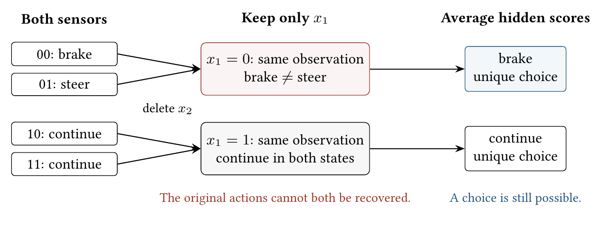
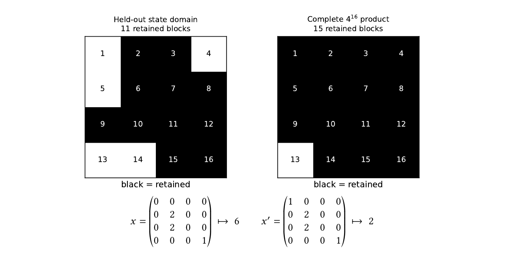
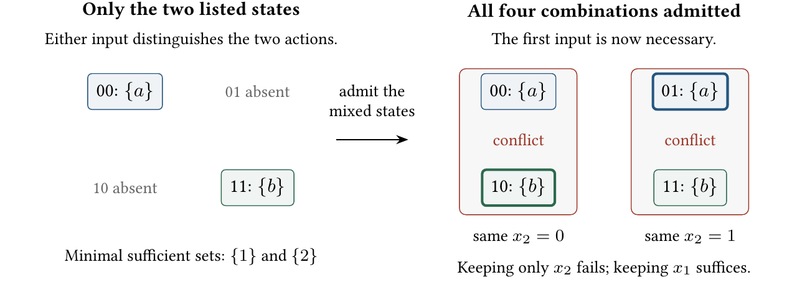

# Less Is Harder Than More: Proving Unnecessary Complexity

Paper4, the JAIR submission, converted to text: part 1 of 5. Read the parts in order. Figures and tables are PNG files in `figures/`, linked where they appear.

TRISTAN SIMAS, McGill University, Canada

Problem. When can a sensor, feature, or API field be removed without changing a fixed system’s decisions? We require the remaining inputs to recover its complete optimal-action set, including ties, at every admitted state.

Results. Admitting every input combination guarantees one smallest preserving set. Yet checking one deletion is coNP-complete when circuits give utilities on Boolean products, even with two actions and at most two optimal-action sets. Missing combinations permit alternative preserving sets, so an auditor must choose inputs within budget and check the chosen set. Requiring every declared reading to have a positive-probability state adds a support check. We classify both tasks exactly for circuit-defined Boolean models.

A unique winner after averaging hidden states can still change the original decisions. Certifying such winners requires

PP weighted score comparisons: finding inputs within budget is NP (NP ) -complete even with two actions and independent uniform inputs. Explicit tables admit logarithmic approximation of the minimum preserving input count; succinct Boolean products admit no polynomial-time 𝑜 (Λ/log Λ) approximation in total encoded length Λ, unless P = NP.

Consequence. Supplied decompositions and symmetry proofs can make audits polynomial-time; their discovery and validation are separate work. For a frozen digit classifier, eleven blocks suffice on held-out rows but fifteen are needed on the full product; four conflicting pairs expose the gap. Building the required response from retained inputs establishes sufficiency, not minimality. Preserve the structure that makes the dependence checkable.

JAIR Associate Editor:

JAIR Reference Format:

Tristan Simas. 2026. Less Is Harder Than More: Proving Unnecessary Complexity. Journal of Artificial Intelligence Research (September 2026), 49 pages.

## 1 Introduction

Suppose a delivery form records an address and whether a signature is required. Removing the signature field makes two otherwise identical orders look the same, although one requires a handover and the other permits leaving the parcel. No rule reading only the address can recover both instructions. The same problem arises when removing a sensor, model feature, or API field: the remaining inputs must still determine the response a fixed system requires on every admitted input. We study removal of a field, rather than changing the value entered in it.

An unused input is easier to remove than an unnecessary one. If a private parameter is never read, its deletion can be checked by inspection. If an input affects an existing system, removing it requires a stronger argument: the remaining inputs must still determine the required response on every input the interface admits. Passing tests establishes that claim only for the calls that ran. Likewise, a feature ablation in a frozen model may preserve decisions on a benchmark while failing on another input admitted by the deployment schema.

Removing inputs merges states that the remaining inputs cannot distinguish. If two merged states require different responses, the removal fails its preservation contract.

Author’s Contact Information: Tristan Simas, McGill University, Canada, tristan.simas@mail.mcgill.ca.

Footnote: This work is licensed under a Creative Commons Attribution International 4.0 License.

Footnote: © 2026 Copyright held by the owner/author(s).

Footnote: doi:

A successful deletion and a failed one. Consider two Boolean hazard sensors, 𝑥 1 and 𝑥 2 , and three actions: brake, steer, and continue. Give the four hazard configurations equal probability. Figure 1 shows what deleting 𝑥 2 loses. Six additional diagnostic sensors affect none of the controller’s scores; those six can be removed without changing any required action.

*Fig. 1. A definite choice can still lose a required answer. Deleting 𝑥 2 merges 00 (brake) with 01 (steer). No choice based on 𝑥 1 alone can recover both original decisions. Averaging selects brake for this group and continue for the other: decisiveness holds, but preservation fails.*

We call recovery of the complete original optimal-action set preservation, including every action tied for the highest score. Averaging over hidden inputs asks a different question. Each observation of 𝑥 1 gives a unique conditional choice, a property we call decisiveness.

For hazard configurations 00, 01, 10, and 11, the utility vectors in the order brake, steer, continue are (4, 0, 0), (0, 2, 0), (0, 0, 4), (0, 0, 4). Averaging over the hidden 𝑥 2 gives (2, 1, 0) when 𝑥 1 = 0 and (0, 0, 4) when 𝑥 1 = 1. Thus retiring 𝑥 2 changes the decision at 01, an event of probability 1/4. The eight-sensor controller will remain our running example; its full distribution is uniform.

Averaging over all four hazard states gives (1, 1/2, 2). Even the empty interface is therefore decisive, while preservation still needs both hazard sensors.

The controller’s scores already explain why the six diagnostic sensors can be omitted: every score is determined by the two hazard readings. Each hazard sensor also has a witness for keeping it. With the second reading fixed at zero, changing the first changes brake to continue. With the first fixed at zero, changing the second changes brake to steer. Thus the construction establishes that the two readings suffice, and the conflicting pairs establish that neither can be removed. The reasons cover every diagnostic setting; they do not depend on how many example readings we test.

From passing tests to checking all admitted inputs. The same question arises for a frozen digit classifier with sixteen image blocks, each taking one of four values. On its 510 distinct held-out inputs, the smallest preserving interface keeps eleven blocks; if the API admits all 4 16 combinations, the minimum is fifteen (Figure 2). The four added blocks each have a pair of inputs that exposes the failed deletion. The classifier is unchanged: the second claim covers more inputs.

Its decision-tree structure makes the larger audit possible without visiting all 4 16 inputs. Its leaves cover the product with boxes of allowed input values, each carrying one prediction. Two boxes with different predictions refute a deletion if their allowed values overlap on every retained input: choose agreeing values there, and the two states become indistinguishable. Checking the leaf boxes therefore settles the whole-domain claim. Section 4.4.2 gives the model and complete audit.

*Fig. 2. Same classifier, different certificate scope. Eleven blocks suffice on the held-out inputs; fifteen are necessary on all admitted combinations. The two arrays disagree only in the top-left block, which the eleven-block interface omits, but receive different predictions. They refute that deletion on the product. Grid labels number blocks from one to sixteen; array entries are quantized input values.*

Keeping all state-identifying inputs preserves the original optimal-action set. Certifying a deletion instead requires agreement at every admitted pair of states that the retained inputs cannot distinguish. Write Opt(𝑠) for the complete optimal-action set, including ties. An interface is the set of retained inputs; a fiber is the set of states giving the same retained observation.

The state domain changes that audit. Suppose the controller is admitted only at hazard settings 00 and 11. Either hazard sensor distinguishes brake from continue, so either can be kept alone. Admitting the mixed settings makes both sensors necessary. The other six sensors still affect no score. In general, a complete product—every combination of input values—has one smallest sufficient interface: exactly the inputs whose change can affect Opt. Missing combinations can leave several alternatives.

Building the required response from chosen inputs establishes why those inputs suffice. This does not select the smallest possible interface, and the construction must still implement the response the task requires. It gives the auditor an established relationship instead of leaving that relationship to be recovered from an arbitrary evaluator.

The cost of recovering it depends on what the auditor receives. A complete table exposes every state; a compact circuit can answer at one state without listing all the others. Even checking one input’s removal from such a circuit is coNP-complete on Boolean products with two actions (Theorem 6.5). Missing combinations introduce a further choice between sufficient interfaces: selecting one within a bit budget is Σ 𝑃 2 -complete under the circuit-defined restricted-state encoding (Theorem 6.7). The short reduction explains this gap between computing answers and establishing which information they need.

Proving an input is unnecessary can be more expensive than adding it. Passing along an already available input may be simple; safely leaving it out requires establishing that no allowed case needs the distinction it carries. This is not a claim that acquiring or retaining every sensor is cheap.

Useful structure supplies a constructive route. Decompositions, symmetry and the classifier’s leaf boxes let an auditor settle claims across the declared domain without visiting every state. We present those mechanisms in Section 4, before the extended classifications. Section 4.4 combines them into an audit that returns a preservation certificate, a conflicting state pair, or no verdict. The later results ask what changes when an observation needs a supported state behind it, hidden-state scores are averaged, or an input can guide a future action. Table 2 identifies the principal audits; Section 6.2 defines their support and conditional-score requirements.

Explaining one supplied prediction and recovering a fixed response across every admitted state are different tasks. Section 5.2 compares this global coordinate audit with particular local-explanation tasks, internal-subcircuit selection, value of information, and planning complexity.

Each compact proof-handle footnote points to a finite Lean declaration; Section 9 distinguishes those checks from the manuscript’s complexity proofs.

Reading route. For preservation and practical audits, read Sections 2 and 4; then read Section 6.2 for support and conditional scores. The principal classifications are Theorems 6.7, 6.29, and 6.35; Table 5 collects the exact queries. Section 7 extends the audit to future decisions. The supplement gives the longest derivations under Fixed-block normalization, Within-Budget Decisiveness Under Conditional Scores, Product completion, and Full Proofs for the Multistep Stochastic Classification. All completeness claims use polynomial-time many-one reductions. Each model is specified where its audit is introduced. Throughout the multistep audit, the retained input set stays fixed; selecting different sensors as events unfold is a different problem.

## 2 What Input Removal Must Preserve

The hazard controller gives the basic test: states that look the same after deletion must retain the same complete set of best actions, including ties. A sensor records one input coordinate; a state records all their values; utility gives the score of each action. The definitions below make this test precise for finite systems.

### 2.1 Decision Problems with Coordinate Structure

Start with all combinations of input values. A second presentation will allow some combinations to be absent.

Definition 2.1 (Decision Problem). A decision problem with product-coordinate structure is a tuple D = (𝐴, 𝑋 1 , . . . , 𝑋 𝑛 , 𝑈 ) with finite nonempty action set 𝐴, finite nonempty coordinate spaces 𝑋 𝑖 , state space 𝑆 = 𝑋 1 × · · · × 𝑋 𝑛 , and utility 𝑈 : 𝐴 × 𝑆 → Q.

Rational or dyadic utilities permit exact encoded comparisons.

Definition 2.2 (Finite Coordinate Presentation). A finite coordinate presentation consists of a finite nonempty state set 𝑆, finite coordinate spaces 𝑋 1 , . . . , 𝑋 𝑛 , coordinate maps 𝜋 𝑖 : 𝑆 → 𝑋 𝑖 , a finite nonempty action set 𝐴, and a utility function 𝑈 : 𝐴 × 𝑆 → Q. A product-coordinate decision problem is the special case 𝑆 = 𝑋 1 × · · · × 𝑋 𝑛 with the canonical projections.

Only products guarantee that replacing one coordinate yields another state. Checking whether agreeing states require the same response also works on listed rows with missing combinations, as does the set-cover reduction in Section 6.6.

Definition 2.3 (Projection). For 𝑠 ∈ 𝑆 and 𝐼 ⊆ {1, . . . , 𝑛}, the projection of 𝑠 onto 𝐼 is 𝑠 𝐼 = (𝜋 𝑖 (𝑠)) 𝑖 ∈𝐼 . For 𝐼 = ∅, this is the unique empty tuple, so all states belong to one projection fiber.

Definition 2.4 (Optimizer Map). For 𝑠 ∈ 𝑆, the optimal-action set is

Opt(𝑠) = arg max 𝑈 (𝑎, 𝑠).

𝑎∈𝐴

### 2.2 Recovering Responses from Retained Inputs

For a frozen classifier, the required response is its prediction. For a controller, it may be a set of tied best actions. A finite function 𝐹 : 𝑆 → 𝑂 is included by taking 𝐴 = 𝑂 and 𝑈 (𝑎, 𝑠) = 1[𝑎 = 𝐹 (𝑠)]: then Opt(𝑠) = {𝐹 (𝑠)}. The encoding still determines the cost of checking preservation.

Group states by the response they require. The resulting groups record just enough information to recover that response; the formal name is the optimizer quotient.

Definition 2.5 (Optimizer Quotient). States 𝑠, 𝑠 ′ ∈ 𝑆 are optimizer-equivalent when Opt(𝑠) = Opt(𝑠 ′ ). Writing this kernel relation as 𝑠 ≡ Opt 𝑠 ′ , the optimizer quotient is

𝑄 D = 𝑆/≡ Opt , with quotient map 𝑞 Opt : 𝑆 → 𝑄 D .

Write 𝜋 (𝑠) for what remains visible and ℎ for a rule that recovers the required response from it. Recovery means ℎ(𝜋 (𝑠)) = Opt(𝑠) at every state. This recovery criterion also holds for real utilities. The kernel ker(𝜋) records the pairs that look identical through 𝜋; the theorem says none may require different responses. Representation 𝜋 1 is finer than 𝜋 2 when 𝜋 2 can be recovered from 𝜋 1 ; formally, 𝜋 2 factors through 𝜋 1 .

Theorem 2.6 (Kernel Factorization for the Optimizer Map) 1 . For every map 𝜋 : 𝑆 → 𝑄,

∃ ℎ : 𝑄 → 2 𝐴 \ {∅}, Opt = ℎ ◦ 𝜋 ⇐⇒ ker(𝜋) ⊆ ≡ Opt .

Moreover, 𝑄 D is canonically isomorphic to range(Opt). If 𝜋 is surjective and satisfies the equivalent conditions above, there is a unique map 𝑢 : 𝑄 → 𝑄 D with 𝑞 Opt = 𝑢 ◦ 𝜋. Consequently, 𝑄 D is the unique coarsest exact abstraction, up to canonical isomorphism.

Proof. Factorization through 𝜋 implies kernel containment. Under kernel containment, ℎ(𝜋 (𝑠)) := Opt(𝑠) is well defined. The map ℎ may be extended arbitrarily off range(𝜋). The canonical bijection from 𝑄 D to range(Opt) sends [𝑠] Opt to Opt(𝑠). For surjective 𝜋, the unique quotient map is 𝑢 (𝜋 (𝑠)) = [𝑠] Opt . ■

Thus a retained observation may merge states only when they require the same response. The brake/steer pair fails exactly this test. The audits below check the familiar factorization criterion without constructing all response groups.

### 2.3 Sufficiency and Relevance

Keeping both hazard sensors preserves the controller’s actions. Keeping only the first merges the brake and steer states, so it is insufficient.

Definition 2.7 (Sufficient Coordinate Set). A coordinate set 𝐼 ⊆ {1, . . . , 𝑛} is sufficient when

𝑠 𝐼 = 𝑠 𝐼 ′ Opt(𝑠) = Opt(𝑠 ′ ) (𝑠, 𝑠 ′ ∈ 𝑆).

=⇒

For this static target, we use sufficient and preserving interchangeably. Later stochastic contracts qualify preservation explicitly.

The empty set suffices exactly when Opt is constant. A conflicting pair agreeing on 𝐼 witnesses insufficiency. 2

Definition 2.8 (Minimal Sufficient Set). A sufficient set is minimal when none of its proper subsets is sufficient.

Footnote: 1 2 DP6-7

Footnote: Lean: UB1, QT5-7

Can two sufficient input sets be replaced by just the inputs they share? If this always works, intersecting all sufficient sets leaves one smallest set. The next lemma records that shortcut; product closure will justify it.

Lemma 2.9 (Intersection Closure Gives a Least Member) 3 . Let 𝐶 be a finite coordinate set and let ∅ ≠ F ⊆

P (𝐶). If 𝐼, 𝐽 ∈ F implies 𝐼 ∩ 𝐽 ∈ F , then

𝐼 F := Ù 𝐼

𝐼 ∈F belongs to F and is its unique least member. Consequently, for every budget 𝑘,

∃𝐼 ∈ F : |𝐼 | ≤ 𝑘 ⇐⇒ |𝐼 F | ≤ 𝑘.

Proof. Finiteness and pairwise closure place the intersection of all members in F . This intersection is the unique least member. Its containment in every 𝐼 ∈ F gives the budget equivalence. ■

Definition 2.10 (Relevant Coordinate). Coordinate 𝑖 is relevant when

 

∃𝑠, 𝑠 ′ ∈ 𝑆 : ∀𝑗 ≠ 𝑖, 𝑠 𝑗 = 𝑠 ′ 𝑗 ∧ Opt(𝑠) ≠ Opt(𝑠 ′ ).

In the opening controller, each hazard sensor has its own conflicting pair, whereas none of the diagnostic sensors does. When all combinations are admitted, keeping exactly such individually necessary inputs always suffices. The next statement allows any response specified by an equivalence relation.

Proposition 2.11 (On Products, the Necessary Inputs Suffice) 4 . Let 𝑆 = 𝑋 1 × · · · × 𝑋 𝑛 , and let ≡ be any equivalence relation on 𝑆. Call 𝐼 sufficient when 𝑠 𝐼 = 𝑠 𝐼 ′ implies 𝑠 ≡ 𝑠 ′ , and call coordinate 𝑖 relevant when some 𝑠, 𝑠 ′ agree outside 𝑖 and satisfy 𝑠 . 𝑠 ′ . The sufficient sets are closed under finite intersection. The relevant-coordinate set is sufficient and is the unique inclusion-minimal sufficient set. Equivalently, a coordinate set is sufficient exactly when it contains every relevant coordinate.

Proof. Let 𝐼 and 𝐽 be sufficient, and suppose 𝑠, 𝑠 ′ agree on 𝐼 ∩ 𝐽 . Let 𝑡 splice the 𝐼 -coordinates of 𝑠 into 𝑠 ′ . Sufficiency of 𝐼 and 𝐽 gives 𝑠 ≡ 𝑡 ≡ 𝑠 ′ . Hence the sufficient sets are intersection-closed and have a unique least member 𝐾.

Every sufficient set contains each relevant coordinate, since omitting one retains its witness pair in a single fiber. Conversely, if 𝑖 ∈ 𝐾 were irrelevant, replace coordinate 𝑖 in one state by its value in another. Irrelevance relates the original state to the replacement, and the replacement agrees with the second state on 𝐾. Hence 𝐾 \ {𝑖} would be sufficient, contradicting leastness. Therefore 𝐾 is exactly the relevant-coordinate set. ■

For equality of Opt, this gives Definitions 2.7 and 2.10. Uniqueness does not make the relevance audit cheap: succinct inputs can describe exponentially many candidate witnesses.

Corollary 2.12 (Full Interface and Smallest Sufficient Interface) 5 . For a product-coordinate decision problem, let 𝑅 be the set of relevant coordinates. Then

{𝐼 : 𝐼 is sufficient} = {𝐼 : 𝑅 ⊆ 𝐼 ⊆ [𝑛]}.

Thus the full interface [𝑛] is sufficient without search, while 𝑅 is the unique least sufficient interface.

Proof. Apply Proposition 2.11: sufficiency is equivalent to containing 𝑅. ■

Remark 2.13 (Listed States and Product Closure) 6 . Suppose the only allowed states are (0, 0) and (1, 1), with different optimizer sets. Either coordinate alone distinguishes them; the empty set does not. Thus {1} and {2} are incomparable minimal sufficient sets. The missing mixed states prevent the splice in Proposition 2.11. This models a log of two co-occurring settings. It is also the set-cover instance with one universe element and two duplicate sets.

Footnote: 3 4 5 6 DQ86

Footnote: IC1-4 EF1 EF1

*Fig. 3. Missing combinations can hide a coordinate’s relevance. On the left, either input distinguishes the two listed states. On the right, the newly admitted states have thick borders. Each outlined column groups states agreeing on 𝑥 2 but requiring different actions. The unique smallest sufficient set is now {1}.*

Equivalently, 𝐼 is sufficient iff Opt = ℎ 𝐼 ◦ 𝜋 𝐼 for some ℎ 𝐼 , which assigns each realized observation its common optimizer (Theorem 2.6). 7

Changing a setting is not removing a channel. Replacing one setting need not make an input removable. If 𝐹 (1) = 𝐹 (3) = A and 𝐹 (2) = B ≠ A, replacing three by one preserves the response, but discarding the count does not. Encoding the count by one mandatory step and two optional Boolean steps gives responses A, B, B, A at 00, 10, 01, 11: each Boolean input is relevant even though 00 and 11 agree. Budgets count the inputs in the supplied encoding.

On a product, fixing omitted inputs to defaults preserves 𝐹 exactly when the retained inputs determine it: states agreeing on those inputs have the same reset tuple, and every state agrees with its own reset. Supplement S2 gives the expanded illustration and criteria. 8

### 2.4 Admissible Outputs

For acceptable-output sets Adm(𝑠), write 𝑠 ∼ Adm 𝑠 ′ iff Adm(𝑠) = Adm(𝑠 ′ ). An empty acceptable set may specify failure.

Proposition 2.14 (Admissible Outputs as an Optimizer Quotient) 9 . Let the output set 𝑂 be finite. For every admissible-output specification Adm : 𝑆 → P (𝑂), there is a decision problem whose optimizer quotient satisfies

𝑠 ∼ Opt 𝑠 ′ Adm(𝑠) = Adm(𝑠 ′ ).

⇐⇒

Proof. Use action space P (𝑂) and make Adm(𝑠) uniquely optimal at 𝑠. Then Opt(𝑠) = {Adm(𝑠)}. ■

Footnote: 7 8 9 QT8-9

Footnote: UB2 IS1-8

This construction can require 2 |𝑂 | actions and need not preserve encoded size. Unlike comparison across families of decision problems (Blackwell 1953; Howard 1966; Raiffa and Schlaifer 1961; Savage 1954), we fix one response. For additive tolerance (Abel et al 2016), it is

 

Adm 𝜀 (𝑠) := 𝑎 ∈ 𝐴 : 𝑈 (𝑎, 𝑠) ≥ max 𝑈 (𝑏, 𝑠) − 𝜀 .

𝑏 ∈𝐴

Write 𝛾 (𝑈 ) for the least positive regret (shortfall from the best utility):

𝛾 (𝑈 ) := min max 𝑈 (𝑏, 𝑠) − 𝑈 (𝑎, 𝑠) > 0 : 𝑎 ∈ 𝐴, 𝑠 ∈ 𝑆 ,

𝑏 ∈𝐴 with 𝛾 (𝑈 ) = +∞ when the set is empty.

Corollary 2.15 (Positive-Gap Tolerance Band) 10 . For every 0 ≤ 𝜀 < 𝛾 (𝑈 ) and every state 𝑠,

Adm 𝜀 (𝑠) = Opt(𝑠).

Consequently the preservation verdicts are identical throughout this interval whether we check a proposed input set, seek a set within a budget, or ask whether one realized observation has a constant response.

Proof. Optimal actions have regret zero; all others have regret at least 𝛾 (𝑈 ). Below that threshold the two correspondences agree at every state, hence so do all three preservation queries. ■

Supplement S3 gives the breakpoint, stability-radius, and tolerance-existence results beyond this fixed positivegap interval.

Decisiveness tests uniqueness after scores are aggregated on a fiber. Requiring a conditional 𝜀-admissible set to be a singleton needs a separate margin for every induced fiber and becomes weakly more demanding as the tolerance grows.

## 3 Encodings and Access Models

The eight-sensor controller has 2 8 possible readings. A table can list every reading and its action scores; a compact circuit can compute those scores when given a reading. With 𝑛 Boolean sensors the full table has 2 𝑛 rows, while the circuit need not list them. Scanning a table and auditing a compact evaluator therefore measure work against different input lengths. A table of logged readings can also omit combinations.

### 3.1 Input Models

The encodings specify what the auditor receives and how its size is measured. With query access, the auditor pays for calls to an evaluator.

Succinct product encoding. An instance gives a polynomial-length list of actions, the coordinate-domain sizes in binary, and a Boolean circuit 𝐶 𝑈 evaluating 𝑈 (𝑎, 𝑠). Arithmetic displays abbreviate polynomial-size bit-circuit implementations; their encoded size includes that implementation. Each coordinate domain is the canonical indexed set 𝑋 𝑖 = [|𝑋 𝑖 |] = {0, . . . , |𝑋 𝑖 | − 1}; its values are not listed separately. For stochastic instances it also gives a circuit 𝐶 𝑃 evaluating 𝑃 (𝑠). Both circuits output dyadic rationals of polynomial bitlength (equivalently, signed integer numerators over a common power-of-two denominator); 𝐶 𝑃 is promised nonnegative and normalized. Hence the predicates 𝑃 (𝑠) > 0 and pointwise utility comparisons are decidable in polynomial time. Comparing scores summed over an exponentially large fiber instead requires differences of weighted counts. After clearing the common denominator, these differences are GapP functions: differences between two counts of accepting computation paths. Writing enc(𝐴) for the bitlength of the explicit action list, the input length is

Footnote: 10 EF11

𝐿 = enc(𝐴) + log |𝑋 𝑖 | + |𝐶 𝑈 | + |𝐶 𝑃 |,

∑︁

𝑖 with the 𝐶 𝑃 term omitted outside the stochastic setting.

Circuit-defined restricted states. Circuits specify the allowed states, coordinate values and utilities without listing them. Each allowed state has one canonical polynomial-length identifier, and projections are total and within their declared domains. The domain is nonempty but may omit combinations. These are semantic promises, not conditions checked by the preservation audit. Sequential encodings also fix a unary horizon.

Definition 3.1 (Promise-Problem Convention). A promise problem is a pair (𝑌 , 𝑉 ), where 𝑉 is the set of valid encodings and 𝑌 ⊆ 𝑉 is the set of yes-instances. An algorithm need only be correct on 𝑉 . A many-one reduction from (𝑌 , 𝑉 ) to (𝑌 ′ , 𝑉 ′ ) maps every input in 𝑉 into 𝑉 ′ and preserves membership in 𝑌 .

Some succinct encodings below are valid only under semantic conditions, such as normalization of 𝐶 𝑃 or canonical state identifiers. Completeness for such an input model is relative to Definition 3.1, and every hardness reduction constructs a valid target instance. A model that specifies how malformed inputs are rejected is an ordinary decision language instead. The multistep encoding in Section 7 uses this second convention.

Explicit-state encoding. The full utility table over 𝐴 × 𝑆 is listed, with input length 𝐿 exp = Θ(|𝐴||𝑆 |) up to entry bitlength. Polynomial time in this model may be exponential in the number of Boolean coordinates.

Query access. The solver receives oracle access to Opt(𝑠) or to the utility values needed to reconstruct it. Complexity is measured by query count together with any declared per-query evaluation cost. The auditor can evaluate selected states without receiving either the full table or the circuit that computes it.

Remark 3.2 (Product-Closure Scope). Proposed-input and some-observation queries allow arbitrary finite coordinate presentations. Any within-budget upper bound that invokes the unique relevant-coordinate set assumes a product state space; Theorem 6.7 separately classifies within-budget sufficiency on circuit-defined restricted states. The conditional-winner lower bound covers every input combination: its proof adds the missing states while preserving the required score comparisons. The set-cover approximation theorem instead applies to listed rows.
