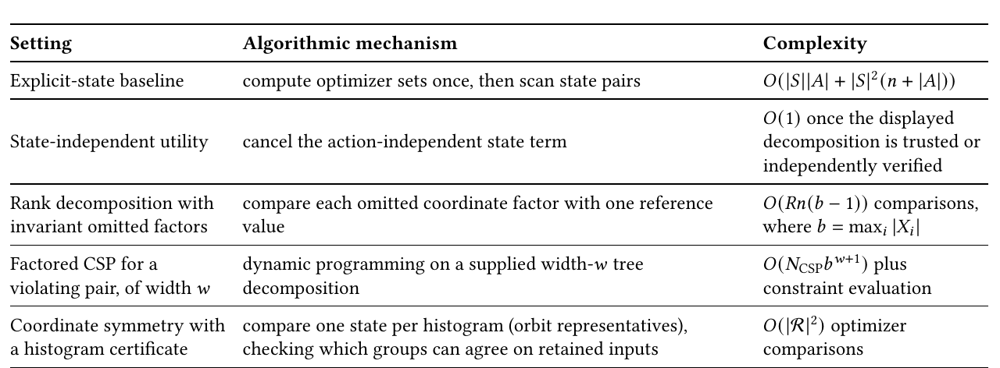
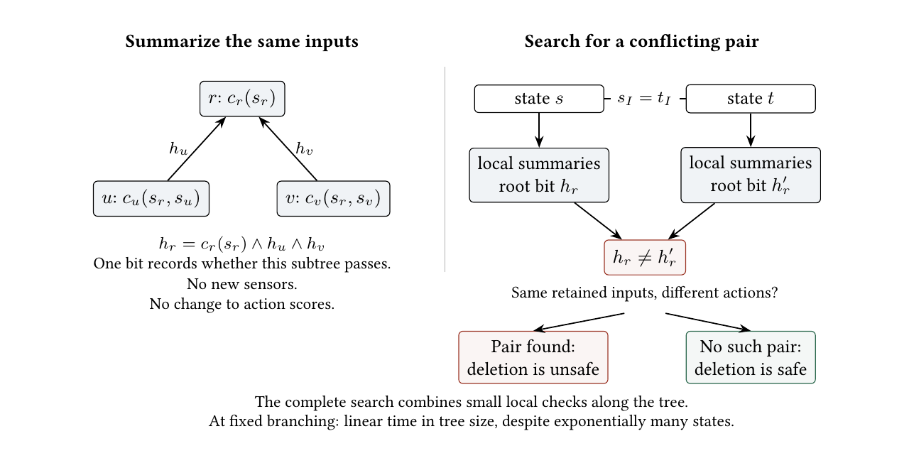
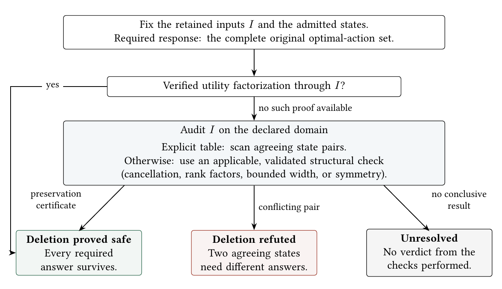
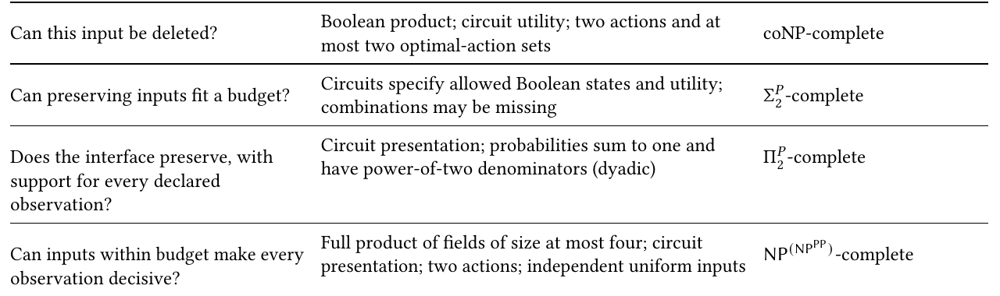

# Less Is Harder Than More: Proving Unnecessary Complexity

Paper4, the JAIR submission, converted to text: part 2 of 5. Read the parts in order. Figures and tables are PNG files in `figures/`, linked where they appear.

## 4 Algorithms and Structural Certificates

The opening controller’s six diagnostic sensors affect no score. A verified score decomposition can certify all six deletions without scanning every reading. Other structure can help too: small interacting groups support local calculations, and symmetry lets many states share one check. An evaluator answers at one state; these certificates cover the whole declared domain. The bounded-width method searches for a conflicting pair with a constraint satisfaction problem (CSP). Table 1 states what each method needs and the work it saves.

The runtime bounds count the supplied factor values, decompositions, and representatives. Each method requires valid certificate data; the bounds do not include discovering that structure in an arbitrary utility circuit.

These methods certify input sufficiency. Conditional choices and support obligations are treated separately in Section 6.2.



*Table 1. Algorithms and certified structural reductions. The first row is an explicit-input baseline; the remaining rows state sufficient structure or certificate data.*

```text
Setting                       Algorithmic   mechanism                                           Complexity
Explicit-state baseline       compute  optimizer sets once, then scan state pairs               𝑂(|𝑆||𝐴| + |𝑆|2(𝑛 + |𝐴|))
                                                                                                𝑂(1)  once the displayed
State-independent  utility    cancel the action-independent  state term                         decomposition   is trusted or
                                                                                                independently  verified
Rank  decomposition  with     compare  each omitted  coordinate factor with one reference       𝑂(𝑅𝑛(𝑏  −  1)) comparisons,
invariant omitted factors    value                                                              where  𝑏 = max𝑖  |𝑋 𝑖 |
Factored CSP  for a           dynamic  programming   on  a supplied width-𝑤  tree               𝑂(𝑁     𝑏𝑤+1) plus
                                                                                                     CSP
violating pair, of width 𝑤    decomposition                                                     constraint evaluation
Coordinate  symmetry   with   compare  one state per histogram  (orbit representatives),        𝑂(|R|2)  optimizer
a histogram certificate       checking which  groups  can agree on retained inputs              comparisons
```

For fixed alphabet size, symmetry gives a polynomial-size representative family, as proved below. The succinct coNP-hard family in Theorem 6.5 already uses only two actions. 11

### 4.1 Two Direct Decomposition Checks

If 𝑈 (𝑎, 𝑠) = 𝑓 (𝑎) + 𝑔(𝑠), then

Opt(𝑠) = arg max 𝑓 (𝑎)

𝑎∈𝐴 for every state, so the empty coordinate set is sufficient.

More generally, suppose a supplied rank-𝑅 decomposition has the form

𝑅 𝑛

∑︁ Ö

𝑈 (𝑎, 𝑠) = 𝑤 𝑟 𝑓 𝑟 (𝑎) 𝑔 𝑟𝑖 (𝑠 𝑖 ).

𝑟 =1 𝑖=1

For a candidate set 𝐼 , assume every factor 𝑔 𝑟𝑖 with 𝑖 ∉ 𝐼 is constant on the declared value domain of coordinate 𝑖. Put 𝑏 := max 𝑖 |𝑋 𝑖 |. Comparing every listed value with one reference value decides this condition in at most 𝑅𝑛(𝑏 − 1) factor comparisons. If the check accepts, states agreeing on 𝐼 give every product term the same value, so their action utilities and optimal-action sets are equal. 12

If this check rejects, the displayed rank decomposition does not certify the proposed interface. For example, let 𝑆 = {0, 1} 2 , 𝐴 = {𝑎, 𝑏}, 𝑈 (𝑎, 𝑠) = 𝑠 2 , and 𝑈 (𝑏, 𝑠) = 1 − 𝑠 2 . For the proposed set 𝐼 = {1}, the omitted factor 𝑠 2 takes both values zero and one, violating constancy. Independently, the states (0, 0) and (0, 1) give an explicit violating pair: they agree on 𝐼 and have optimizer sets {𝑏} and {𝑎}.

### 4.2 Bounded Treewidth

To disprove sufficiency, find two states that agree on the retained inputs but have different optimal-action sets. A CSP can search for those two states directly. If its constraints can be arranged in a tree of small overlapping variable groups, each group can be checked locally and its result passed to its neighbors. A tree decomposition specifies those groups and their links; its width is one less than the largest group size. The algorithm below is exponential in that size, rather than in the total number of inputs.

Footnote: 11 12 DQ57, DQ74-77

Footnote: DQ51, DQ72, ACT1

Proposition 4.1 (Bounded-Width CSP for Violating State Pairs) 13 . For a candidate set 𝐼 , form a CSP with two state-copy variables per coordinate, together with any auxiliary variables introduced by a local factor compilation, and constraints accepting exactly the state pairs that agree on 𝐼 and have different optimal-action sets. The CSP is satisfiable exactly when 𝐼 is insufficient. If an equisatisfiable factorization of size 𝑁 CSP has maximum domain size 𝑏 and a supplied width-𝑤 tree decomposition, standard dynamic programming decides sufficiency in 𝑂 (𝑁 CSP 𝑏 𝑤+1 ) time plus constraint evaluation.

Proof. The two variable copies encode the candidate state pair. The accepting constraint is precisely a witness of insufficiency. Equisatisfiability preserves that verdict, and dynamic programming on the supplied decomposition has the stated bound (Bessière et al 2013; Bodlaender 1993; Freuder 1990). For fixed 𝑤, a decomposition need not be supplied: Bodlaender’s algorithm tests whether the CSP primal graph has treewidth at most 𝑤 and returns a decomposition in 𝑓 (𝑤)𝑁 CSP time (Bodlaender 1996). The statement retains the supplied form because the decomposition is also an independently checkable certificate. The input contract includes correctness of the compilation of the violating-pair predicate—for example, a canonical construction or a separately checked derivation trace. A tree decomposition by itself certifies only the width of the supplied CSP, not its equivalence to insufficiency. ■

Example 4.2 (A tree-factored diagnostic decision). Let 𝑇 be a rooted tree of maximum out-degree Δ, with one Boolean state coordinate 𝑠 𝑣 at every node. Each nonroot node carries a local compatibility predicate 𝑐 𝑣 (𝑠 par(𝑣) , 𝑠 𝑣 ), and the root carries a unary predicate 𝑐 𝑟 (𝑠 𝑟 ). Put

𝐻 (𝑠) := 𝑐 𝑟 (𝑠 𝑟 ) ∧ Û 𝑐 𝑣 (𝑠 par(𝑣) , 𝑠 𝑣 ).

𝑣 ∈𝑉 (𝑇 )\{𝑟 }

A diagnostic controller has actions accept and reject, with

𝑈 (accept, 𝑠) = 1[𝐻 (𝑠)], 𝑈 (reject, 𝑠) = 12 .

Thus the optimizer is {accept} exactly on globally compatible states and {reject} otherwise.

For a proposed coordinate set 𝐼 , introduce two state copies 𝑠, 𝑡 and Boolean summary variables ℎ 𝑣 , ℎ ′ 𝑣 . The local constraints recursively set ℎ 𝑣 to the conjunction of 𝑐 𝑣 and the summaries of the children, and do the same for ℎ ′ 𝑣 on 𝑡. Add 𝑠 𝑣 = 𝑡 𝑣 for 𝑣 ∈ 𝐼 and require ℎ 𝑟 xor ℎ 𝑟 ′ . The resulting CSP is satisfiable exactly when two states agree on 𝐼 and have different optimizer sets.

The decomposition is obtained directly from 𝑇 . For each nonroot 𝑣, use the bag

{𝑠 par(𝑣) , 𝑡 par(𝑣) , 𝑠 𝑣 , 𝑡 𝑣 , ℎ 𝑣 , ℎ ′ 𝑣 } ∪ {ℎ 𝑐 , ℎ 𝑐 ′ : 𝑐 is a child of 𝑣 }, with the smaller root analogue. Every constraint is contained in one bag, and the bags containing each variable form a connected subtree. Hence the width is at most 2Δ + 5, the factorized CSP has linear size, and its tree decomposition is constructed in linear time. Proposition 4.1 therefore decides sufficiency in 𝑂 (|𝑉 (𝑇 )| 2 2Δ+6 ) time. This construction applies to the displayed tree-factored utility. An arbitrary factored utility may yield an unbounded-width CSP for violating state pairs because the two-copy compilation adds agreement and optimizercomparison constraints. The applicable parameter is therefore the width of the compiled CSP, which the auditor must construct and check, rather than the width of the original Bayesian network or factor graph.

The extra variables in Figure 4 do useful work: they summarize the existing inputs so that small checks can settle the whole-domain claim.

Footnote: 13 DQ79-81, DQ87



*Fig. 4. More structure, cheaper audit. Each summary bit records whether all checks in its subtree pass. Two copies search for states with the same retained inputs but different actions. Finding a pair refutes deletion; exhausting this search without one certifies preservation. For the tree-factored utility in Example 4.2, dynamic programming combines bounded-size bags in linear time at fixed branching, without enumerating all state pairs.*

### 4.3 Coordinate Symmetry and Histogram Certificates

If permuting coordinates leaves every utility unchanged, states with the same histogram have the same optimal actions. We can therefore compare histograms instead of all states when checking a proposed input set.

For an arbitrary succinct utility this subsection is a promise-class result. A directly checkable sufficient contract is a coefficient or factor presentation unchanged by coordinate permutations—for example, all unary coordinate coefficients in each action score are equal and all pairwise coefficients are equal. Alternatively the model may supply an independently checked symmetry proof. Once invariance is established, the histogram certificate below is polynomial in the supplied representative family.

Let 𝑆 be a finite family of 𝑑-tuples over {0, . . . , 𝑘 − 1}. Here permutation invariance means that for every coordinate permutation 𝜎 and every 𝑠 ∈ 𝑆 with 𝜎𝑠 ∈ 𝑆, 𝑈 (𝑎, 𝜎𝑠) = 𝑈 (𝑎, 𝑠) for every action 𝑎. On the full product this is the usual action of the complete symmetric group; on a listed state family it is only required for pairs that both belong to the declaration. The orbit type of a state is its coordinate histogram ℎ 𝑠 . Equal histograms are equivalent to membership in the same permutation orbit. For two states define their common multiplicity by

𝑘 −1 cm(𝑠, 𝑠 ′ ) := min{ℎ 𝑠 (𝑣), ℎ 𝑠 ′ (𝑣)}.

∑︁

Footnote: 𝑣=0

Symmetry makes Opt constant on each orbit. 14 For a complete representative family, the certificate is polynomial in the number of inputs 𝑑 when the alphabet size 𝑘 is fixed.

Footnote: 14 DQ82

On a full product, symmetry also carries any single-coordinate relevance witness to every coordinate. By

Proposition 2.11, the least sufficient interface is therefore empty when Opt is constant and full otherwise. Testing the empty interface with the histogram test below distinguishes these cases.

Proposition 4.3 (Orbit Representatives and the Histogram Certificate) 15 . Let R contain one representative of every orbit type occurring in the finite state family. Two representatives are compatible on 𝐼 when their orbits contain states in the family that agree on 𝐼 . Under symmetric utility, 𝐼 is sufficient if and only if every compatible representative pair has equal optimizer sets.

On an explicitly listed state family, exact compatibility is computed by hashing each state by its 𝐼 -projection and recording the orbit types in each bucket. Constructing the buckets takes 𝑂 (|𝑆 |𝑑) time, and recording all compatible type pairs takes at most 𝑂 (|𝑆 | 2 ) additional time.

The following histogram test is a directly checkable sufficient condition on an arbitrary listed family: for every 𝑟, 𝑟 ′ ∈ R,

|𝐼 | ≤ cm(𝑟, 𝑟 ′ ) =⇒ Opt(𝑟 ) = Opt(𝑟 ′ ).

Then 𝐼 is sufficient. The checker performs one optimizer comparison per ordered representative pair. If R contains one representative for each occurring orbit type, then

 𝑑 + 𝑘 − 1  2

 𝑑 + 𝑘 − 1

|R| ≤ 2  .

𝑘 − 1 |R| ≤ 𝑘 − 1

,

On the full product 𝑆 = {0, . . . , 𝑘 −1} 𝑑 , the histogram implication is also necessary: two orbit types have representatives agreeing on 𝐼 if and only if |𝐼 | ≤ cm(𝑟, 𝑟 ′ ). The histogram test is therefore exact on the full product and merely sufficient on an arbitrary listed subfamily.

Proof. States in one orbit have equal optimizer sets. A pair agreeing on 𝐼 maps to a compatible representative pair; compatibility supplies the converse witness. This proves the exact representative test.

For the histogram certificate, if states 𝑠, 𝑠 ′ agree on 𝐼 , the multiset of their values on 𝐼 is a submultiset of both state histograms. Therefore |𝐼 | ≤ cm(𝑠, 𝑠 ′ ). Choose representatives 𝑟, 𝑟 ′ of their orbit types. Symmetry transfers Opt(𝑠) and Opt(𝑠 ′ ) to the representative optimizer sets, while orbit invariance transfers common multiplicity. The certificate hypothesis gives Opt(𝑟 ) = Opt(𝑟 ′ ), hence Opt(𝑠) = Opt(𝑠 ′ ).

On the full product, the converse compatibility statement follows by choosing any common submultiset of size |𝐼 | from the two histograms, placing it on the coordinates of 𝐼 in both states, and arranging the remaining symbols on the other coordinates. Thus |𝐼 | ≤ cm(𝑟, 𝑟 ′ ) is exactly the compatibility condition there.

Orbit types are multisets of 𝑑 values from a 𝑘-element alphabet. The stars-and-bars count bounds a family with one representative per orbit type by 𝑑+𝑘 −1 

𝑘 −1 . Its square gives the comparison count, which is polynomial in 𝑑 for fixed 𝑘. 16 ■

Single-action, bounded-state, strict-dominance, and constant-optimizer instances give further elementary boundary cases.

### 4.4 An Audit Procedure

Figure 5 turns these certificates into a preservation audit with three possible outcomes.

4.4.1 Contract and Checks. Record the response, declared states and observations, supplied encoding, and candidate 𝐼 . A listed audit covers its rows; a product audit covers all combinations. Absence from a sample does not establish zero probability. For stochastic or sequential audits also record normalized probabilities, support obligations, horizon, and any alternation promise.

Footnote: 15 16 DQ82-85, SYM1-7

Footnote: DQ83-85, SYM1-7



*Fig. 5. A preservation audit has three outcomes: a certificate, a conflicting pair, or no verdict. Minimality, support coverage, and decisiveness require their own checks.*

A verified factorization 𝑈 (𝑎, 𝑠) = 𝑈 b (𝑎, 𝑠 𝐼 ) certifies sufficiency by Theorem 2.6. Without one, scan agreeing pairs if the table is explicit; otherwise try the applicable decomposition, bounded-width, or symmetry checks above. Validate their prerequisites: the compiled CSP must encode the conflicting pairs, and symmetry needs a checked presentation, proof, or trusted contract. A failed sufficient check is not a refutation; unequal histogram labels refute deletion only if their orbits contain agreeing states.

The preceding proofs establish correctness and Table 1 gives the costs, excluding certificate discovery and validation. Explicit value lists are required where values are compared; a binary domain-size declaration does not supply them. To certify inclusion-minimality, test every single-input deletion 𝐼 \ {𝑖} and require each to fail preservation. Coverage and decisiveness require their separate contracts (Section 6.2).

4.4.2 Auditing the Same Classifier on Two State Domains. We audited one frozen decision tree on two declared domains, using the UCI digits data distributed by scikit-learn (Alpaydin and Kaynak 1998; Pedregosa et al 2011). Each 8 × 8 image was pooled into sixteen 2 × 2 block sums and quantized to four values at cut points 8, 24, 40: intervals [0, 8), [8, 24), [24, 40), and [40, 64]. A stratified 70/30 split with seed 1729 gave 1,257 training and 540 held-out images. The tree used Gini splitting, maximum depth ten, and a three-sample leaf floor. The fitted tree had depth ten, 121 leaves, and accuracy 414/540 = 76.7%. The preservation target is its frozen prediction, not the data label.

The listed domain contains 510 distinct held-out inputs. Each differently predicted pair contributes the blocks distinguishing it. The 21,203 distinct sets reduce to nineteen constraints after removing those implied by smaller sets. Exhausting all 2 16 interfaces gives minimum eleven, with five smallest and nine inclusion-minimal interfaces.

Greedy selection, which repeatedly adds the block covering the most remaining constraints, also returns eleven with deterministic tie-breaking.

The product domain admits all 4 16 quantized inputs. Comparing the tree’s leaf boxes—the regions of block values reaching each leaf—finds fifteen relevant blocks, which form the unique smallest sufficient interface by

Proposition 2.11. It retains every block except block 13. Blocks are numbered from one to sixteen in row-major order, as in Figure 2. Four blocks absent from the selected eleven-block minimum become necessary: blocks 1, 4, 5, and 14. For each, the artifact supplies a pair differing only in that block with different predictions. Figure 2 shows one such pair; the four pairs refute the listed certificate on the product.

The symbolic audit checks overlaps between differently labelled leaf boxes, covering the product without enumerating it. Some product inputs are implausible handwriting; restricting the declaration to independently justified plausible inputs requires another audit. The comparison establishes the exact retention minimum for this frozen model on each declared domain. The archive records the canonical interfaces, tree configuration and hash, rows, witnesses, and replay command. Greedy’s general guarantee comes from the hitting-set result, not its success on this instance. Data and Code Availability locates the archive.

4.4.3 Running the Audit on the Sensor Controller.

Example 4.4 (End-to-end pre-flight audit of the sensor controller). For the opening controller, 𝐼 = {1} is decisive but not preserving: (0, 0, 0 6 ) and (0, 1, 0 6 ) agree on 𝐼 and require brake and steer. The additive decomposition check cannot certify 𝐼 : a state term shared by all actions cannot change which wins. Write the scores as 4(1 − 𝑥 1 ) (1 − 𝑥 2 ) for brake, 2(1 − 𝑥 1 )𝑥 2 for steer, and 4𝑥 1 for continue. The six unused sensors have constant factors in this expression, whereas 𝑥 2 varies. The invariant-factor check certifies 𝐽 = {1, 2} but fails for 𝐼 .

The two-copy CSP finds the same conflicting pair for 𝐼 . After removing the isolated diagnostic pairs, one bag contains 𝑥 1 , 𝑥 2 , 𝑥 1 ′ , 𝑥 2 ′ , giving width at most three. For 𝐽 the CSP is unsatisfiable because every agreeing state pair has the same utility. Full coordinate-permutation symmetry is absent: 𝑥 1 and 𝑥 2 play different roles, so the histogram check is inapplicable, not inconclusive. Recovering the controller’s original actions therefore needs both hazard sensors, 𝐽 . If the contract only asks for a unique winner after averaging hidden states, retaining 𝑥 1 alone, 𝐼 , suffices.

## 5 What Must Be Proved Before Removing an Input

### 5.1 Choosing Inputs and Checking States

The agreement-only controller leaves a choice: keep either hazard sensor. With missing combinations, an auditor may likewise have to choose among different sufficient input sets. Once a set is chosen, every admitted pair that looks the same through it must require the same complete optimal-action set. Formally, when circuits specify the states and utility and 𝑘 is the budget,

∃𝐼 (|𝐼 | ≤ 𝑘) ∀𝑠, 𝑡 ∈ 𝑆 : 𝑠 𝐼 = 𝑡 𝐼 =⇒ Opt(𝑠) = Opt(𝑡).

The operations are choose inputs, then check all state pairs: the existential–universal pattern behind the Σ 𝑃 2 classification. A completeness result establishes both an upper bound and matching hardness: the audit can be solved within the named class, and a solver for it would solve every problem in that class through a polynomial-time reduction. On a complete product, the smallest sufficient set is unique and contains exactly the inputs whose change can affect the response. Each omitted input must still be proved irrelevant. The classification below shows that this audit is coNP-complete, while missing combinations retain the harder choice between sufficient sets.

Table 2 separates the four central questions. For deletion, one conflicting pair witnesses failure (coNP). Support coverage asks whether every reading admitted by the interface can actually arise: each needs a positive-probability state behind it (Π 𝑃 2 ). A unique conditional winner instead requires adding the scores of hidden states and comparing the totals (PP). The budget query must choose inputs that give every observation one winner. The nested class in the last row records those operations in order: choose the inputs, search for an observation that fails the requirement, and compare its weighted scores.

Question Model supplied to the auditor Complexity



*Table 2. Four input-removal questions. The first is the baseline; the other three expose coordinate choice, support coverage, and weighted comparison. These are decision problems under the stated succinct models, not runtime predictions for individual instances. The full classifications appear in Table 5.*

```text
                                        Boolean product;  circuit utility; two actions and at
Can this input be deleted?                                                                      coNP-complete
                                        most two  optimal-action sets
Can preserving  inputs fit a budget?
                                        Circuits specify allowed Boolean states and utility;    Σ𝑃
                                                                                                   -complete
                                        combinations  may  be missing                             2
Does the interface preserve, with
                                        Circuit presentation; probabilities sum to one and      Π𝑃
                                                                                                   -complete
                                        have power-of-two   denominators  (dyadic)                2
support for every declared
observation?
Can inputs within budget  make  every
                                        Full product of fields of size at most four; circuit    NP(NPPP)-complete
                                        presentation; two actions; independent uniform  inputs
observation decisive?
```

### 5.2 Relation to Existing Complexity Results

We keep the decision rule fixed and ask which inputs recover all its best actions. How the states are supplied changes the difficulty: choosing preserving columns within a budget on listed rows is NP-complete, while a full product has one least sufficient set (Bassan et al 2024; Wong and Ziarko 1985). Theorem 6.7 classifies the missing-combinations case with ordinary Boolean bit budgets. Bassan et al. study a local reason for one MLP prediction. Selecting an internal neural subcircuit that remains faithful globally is the task of Adolfi et al., while Umans minimizes the size of an equivalent Boolean formula. These problems differ in what the auditor is allowed to select (Adolfi et al 2025; Bassan et al 2024; Umans 2001).

Preserving columns are reducts in an optimizer-labelled table; a backdoor to constant-optimizer problems asks for the same constancy. The supplement’s Input Preservation in Existing AI Models gives the exact identifications and separates this target from selecting one action or preserving numerical values.

Wäldchen et al. choose variables that determine one supplied binary prediction with a prescribed probability; their within-budget query is NP PP -complete (Wäldchen et al 2021). Probabilistic decision-tree explanations also concern one supplied input (Arenas et al 2025). Here the retained inputs must give every observation a unique conditional winner. Choosing those inputs therefore leaves a universal observation audit, giving the nested

PP

NP (NP ) classification.

Compact finite-horizon POMDP planning is already PSPACE-complete (Mundhenk et al 2000). Theorem 7.7 instead compares the full and projected complete optimizer sets at roots or histories and selects one fixed coordinate interface within a budget.

Krause and Guestrin optimize scalar value of information and prove NP PP -hardness even for polytrees (Krause and Guestrin 2009). Same-decision probability asks whether hidden information would change a threshold decision and supports stopping and feature selection (Chen et al 2014; A. Choi et al 2012; Y. Choi et al 2017).

Decisiveness here requires a unique conditional winner at every observation; preservation instead recovers the complete, possibly tied optimal-action set.

## 6 Certification Complexity

Checking a deletion means ruling out conflicting states that agree on the retained inputs. Three requirements add work to that baseline: choosing among sufficient input sets when combinations are missing, finding a supported state behind every declared observation, and comparing weighted scores to require one conditional winner. Table 2 summarizes the resulting classifications.

The approximation results compare how closely an auditor can approach the smallest sufficient set on explicit and succinct inputs. The two-action results distinguish testing a score tie from testing a score threshold; the sequential results include future decisions. The supplement’s Fixed-block normalization, Within-Budget Decisiveness Under Conditional Scores, and Product completion sections give the complete transcript, selector and completion derivations.

### 6.1 Input Sufficiency: Product Closure Versus Missing Combinations

Deleting the second hazard sensor merges a brake state with a steer state. One such pair settles a failed deletion; a successful deletion must exclude every such pair. On all input combinations, the budget query asks how many inputs are individually necessary. Missing combinations can instead permit different sufficient choices. The formal queries use the encodings in Remark 3.2.

6.1.1 Product Closure Removes the Coordinate Choice.

Problem 6.1 (SUFFICIENCY-CHECK). Given a finite coordinate presentation D and 𝐼 , is 𝐼 sufficient?

Problem 6.2 (WITHIN-BUDGET-SUFFICIENCY). Given a product-coordinate problem D and budget 𝑘, is some |𝐼 | ≤ 𝑘 sufficient?

Problem 6.3 (RESTRICTED-WITHIN-BUDGET-SUFFICIENCY). The same budget query on a finite coordinate presentation, without product closure.

Problem 6.4 (SOME-OBSERVATION-SUFFICIENCY). Given a finite coordinate presentation and 𝐼 , is Opt constant on some realized fiber {𝑠 : 𝑠 𝐼 = (𝑠 0 ) 𝐼 }?

Product closure reduces the budget query to |𝑅| ≤ 𝑘 for the relevant set 𝑅 (Proposition 2.11). For Boolean responses, 𝑅 is the set of variables the response depends on, studied in junta theory (Fischer et al 2004). These coNP classifications (Bassan et al 2024) establish the cost of checking a compactly supplied response (Balcázar et al 1992; Papadimitriou and Yannakakis 1986). Restricted domains, coverage, and conditional scores introduce the additional quantifiers.

Theorem 6.5 (One-Coordinate Deletion Is coNP-Complete) 17 . Under the succinct Boolean-product encoding of

Section 3, Sufficiency-Check is coNP-complete. Hardness already holds with two actions, at most two optimizer-set values, and a proposed interface obtained from the full interface by deleting one coordinate.

Proof. For membership, negating Definition 2.7 gives a polynomial witness (𝑠, 𝑠 ′ ) with 𝑠 𝐼 = 𝑠 𝐼 ′ and Opt(𝑠) ≠ Opt(𝑠 ′ ) whenever 𝐼 is not sufficient, so the complement is in NP.

For hardness, reduce Tautology on 𝑛 variables to the Boolean product {0, 1} 𝑛+1 . Write a state as (𝑥 0 , 𝑥), propose the interface containing all 𝑥-coordinates but not 𝑥 0 , and use the actions accept and reject. Set

𝑈 (accept, (0, 𝑥)) = 1, 𝑈 (reject, (𝑥 0 , 𝑥)) = 0.

𝑈 (accept, (1, 𝑥)) = 1[𝜑 (𝑥)],

Footnote: 17 DQ40

Every 𝑥 0 = 0 state has optimizer {accept}. An 𝑥 0 = 1 state has the same optimizer when 𝜑 (𝑥) holds and the tied optimizer {accept, reject} otherwise. Each proposed-interface fiber consists of (0, 𝑥) and (1, 𝑥), so the interface is sufficient exactly when 𝜑 is a tautology. The validity, projection, and utility circuits have size polynomial in |𝜑 |.

■

Quotient cardinality. The hardness persists when the optimizer quotient has at most two classes. Parameterization by either action count or optimizer-quotient cardinality alone is therefore para-coNP-hard.

Theorem 6.6 (Finding a Sufficient Set Within Budget Is coNP-Complete) 18 . Under the succinct Boolean-product encoding of Section 3, the apparent existential layer in Within-Budget-Sufficiency collapses to relevance containment. Consequently, Within-Budget-Sufficiency is coNP-complete.

Proof. Proposition 2.11 identifies sufficient sets on a product space with the supersets of the relevant-coordinate set 𝑅. The within-budget query therefore asks whether |𝑅| ≤ 𝑘. Its complement has a polynomial certificate: list 𝑘 + 1 distinct coordinates and, for each one, a state pair witnessing relevance. This certificate places the problem in coNP.

For hardness, reuse the Boolean-product construction in the proof of Theorem 6.5 and set 𝑘 = 0. A sufficient set of size zero exists exactly when its optimizer map is constant, which holds exactly when 𝜑 is a tautology. Thus the 𝑘 = 0 slice is coNP-hard, but its optimum may be zero. The Boolean paired family in Proposition 6.38 replaces that degenerate gap by optimum one versus all 𝑝 coordinates. ■

6.1.2 Missing Combinations Restore the Coordinate Choice. On the agreement-only hazard states 00 and 11, either sensor suffices. Neither sensor is mandatory by itself, but retaining no sensor fails. In larger circuit-defined domains, choosing a sufficient set within budget must be followed by an audit of every state pair that choice merges. The next theorem proves that this choose-then-check structure has the full Σ 𝑃 2 worst-case complexity, even when each selectable input is one bit.

The hardness construction makes a bit budget enforce whole-block choices. For each choice it provides two blocks of input bits. Omitting a bit from each block hides a conflicting state pair that differs only at those two bits. Keeping one whole block prevents this failure; after retaining the mandatory identifier bits, the budget leaves room for exactly one block per choice. Those choices encode a candidate assignment. The remaining state pairs test whether that assignment works for every setting of the other variables.

Theorem 6.7 (Missing Combinations Keep the Choice Alive) 19 . Restricted-Within-Budget-Sufficiency is Σ 𝑃 2 -complete under the circuit-defined restricted-state encoding. Hardness already holds when every coordinate is

Boolean and the budget counts individual bits.

Proof. For membership, first replace 𝑘 by min{𝑘, 𝑛}, which does not change the set of feasible coordinate subsets. Then guess 𝐼 and use a pair of agreeing states with different optimizer sets as the NP witness for failure. The within-budget query is therefore in Σ 𝑃 2 .

For hardness, reduce ∃𝑧 ∀𝑥 𝜑 (𝑧, 𝑥) directly to individually selectable bits. Pad so 𝑑 = |𝑧| ≥ 1 and 𝑢 = |𝑥 | ≥ 1. The main states are 𝑚(𝑧 ′ , 𝑥, 𝑟 ) for 𝑟 ∈ {0, 1}, with two actions and

𝑈 (0, 𝑚) = 1, ( 0, 𝜑 (𝑧 ′ , 𝑥),

Footnote: ′

𝑈 (1, 𝑚(𝑧 , 𝑥, 𝑟 )) = 2𝑟, ¬𝜑 (𝑧 ′ , 𝑥),

Put 𝑇 = 𝑑 + 𝑢 + 1 and 𝐿 = 𝑇 + 1. Each existential bit has two 𝐿-bit candidate blocks 𝑄 𝑗,0 , 𝑄 𝑗,1 . Set

( 0 𝑥 0 𝑑+1 , 𝑧 ′ 𝑗 = 𝑏,

𝑄 𝑗,𝑏 (𝑚) = 1 𝑧 ′ 𝑥 𝑟, 𝑧 ′ 𝑗 ≠ 𝑏.

Footnote: 18 19 LMS1-2

Footnote: DQ36, SK4-8

Selecting block 𝑄 𝑗,𝑧 𝑗 for every 𝑗 will group the two 𝑟 -states for each matching (𝑧, 𝑥) and expose every offassignment state.

Let 𝐹 = 𝑑𝐿 2 , choose ℎ = max{3, ⌈log 2 (𝐹 + 1)⌉}, and prepend two marker bits and ℎ public identifier bits. Main states have public word 00 0 ℎ . For every ( 𝑗, 𝑖, ℓ) ∈ [𝑑] × [𝐿] × [𝐿], choose a distinct nonzero 𝑐 𝑗,𝑖,ℓ ∈ {0, 1} ℎ and add a forcing pair with public word 00 𝑐 𝑗,𝑖,ℓ . Its first state has all candidate bits zero; its second has ones exactly at 𝑄 𝑗,0 [𝑖] and 𝑄 𝑗,1 [ℓ]. Give the two endpoints opposite unique optimizers.

The public bits are forced by vertex-disjoint calibration edges whose candidate bits are all zero. For every payload position 𝑘, use the edge

10 𝑒 𝑘+1 ←→ 10 (𝑒 𝑘+1 ⊕ 𝑒 𝑘 ), with subscripts modulo ℎ. Add 10 1 ↔ 11 1 ℎ and 01 0 ℎ ↔ 11 0 ℎ for the two marker positions, again with opposite

ℎ unique optimizers at the endpoints. Because ℎ ≥ 3, these calibration endpoints are distinct from one another; their nonzero markers separate them from main and forcing states. The nonzero forcing identifiers separate the forcing pairs from one another and from the main states.

Set the bit budget to

𝑞 + 𝑑𝐿, 𝑞 = ℎ + 2.

Omitting a public bit merges its calibration pair, so all 𝑞 public bits are mandatory. For each 𝑗, the retained candidate bits must cover every edge of the complete bipartite graph between 𝑄 𝑗,0 and 𝑄 𝑗,1 . Every vertex cover of 𝐾 𝐿,𝐿 has size at least 𝐿; a cover of size 𝐿 is one whole side, since omitting a vertex on each side leaves their edge uncovered. The remaining budget therefore selects exactly one complete block per 𝑗 and no other candidate bits. Decode those sides as 𝑧.

For this canonical mask, every forcing and calibration state is isolated. The main states with 𝑧 ′ = 𝑧 form exactly the two-state fibers indexed by 𝑥; if 𝑧 ′ ≠ 𝑧, one retained block contains the exposed identifier 1𝑧 ′ 𝑥𝑟 , so that main state is a singleton. The two matched states both prefer action zero when 𝜑 (𝑧, 𝑥) holds; otherwise 𝑟 = 0 prefers zero and 𝑟 = 1 prefers one. Thus this mask is sufficient exactly when ∀𝑥 𝜑 (𝑧, 𝑥). A validity circuit recognizes the three disjoint state families by their public words, decodes the exposed main identifier or forcing index, and checks the displayed bit patterns. The number of coordinates, state-name length, utilities, and all circuits are polynomial in the source size. Thus the construction is a polynomial many-one reduction with Boolean coordinates and an ordinary bit budget. The executable audit exhausts all source predicates and all budget-feasible masks for one existential and one universal bit. Supplement S1.1 also records the preliminary token-field construction. ■

Missing combinations keep the coordinate choice alive: choose which inputs to retain, then check all allowed state pairs that agree on them. The neighboring logic-minimization precedent is Umans’s Σ 𝑃 2 -completeness result for minimum equivalent DNF and shortest implicants (Umans 2001).

The same hardness with a positive tolerance. The utility gaps in the preceding two hardness constructions are integral: every positive pointwise regret is at least one. Accepting actions within a tolerance 0 ≤ 𝜀 < 1 of the best score therefore changes neither construction’s required responses. Corollary 2.15 transfers the coNP proposed-input lower bound and the Σ 𝑃 2 restricted-domain classification to Adm 𝜀 . The later approximation construction separating a one-input optimum from an all-input optimum also has integral gaps (Definition 6.37), so its lower bound survives the same tolerance.

Remark 6.8 (Rough-Set Search versus Product-Closed Certification). On listed rows, the auditor may still have to choose between different preserving input sets. A full product fixes the smallest set to the relevant coordinates. The next query leaves the inputs fixed and asks the auditor to choose one reading instead.

6.1.3 One Observation and an Existential–Universal Check. For a fixed retained input set, choose one observation realized by an allowed state. Check that all states giving that observation have the same complete optimal-action set. The resulting existential–universal pattern yields Σ 𝑃 2 . In the reduction, existential variables choose the observation and universal variables range over the states that produce it.

The algorithm chooses the observation to certify. Anchor and abductive explanations make a related local choice (Darwiche and Hirth 2023; Ignatiev et al 2019; Marques-Silva and Ignatiev 2022; Ribeiro et al 2018). The predecessor comparisons are in Section 5.2.

Theorem 6.9 (Finding One Observation That Preserves the Answer) 20 . Under the succinct Boolean-product encoding of Section 3, Some-Observation-Sufficiency is Σ 𝑃 2 -complete.

Proof. For membership, guess a representative state 𝑠 0 and verify

∀𝑠 ∈ 𝑆 : (𝑠 𝐼 = (𝑠 0 ) 𝐼 ) ⇒ Opt(𝑠) = Opt(𝑠 0 ).

The action list is polynomial, so both optimizer sets can be computed and compared in polynomial time. The existential guess followed by the universal state check places the problem in Σ 𝑃 2 .

For hardness, reduce from an instance ∃𝑧 ∀𝑥 𝜓 (𝑧, 𝑥) of ∃∀-SAT. Pad the universal block so that |𝑥 | ≥ 1, use the Boolean product state space on (𝑧, 𝑥), and retain exactly the 𝑧 coordinates. Take actions yes and no, and define

( 2, 𝜓 (𝑧, 𝑥) is true,

𝑈 (yes, (𝑧, 𝑥)) = 0, 𝜓 (𝑧, 𝑥) is false,

( 1, 𝑥 = 0 |𝑥 | ,

𝑈 (no, (𝑧, 𝑥)) = 0, 𝑥 ≠ 0 |𝑥 | .

If 𝜓 (𝑧, 𝑥) is true for every 𝑥, action yes is uniquely optimal throughout the 𝑧-fiber. Conversely, suppose 𝜓 (𝑧, 𝑥 ★ ) is false. When 𝑥 ★ ≠ 0 |𝑥 | , the optimizer at (𝑧, 𝑥 ★ ) is {yes, no}, while the optimizer at (𝑧, 0 |𝑥 | ) is a singleton. When 𝑥 ★ = 0 |𝑥 | , the optimizer there is {no}. Choose any nonzero 𝑥 b , which exists after padding. At (𝑧, 𝑥 b ) the optimizer is either {yes} or {yes, no}, so it again differs. Thus a 𝑧-fiber is optimizer-constant exactly when ∀𝑥 𝜓 (𝑧, 𝑥), and some realized observation has a constant fiber exactly when the source formula is true.

The retained projection and both utilities are computed by circuits of size polynomial in |𝜓 |. The construction is therefore a polynomial-time many-one reduction. ■
