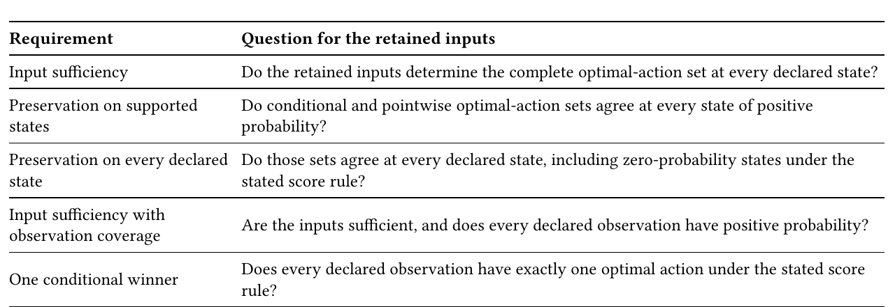
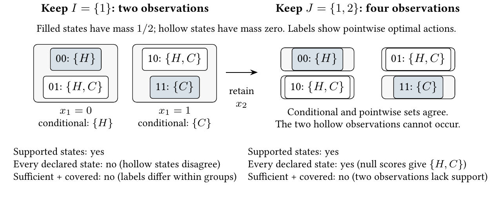
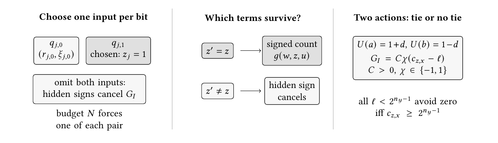

# Less Is Harder Than More: Proving Unnecessary Complexity

Paper4, the JAIR submission, converted to text: part 3 of 5. Read the parts in order. Figures and tables are PNG files in `figures/`, linked where they appear.

### 6.2 What to Require at Unreachable Observations

Suppose two inputs report a commanded mode and its confirmed mode. An interlock keeps them in agreement, although the interface schema admits disagreement too. Does deletion have to preserve the response only during interlocked operation, or also at the extra settings admitted by the schema? And must every retained reading be able to occur? Example 6.14 will give this situation explicit scores.

The first question chooses which states must keep their responses: only those with positive probability (supported states), or every state the schema admits (declared states). The second asks for observation coverage: every retained reading must have at least one positive-probability state behind it. Removing inputs groups states into fibers, each with one retained reading. A fiber can mix supported and unsupported states or contain no supported state at all. The definitions keep these two requirements separate.

Definition 6.10 (Stochastic Decision Problem). A stochastic decision problem is a tuple

D 𝑆 = (𝐴, 𝑋 1 , . . . , 𝑋 𝑛 , 𝑈 , 𝑃), where 𝑃 ∈ Δ(𝑆) is a distribution on 𝑆 = 𝑋 1 × · · · × 𝑋 𝑛 .

Footnote: 20 DQ98, CC4

For a retained coordinate set 𝐼 , define the unnormalized score and its complete optimizer by

𝐹 𝐼 (𝑠, 𝑎) := Opt 𝐼 stoch (𝑠) := arg max 𝐹 𝐼 (𝑠, 𝑎).

∑︁

𝑃 (𝑡)𝑈 (𝑎, 𝑡),

𝑡 :𝑡 𝐼 =𝑠 𝐼 𝑎∈𝐴

On a positive-mass fiber, normalization scales every action score by the same positive number, so this is the ordinary conditional optimizer. On a zero-mass fiber, every action has score zero and Opt 𝐼 stoch (𝑠) = 𝐴.

Definition 6.11 (Preservation on Supported and Declared States). A coordinate set 𝐼 preserves on supported states if

∀𝑠 ∈ supp(𝑃), Opt 𝐼 stoch (𝑠) = Opt(𝑠).

It preserves on every declared state if

∀𝑠 ∈ 𝑆, Opt 𝐼 stoch (𝑠) = Opt(𝑠).

The first requirement ignores unreachable states. The second tests every state, including unreachable states in positive-mass fibers. On zero-mass fibers, it compares the pointwise optimizer with the full action set 𝐴.

For any finite observation map 𝜙 : 𝑆 → 𝑌 , the same definitions use the fiber 𝜙 −1 (𝜙 (𝑠)) in place of agreement on 𝐼 . The complexity classifications below use coordinate projections; they do not transfer automatically to arbitrary succinctly represented maps.

Definition 6.12 (Input Sufficiency with Observation Coverage). Write F 𝐼 (𝑠) = {𝑡 : 𝑡 𝐼 = 𝑠 𝐼 }. A coordinate set 𝐼 is sufficient with observation coverage if

(1) 𝐼 is sufficient, so Opt is constant on every 𝐼 -fiber; and

(2) every declared 𝐼 -fiber has a positive-mass realization:

∀𝑠 ∈ 𝑆 ∃𝑡 ∈ F 𝐼 (𝑠) : 𝑃 (𝑡) > 0.

For the some-observation query, an 𝐼 -fiber qualifies if it contains a positive-mass state and Opt is constant on that fiber. This requirement never evaluates a conditional expectation on a null event. It requires every observation declared by the interface to occur and to recover the complete pointwise optimizer set.

Definition 6.13 (One Conditional Winner). A coordinate set 𝐼 is decisive if every combinatorial fiber has one conditionally optimal action:

∀𝑠 ∈ 𝑆 ∃𝑎 ∈ 𝐴, Opt 𝐼 stoch (𝑠) = {𝑎}.

For the some-observation version, this singleton condition need hold on only one combinatorial 𝐼 -fiber.

Example 6.14 (Supported and Declared-State Sensor Retention). Let 𝑥 1 , 𝑥 2 ∈ {0, 1} record a commanded mode and its confirmed mode, and let 𝐴 = {𝐻, 𝐶} be two control actions. An interlock excludes disagreement during observation, although the interface schema declares all four states. Give the two matched states equal probability:

𝑃 (0, 0) = 𝑃 (1, 1) = 12 , 𝑃 (0, 1) = 𝑃 (1, 0) = 0.

The utility table is

(𝑥 1 , 𝑥 2 ) 𝑈 (𝐻, 𝑥) 𝑈 (𝐶, 𝑥)

(0, 0) 2 0

(0, 1) 0 0

(1, 0) 0 0

(1, 1) 0 2 so the unmatched states represent a tie under the system’s fallback rule. Retain 𝐼 = {1}. The two fiber-score vectors are (1, 0) and (0, 1). They reproduce the pointwise optimizer at both supported states.



*Table 3. What each requirement asks. Under full support the four preservation rows coincide; one conditional winner still asks a different question. On a zero-mass fiber the score rule gives every action score zero.*

```text
Requirement                      Question   for the retained  inputs
Input sufficiency                Do  the retained inputs determine the complete  optimal-action  set at every declared state?
Preservation on supported        Do  conditional and pointwise  optimal-action sets agree at every state of positive
states                           probability?
Preservation on every  declared  Do  those sets agree at every declared state, including zero-probability states under the
state                            stated score rule?
Input sufficiency with
                                 Are the inputs sufficient, and does every declared observation have  positive probability?
observation coverage
                                 Does  every declared observation  have exactly one optimal  action under the stated score
One  conditional winner
                                 rule?
```

Figure 6 compares 𝐼 with the full interface 𝐽 = {1, 2}. Each 𝐼 -fiber mixes a supported singleton optimizer with an unmatched tie, so 𝐼 is not sufficient and does not preserve on every declared state. With 𝐽 , each state stands alone. It preserves on every declared state because the zero-mass states have both pointwise and fiber optimizer equal to 𝐴; it lacks observation coverage because those observations cannot occur. The empty interface and {2} also mix pointwise labels. Thus no interface is both sufficient and observation-covering on this product.



*Fig. 6. The same interlock gives different preservation verdicts. Boxes group states that look the same through the retained inputs. Keeping one sensor recovers the actions on the support; keeping both recovers them at every declared state under the zero-score convention. Neither interface is both sufficient and observation-covering: the first mixes pointwise labels, and the second declares unsupported observations.*

If an application declares its observation space to be exactly the image of supp(𝑃), coverage is automatic. If the interface schema instead declares the full coordinate product, observation coverage audits the extra observations as well. When each state has one best action and every declared observation is reachable, preservation on every declared state coincides with input sufficiency plus observation coverage; the exact general relationship is proved in Theorem 6.24.

For a unique conditional winner, restricting the declaration to reachable observations means testing only positive-mass fibers. The conditional-winner lower bounds use uniform or strictly positive dyadic distributions. Their upper-bound tests can also check that a state producing the observation has positive probability, so these classifications do not depend on the zero-mass convention.

Applying the structural certificates. The earlier input-sufficiency checks also prove decisiveness when every observation has positive probability and all states behind it have the same unique best action (Proposition 6.26). Otherwise conditional uniqueness requires its own fiber-score check.

### 6.3 Markov Blankets and Preservation on Supported States

Set 𝑌 (𝑠) = Opt(𝑠) and let 𝑆 −𝐼 denote the omitted coordinates. A Markov blanket requires that they give no further information about 𝑌 .

Theorem 6.15 (Optimizer Markov-Blanket Equivalence) 21 . Assume a finite nonempty action set and nonnegative state probabilities. For every coordinate set 𝐼 , the following are equivalent:

(1) 𝑌 is conditionally independent of 𝑆 −𝐼 given 𝑆 𝐼 under 𝑃;

(2) Opt is constant on 𝐹 ∩ supp(𝑃) for every 𝐼 -fiber 𝐹 ; and

(3) 𝐼 is preserving on supported states in the sense of Definition 6.11.

Proof. Given a positive-mass (𝑣, 𝑤), the law of 𝑌 is the point mass at 𝑌 (𝑣, 𝑤). Conditional independence holds iff this depends only on 𝑣, proving 1⇔2. Averaging a common optimizer set with positive weights preserves exactly that set, giving 2⇒3. Conversely, a single fiber optimizer cannot equal two different supported pointwise sets. ■

Corollary 6.16 (When a Markov Blanket Matches Input Sufficiency) 22 . Under full support, the conditions of

Theorem 6.15 coincide with input sufficiency and its coNP row in Table 5. Without that promise, preservation on every declared state can be stronger and is Π 𝑃 2 -complete. The coNP classification does not include recognizing full support.

Proof. Full support turns item 2 into sufficiency. Otherwise all-state preservation also tests unsupported states within positive fibers and imposes the null-fiber condition of Theorem 6.24; Proposition 6.25 supplies a separation. ■

Corollary 6.17 (Full-Support Blanket Uniqueness and Sparse-Support Failure) 23 . Under full support on a product space, the unique minimal Markov blanket for 𝑌 = Opt is the relevant-coordinate set. Without support closure, incomparable minimal optimizer Markov blankets can occur.

Proof. Full support reduces the claim to Proposition 2.11. For the separation, take 𝑆 = {0, 1} 2 , put mass 1/2 on 00 and 11, and set 𝑈 (𝑎, (𝑥 1 , 𝑥 2 )) = 1[𝑎 = 𝑥 1 ]. On the support, either coordinate alone determines Opt = {𝑥 1 }, while the empty set does not. Thus {1} and {2} are incomparable minimal blankets. ■

Koller and Sahami use Markov blankets for sequential feature elimination (Koller and Sahami 1996).

Footnote: 21 22 23 UB17-19

Footnote: UB15 UB16

### 6.4 Intersection Closure Governs Within-Budget Certification

If two sensor selections each preserve the original actions, can we keep only the sensors they share? On a full product, yes: both must contain every individually necessary sensor (Proposition 2.11). The two-row domain in Figure 3 permits alternatives. Requiring a definite conditional choice permits alternatives even on a full product: either sensor can break a tie that returns when both are hidden. The proposition records when keeping only the shared sensors preserves the guarantee.

Proposition 6.18 (Intersection Closure Separates Preservation from Decisiveness) 24 . On Boolean product spaces with nonnegative state weights, both the family of sufficient, observation-covering sets and the family that preserves every declared state are closed under intersection. Decisive coordinate sets need not be intersection-closed, even with two actions, two Boolean coordinates, and a uniform full-support distribution.

Proof. Every sufficient and observation-covering set, and every set that preserves on all declared states, is sufficient. Product closure identifies sufficient sets with the supersets of the relevant-coordinate set, so the intersection of two preserving sets remains sufficient. Let 𝐽 denote that intersection and let 𝐼 be either preserving set. On a positive-mass 𝐽 -fiber, the static-sufficiency argument makes the pointwise optimizer constant, so averaging preserves it. On a zero-mass 𝐽 -fiber, the 𝐼 -fiber of any state is a subset of its 𝐽 -fiber and therefore also has zero mass. Preservation on every declared state by 𝐼 then forces Opt(𝑠) = 𝐴, exactly the condition required for preservation on every declared state by 𝐽 . Thus 𝐽 preserves on both kinds of fiber. For observation coverage, every 𝐽 -fiber is a union of 𝐼 -fibers, and each 𝐼 -fiber has a positive-mass representative. Hence every 𝐽 -fiber is positive as well.

For failure of decisiveness closure, let the action gap 𝑔 = 𝑈 (𝑎, ·) − 𝑈 (𝑏, ·) on the four states be

𝑥 2 = 0 𝑥 2 = 1

𝑥 1 = 0 3 −1

𝑥 1 = 1 −1 −1 under the uniform distribution. Retaining either coordinate gives weighted fiber gaps 1/2 and −1/2, so both {1} and {2} are decisive. Their intersection is empty, and its sole fiber has total gap zero, so the two actions tie. Thus the intersection is not decisive. ■

Thus the product-space shortcut for within-budget input sufficiency does not settle within-budget decisiveness. The latter still requires choosing a set and comparing its conditional action scores.

### 6.5 Stochastic Certification

Hiding a sensor leaves several possible states behind one reading. The controller then adds their probabilityweighted action scores. In the opening example this produces a definite brake choice, even though one hidden state requires steer. Section 6.2 specifies which states must still have their original actions recovered.

6.5.1 Preservation and Decisiveness. The two-action examples below isolate both possibilities: preserving a tie, and obtaining one winner while losing an original response.

Example 6.19 (Preservation without Decisiveness). Let 𝑆 = {𝑠 1 , 𝑠 2 }, 𝐴 = {𝑎, 𝑏}, and 𝑈 ≡ 0, with positive mass on both states and no retained coordinates. Both optimizer sets are {𝑎, 𝑏}: preservation holds, but decisiveness fails. 25

Example 6.20 (Decisiveness without Preservation). Let 𝑆 = {𝑠 1 , 𝑠 2 } and 𝐴 = {𝑎, 𝑏} under the uniform distribution, with

𝑈 (𝑎, 𝑠 1 ) = 2, 𝑈 (𝑏, 𝑠 1 ) = 1, 𝑈 (𝑎, 𝑠 2 ) = 0, 𝑈 (𝑏, 𝑠 2 ) = 3.

Footnote: 24 25 EX4-5

Footnote: DC140-143

With no retained coordinates, the expected utilities are (1, 2), uniquely favoring 𝑏. Decisiveness holds, but preservation fails at 𝑠 1 , whose optimizer is {𝑎}. 26

Checking preservation starts by comparing the best-action sets within each group of hidden states. To determine whether a conditional winner is unique, the auditor must also add their probability-weighted scores for each action.

6.5.2 Queries over Reachability and Conditional Scores.

Problem 6.21 (Preservation and Observation-Coverage Queries). For each contract in Definitions 6.11 and 6.12, the check query supplies 𝐼 , the within-budget query asks for some |𝐼 | ≤ 𝑘, and the some-observation query asks for one qualifying realized 𝐼 -fiber. Their names are:

• On-Support-Preservation-Check, Within-Budget-Support-Preservation, and Some-Observation-

Support-Preservation. A qualifying fiber has positive mass and a constant optimizer on its support.

• All-State-Preservation-Check, Within-Budget-All-State-Preservation, and Some-Observation-

All-State-Preservation. A qualifying fiber has Opt 𝐼 stoch (𝑠) = Opt(𝑠) at every declared state in it.

• Sufficiency-With-Coverage-Check, Within-Budget-Sufficiency-With-Coverage, and Some-

Observation-Sufficiency-With-Coverage. A qualifying fiber has positive mass and a constant optimizer throughout.

6.5.3 Sparse Support Keeps the Blanket Choice Alive. Return to the commanded and confirmed modes. If only matched settings can occur and their required responses differ, either input can determine the response on the support. Admitting all four settings in the schema does not remove that choice when the audit ignores zero-probability states. By contrast, positive probability on every combination leaves one smallest preserving set. The classification also describes a Markov blanket of the action label: the retained inputs determine that label on the support.

Theorem 6.22 (Sparse Support Keeps the Blanket Choice Alive) 27 . Under the dyadic succinct Boolean-product encoding of Section 3, with nonnegative normalized probabilities:

(1) On-Support-Preservation-Check is coNP-complete;

(2) Within-Budget-Support-Preservation is Σ 𝑃 2 -complete; and

(3) Some-Observation-Support-Preservation is Σ 𝑃 2 -complete.

Equivalently, deciding whether an optimizer Markov blanket of size at most the given budget exists without a full-support promise is Σ 𝑃 2 -complete. The lower bound already holds with two actions, Boolean coordinates, and dyadic probabilities.

Proof. Theorem 6.15 identifies preservation on supported states with constancy of Opt on the positive-mass part of every fiber. A failed proposed input set therefore has a polynomial witness: two positive-mass states that agree on 𝐼 and have different optimizer sets. This puts the proposed-input query in coNP. Guessing 𝐼 before that check puts the within-budget query in Σ 𝑃 2 . For the some-observation query, guess a positive-mass 𝑠 0 and universally check every positive-mass state agreeing with it on 𝐼 ; this also lies in Σ 𝑃 2 .

Proposed-input and some-observation hardness already hold in the full-support subfamily. Give the Boolean products in Theorems 6.5 and 6.9 their uniform distributions and apply Theorem 6.15.

For within-budget hardness, take the Boolean restricted-state instance L 𝜑 ⊆ {0, 1} 𝑁 constructed in Theorem 6.7. Write 𝑑 = |𝑧|, 𝑢 = |𝑥 |, 𝐿 = 𝑑 + 𝑢 + 2, 𝐹 = 𝑑𝐿 2 , ℎ = max{3, ⌈log 2 (𝐹 + 1)⌉}, and 𝑞 = ℎ + 2. The construction has

𝑀 = 2 𝑑+𝑢+1 main states, 𝐾 = 2𝐹 + 2𝑞 forcing and calibration states.

Footnote: 26 27 UB15, LMS1-2

Footnote: EX6-7

Choose 𝑒 = ⌈log 2 (2𝐾)⌉, put 𝛿 = 2 −𝑒 , and set

1 − 𝐾𝛿

𝜇 = .

𝑀

On the full Boolean cube, assign mass 𝜇 to each main codeword, mass 𝛿 to each forcing or calibration codeword, and zero elsewhere. Then 𝐾𝛿 ≤ 1/2, so every allowed codeword has positive dyadic mass, and 𝑀𝜇 + 𝐾𝛿 = 1. The probability circuit recognizes the same three disjoint codeword families as the validity circuit and returns one of these two polynomial-bit constants. No model count is computed. Extend both utilities arbitrarily, say by zero, off the support.

Positive-mass pairs agreeing on an interface are now exactly the allowed pairs of L 𝜑 agreeing on that interface. By Theorem 6.15, an interface is preserving on supported states exactly when it is sufficient for L 𝜑 . The budget is unchanged, so Theorem 6.7 supplies the Σ 𝑃 2 lower bound. The state, utility, support, and dyadic-mass circuits all have polynomial encoded size. The executable audit checks the normalized masses, the Boolean forcing geometry, and the on-support equivalence for every one-bit source predicate and every budget-feasible interface. ■

6.5.4 Observation Coverage Adds a Support Witness. Keeping both mode inputs distinguishes all four schema readings, but the interlock still prevents the two unmatched readings. Distinguishing states does not establish that a reading can occur. The next results separate these jobs: preserve the common response within each group, then check its support. This avoids summing scores when constancy already fixes their winner. 28 When every state has positive probability, the support check is automatic and all preservation contracts give the same verdict and response groups. 29

Theorem 6.23 (Full Support Reduces Preservation to Input Sufficiency) 30 . Assume the distribution 𝑃 has full support and the action set is nonempty. Then:

(1) both Within-Budget-Sufficiency-With-Coverage and Within-Budget-All-State-Preservation are equivalent to the underlying Within-Budget-Sufficiency query;

(2) for each fixed 𝐼 , both some-observation variants are equivalent to the underlying Some-Observation-

Sufficiency query on 𝐼 .

Consequently, under full support, input sufficiency, preservation on supported states, preservation on every declared state, and sufficiency with observation coverage all have the same coNP-complete within-budget query; their some-observation variants all have the same Σ 𝑃 2 -complete query.

The supplement’s Full-support consequences section proves the two underlying equivalences and the full classification.

Without full support, the null-score convention adds the following condition. 31

Theorem 6.24 (Preservation Can Hold Without Observation Coverage) 32 . Assume that 𝐴 is nonempty and 𝑃 is nonnegative. Write F 𝐼 (𝑠) = {𝑡 : 𝑡 𝐼 = 𝑠 𝐼 }. Then

𝐼 is preserving on every declared state ⇐⇒  Opt  is constant on every 𝐼 -fiber, (1)

∀𝑠 (∄𝑡 ∈ F 𝐼 (𝑠) : 𝑃 (𝑡) > 0) ⇒ Opt(𝑠) = 𝐴 .


By contrast, 𝐼 is sufficient with observation coverage exactly when the first conjunct holds and

∀𝑠 ∃𝑡 ∈ F 𝐼 (𝑠) : 𝑃 (𝑡) > 0.

Sufficiency with observation coverage implies preservation on every declared state. If Opt(𝑠) ≠ 𝐴 for every state, then the two predicates are equivalent. In particular, the equivalence holds when every pointwise optimizer is a singleton and |𝐴| ≥ 2; the action cardinality assumption is necessary because, for |𝐴| = 1, the unique singleton optimizer is 𝐴 itself.

Footnote: 28 29 30 31 32 DC113, DC162

Footnote: DC91-93, OU12 DC95-99 DQ94-95 DC108-110, OU14-18

Proof. Preservation identifies the common fiber optimizer with every pointwise optimizer in that fiber, so it implies input sufficiency. On a zero-mass fiber every score is zero, making the fiber optimizer 𝐴; preservation there is therefore equivalent to the second conjunct of (1).

Conversely, suppose both conjuncts hold. On a positive-mass fiber, let 𝑂 be the common pointwise optimizer. Every action in 𝑂 ties pointwise, and every action outside 𝑂 is strictly worse at each state. Nonnegative averaging with at least one positive coefficient preserves exactly that argmax set. On a zero-mass fiber, all aggregate scores tie and the second conjunct gives the same pointwise optimizer 𝐴. This proves (1).

The sufficiency-and-coverage formula is Definition 6.12, written with F 𝐼 (𝑠). Its coverage conjunct removes the zero-mass case, so the positive-fiber argument proves preservation on every declared state. Conversely, if preservation on every declared state holds and some fiber has no positive-mass representative, the normal form forces Opt(𝑠) = 𝐴 on that fiber. The stated no-universal-optimizer hypothesis rules this out. ■

Proposition 6.25 (Input Sufficiency Need Not Preserve Every Declared State) 33 . There exist instances where the retained inputs determine Opt pointwise but fail preservation on every declared state after a distribution 𝑃 is fixed.

Proposition 6.26 (Singleton Sufficiency Gives One Conditional Winner) 34 . Suppose that every 𝐼 -fiber has positive probability and that its pointwise optimal-action set is a singleton constant on that fiber. Then 𝐼 preserves on every declared state and is decisive.

Corollary 6.27 (Relevance and Positive Support) 35 . Every coordinate set that preserves on every declared state contains every statically relevant coordinate. Hence, on the Boolean cube, a yes-instance of Within-Budget-AllState-Preservation with budget 𝑘 has at most 𝑘 statically relevant coordinates. Conversely, input sufficiency on 𝐼 implies preservation on every declared state whenever every 𝐼 -fiber contains a positive-mass state. On one named fiber, optimizer constancy together with positive mass implies preservation on that observation.

Proof of Propositions 6.25–6.26 and Corollary 6.27. For the separation, retain the full interface on two states with 𝑃 (𝑠 0 ) = 1, 𝑃 (𝑠 1 ) = 0, and opposite singleton optimizers. Static sufficiency holds, but the null state’s aggregate optimizer is 𝐴. The normal form proves the positive-fiber implications, including uniqueness for a common singleton. Preservation implies sufficiency, hence relevance containment on products and the budget bound; the same averaging argument works on a named positive fiber. ■

Proposition 6.28 (When No Interface Preserves Every Declared State) 36 . On a Boolean product space, let 𝑅 be the statically relevant-coordinate set. No coordinate set preserves on every declared state if and only if there is a state 𝑠 such that

Opt(𝑠) ≠ 𝐴 and ∄𝑡 ∈ 𝐹 𝑅 (𝑠) : 𝑃 (𝑡) > 0.

In particular, under the all-state convention, the full coordinate set fails exactly when some zero-probability state 𝑠 has Opt(𝑠) ≠ 𝐴. By contrast, the full coordinate set has observation coverage exactly when every declared state has positive probability.

Proof. A preserving 𝐼 contains 𝑅. Every 𝑅-fiber is a union of 𝐼 -fibers with a common pointwise optimizer. If it is positive, averaging preserves that optimizer; if null, all its 𝐼 -fibers are null and preservation forces Opt = 𝐴. Thus any preserving interface makes 𝑅 preserve too. The normal form applied to 𝑅 gives the criterion. Full-interface fibers are singletons, giving the stated special cases. ■

Footnote: 33 34 35 36 DC126, DC128, DC150

Footnote: DC108 DQ91, DC138 DQ90-91, DQ96-97

A smaller interface can restore preservation on every declared state by grouping an unsupported state with a supported state having the same optimizer.

Coverage asks a different question: for every reading the interface admits, can we find a state of positive probability that produces it? That is a for-every-reading, find-a-state test. The theorem proves that this extra support obligation reaches Π 𝑃 2 even when each state has one best action.

Theorem 6.29 (Every Declared Observation Needs a Witness) 37 . Under the dyadic succinct product-state encoding of Section 3, with nonnegative normalized probabilities:

(1) Sufficiency-With-Coverage-Check is Π 𝑃 2 -complete;

(2) Within-Budget-Sufficiency-With-Coverage is Π 𝑃 2 -complete; and

(3) Some-Observation-Sufficiency-With-Coverage is Σ 𝑃 2 -complete.

The lower bounds already hold on Boolean product spaces with two actions and dyadic probabilities. The proposed-input and within-budget lower-bound instances have a unique pointwise optimizer at every state.

Proof. For a proposed set, input sufficiency is a coNP condition and coverage has the form

∀𝑠 ∃𝑡 : 𝑡 𝐼 = 𝑠 𝐼 ∧ 𝐶 𝑃 (𝑡) > 0.

The matrix is polynomial-time computable, so their conjunction lies in Π 𝑃 2 . The some-observation query guesses an observation and a positive representative, then universally checks optimizer constancy on that fiber, placing it in Σ 𝑃 2 .

For the within-budget problem, let 𝑅 be the unique statically relevant-coordinate set. If 𝐼 is sufficient with observation coverage and 𝑅 ⊆ 𝐼 , every 𝑅-fiber is a union of 𝐼 -fibers and therefore contains positive mass; sufficiency of 𝑅 then gives 𝑅 observation coverage. Thus 𝑅 is the least sufficient and observation-covering set whenever any one exists, and

∃𝐼 |𝐼 | ≤ 𝑘 ∧ 𝐼 is sufficient and observation-covering 

(2)

⇐⇒ |𝑅| ≤ 𝑘 ∧ 𝑅 is sufficient and observation-covering.

The complement of (2) is in Σ 𝑃 2 . If |𝑅| > 𝑘, a certificate lists 𝑘 + 1 distinct relevant coordinates and a local relevance witness for each. If 𝑅 fails coverage, a certificate lists a state 𝑠 and a set 𝑊 ⊆ 𝑅 of relevant coordinates, with local relevance witnesses, such that every positive-mass state differs from 𝑠 on some coordinate in 𝑊 . The local witnesses certify 𝑊 ⊆ 𝑅, while the disagreement condition excludes every positive-mass realization of 𝑠 𝑅 . Thus the whole 𝑅-fiber contains no positive-mass state. Conversely, when an 𝑅-fiber has no positive-mass state, 𝑊 = 𝑅 is a complete certificate. The remaining test is universal with a polynomial-time matrix, so the within-budget problem lies in Π 𝑃 2 .

The matching within-budget reduction below has two separate jobs. Parity and local relevance first pin the only budget-feasible interface; the support circuit then makes coverage of that interface express ∀𝑥 ∃𝑦 𝜑 (𝑥, 𝑦).

For matching hardness of the first two queries, reduce the standard ∀𝑥∃𝑦 𝜑 (𝑥, 𝑦) problem (Stockmeyer 1976). Use states (𝑥, 𝑐, 𝑦, 𝑏), observe (𝑥, 𝑏), and put

𝜓 (𝑥, 𝑐, 𝑦) = 𝑐 ∧ 𝜑 (𝑥, 𝑦).

For each (𝑥, 𝑐, 𝑦), give the unique state with 𝑏 = 𝜓 (𝑥, 𝑐, 𝑦) the dyadic atom 2 − ( |𝑥 |+|𝑦 |+1) and give its companion mass zero. The distribution is normalized without computing a model count because exactly one state per triple receives an atom. The (𝑥, 0) fiber is always positive: choose 𝑐 = 0. The (𝑥, 1) fiber is positive exactly when

∃𝑦 𝜑 (𝑥, 𝑦).

For actions 𝑎 0 , 𝑎 1 , set

𝑈 (𝑎 1 , 𝑥, 𝑐, 𝑦, 𝑏) = 1[𝑏 ⊕ parity(𝑥) = 1], 𝑈 (𝑎 0 , 𝑥, 𝑐, 𝑦, 𝑏) = 1 − 𝑈 (𝑎 1 , 𝑥, 𝑐, 𝑦, 𝑏).

Footnote: 37 DC126-130

The unique pointwise label is therefore 𝑎 𝑏 ⊕parity(𝑥 ) . This optimizer depends only on the observed coordinates, and toggling any 𝑥 𝑖 or 𝑏 changes it, so the relevant set is exactly (𝑥, 𝑏). The observed interface is therefore sufficient with observation coverage exactly when ∀𝑥∃𝑦 𝜑 (𝑥, 𝑦), and the budget |𝑥 | + 1 forces the same interface in the within-budget query. All circuits and dyadic numbers have polynomial encoded size. Some-observation hardness already holds in the full-support subfamily by the static Σ 𝑃 2 reduction and Theorem 6.23. ■

Corollary 6.30 (Complexity of Preserving Every Declared State) 38 . Under the same encoding, All-StatePreservation-Check and Within-Budget-All-State-Preservation are Π 𝑃 2 -complete, and Some-ObservationAll-State-Preservation is Σ 𝑃 2 -complete.

Proof. The normal form in Theorem 6.24 gives the proposed-input upper bound. Passing to the relevant-coordinate set gives the within-budget upper bound, and the selected observation is either a positive constant fiber or a null fiber with universal optimizer, giving the some-observation upper bound. For proposed-input and within-budget hardness, the construction above has a unique pointwise optimizer at every state; sufficiency with observation coverage and preservation on every declared state therefore coincide. Some-observation hardness uses the same full-support static family. ■

The lower-bound instances have unique pointwise winners; support coverage supplies the ∀∃ test.

Problem 6.31 (One-Conditional-Winner Queries). Decisiveness-Check asks whether a supplied 𝐼 is decisive; Some-Observation-Decisiveness-Check asks whether one combinatorial 𝐼 -fiber has a unique winner; and Within-Budget-Decisive-Set asks for a decisive |𝐼 | ≤ 𝑘.

6.5.5 One Fiber: Equality Versus a Threshold. For two actions, such as brake and steer, subtract the probabilityweighted steer score from the brake score in each hidden state and add the differences. A positive total selects brake, a negative total selects steer, and zero is a tie. Asking for one winner therefore tests whether this total is nonzero; it does not ask which action wins. With three actions, two holds can instead tie at a threshold that accept must exceed.

The class C = P tests whether a signed count is zero; its complement, coC = P, tests whether it is nonzero. For a two-action fiber, zero means a tie and nonzero means one winner. These are different counting tests. A PP-hard test of equality on one two-action fiber would imply PP = C = P. This boundary concerns one observation: the construction assigns each forbidden smaller count its own observation, where equality produces a tie. Checking that every observation avoids a tie therefore expresses a threshold with two actions, giving the proposed-input and within-budget classes (Theorem 6.35). The individual-bit horizon-two reduction will reuse the three-action score mechanism on its own restricted state set.

Throughout the stochastic counting results, MAJ means weak majority. For a Boolean formula 𝜓 (𝑦),

MAJ 𝑦 𝜓 {𝑦 : 𝜓 (𝑦)} ≥ 2 |𝑦 | −1 . (3)

⇐⇒

For a language class C, write ∃·C for polynomially bounded existential projection: an input is accepted exactly when some polynomial-length string makes the paired input belong to a language in C (Torán 1991; Wagner 1986).

The next lemma connects these guesses to solver calls. An oracle transcript records the questions asked and the replies received. Calls are adaptive when a later question depends on an earlier reply. Guessing a complete transcript fixes the questions, but leaves every reply to be checked. For an oracle that asks whether a witness exists, a yes-reply needs one valid witness; a no-reply must rule out every candidate witness.

The supplement, Exact-Counting Projection Identities, gives the adaptive-oracle identities and their derivation.

Footnote: 38 DC126-130

Decisiveness implies the some-observation version: choose any state 𝑠 0 . The optimizer of its 𝐼 -fiber is a singleton, although the fiber itself may contain many states. 39

Theorem 6.32 (Finding One Observation with a Unique Winner) 40 . Under the dyadic succinct encoding, Some-Observation-Decisiveness-Check is NP PP -complete even when the action set has exactly three elements. The hardness already holds for the uniform distribution.

Proof. Membership follows by guessing a state 𝑠 0 and an action 𝑎, then using PP comparisons to verify that 𝑎 strictly beats every competitor on the 𝑠 0 -fiber. For hardness, reduce E-MAJSAT, the canonical NP PP -complete problem (Littman, Goldsmith, et al 1998). Given 𝜑 (𝑥, 𝑦), take the uniform state space on (𝑥, 𝑦), retain the 𝑥 coordinates, and set

1

𝑈 (accept, 𝑥, 𝑦) = 1[𝜑 (𝑥, 𝑦)], 𝑈 (hold 𝐿 , 𝑥, 𝑦) = 𝑈 (hold 𝑅 , 𝑥, 𝑦) = − 2 − ( |𝑦 |+1) .

2

The fiber indexed by 𝑥 has a unique optimum exactly when MAJ 𝑦 𝜑 (𝑥, 𝑦) holds, so some observation is decisive exactly when ∃𝑥 MAJ 𝑦 𝜑 (𝑥, 𝑦). ■

6.5.6 A Common Counting Source for Two Constructions. The budget query combines three jobs: choose sensors, check every retained reading, and add the scores of the hidden states behind that reading. The reductions encode those jobs by existential, universal, and counted variables of fixed lengths. This adds a representation requirement to the counting-quantifier and SSAT settings (Lee et al 2018; Littman, Majercik, et al 2001; Torán 1991; Wagner 1986): retained coordinates must encode the existential assignment. The majority-test observations use counted blocks of equal length so that they share one threshold. In the supplementary three-action construction, exposed singleton observations have separate tie-breaking scores; they are not additional majority tests. We use rightassociated oracle notation (Kwisthout 2011); complementing an oracle leaves its adaptive power unchanged. The supplement’s Fixed-block normalization section also normalizes strict to weak majority.

Lemma 6.33 (One Threshold for Every Observation) 41 . The language of Boolean circuits satisfying

∃𝑧 ∀𝑥 MAJ 𝑦 𝜑 (𝑧, 𝑥, 𝑦). (4) is NP (NP PP ) -complete under polynomial-time many-one reductions. Here 𝜑 is evaluated as a circuit, so no auxiliary gate variables enter the majority block. Moreover, the reduction from an input 𝑤 produces a majority block of length 𝑛 𝑦 = 𝑝 (|𝑤 |) for one polynomial 𝑝; the length is independent of the values assigned to (𝑧, 𝑥).

Why this holds. Choosing the outer assignment leaves the universal/counting test. Padding makes the majority block length independent of the assignments. The supplement’s section Supporting Proofs for the Main Results gives the complete proof of this result.

6.5.7 Exact Two-Action Classification. Two actions are enough for the full choose-then-check difficulty. Although one reading only tests for a tie, a check over every reading can rule out every count below a threshold. For example, a count is at least four exactly when it differs from each of zero, one, two, and three. The threshold lemma below formalizes this step; the selector construction makes the input budget encode the initial choice.

The supplement’s Exact-Counting Projection Identities identifies the resulting projection forms with the standard oracle classes used below (Torán 1991; Wagner 1986).

The zero set of a GapP function defines C = P. After padding two nondeterministic machines to the same path length, every GapP function has the form

𝑔(𝑤, 𝑢) = ∑︁ ℎ(𝑤, 𝑢, 𝑝) ∈ {−1, 0, 1}, (5)

ℎ(𝑤, 𝑢, 𝑝), where ℎ is computed by a polynomial-size circuit. The relevant complete predicates are

Footnote: 𝑝 ∈ {0,1} 𝑚

Footnote: 39 40 41 OU13

Footnote: DC19 DC134, OU1, EH4-6

∀𝑥 𝑔(𝑤, 𝑥) ≠ 0, ∃𝑥 𝑔(𝑤, 𝑥) ≠ 0, ∃𝑧 ∀𝑥 𝑔(𝑤, 𝑧, 𝑥) ≠ 0.

The next observation lets the universal fiber layer recover a threshold without adding a third action.

Lemma 6.34 (A Threshold Is a Family of Nonzero Tests) 42 . Let 𝑚 ≥ 1, let 𝑐 = |{𝑦 ∈ {0, 1} 𝑚 : 𝜑 (𝑦)}|, and encode ℓ ∈ {0, . . . , 2 𝑚−1 − 1} with 𝑚 − 1 bits. Then

𝑐 ≥ 2 𝑚−1 ∀ℓ < 2 𝑚−1 : 𝑐 − ℓ ≠ 0.

⇐⇒

Moreover, with a signed path (𝑏, 𝑣) ∈ {0, 1} 𝑚+1 ,

( 𝑏 = 0, ∑︁

1[𝜑 (𝑣)],

ℎ(ℓ, 𝑏, 𝑣) = ℎ(ℓ, 𝑏, 𝑣) = 𝑐 − ℓ.

−1[𝑣 < ℓ], 𝑏 = 1 satisfies

𝑏,𝑣

Proof. The forbidden values 0, . . . , 2 𝑚−1 − 1 are exactly the counts below weak majority. The signed-path identity follows because precisely ℓ strings 𝑣 ∈ {0, 1} 𝑚 represent integers below ℓ. ■

Theorem 6.35 (Exact Two-Action Decisiveness Classification) 43 . Suppose 𝐴 = {𝑎, 𝑏} and define the signed score gap on an 𝐼 -fiber by

𝐺 𝐼 (𝑠) := ∑︁ 

𝑃 (𝑡) 𝑈 (𝑎, 𝑡) − 𝑈 (𝑏, 𝑡) .

𝑡 :𝑡 𝐼 =𝑠 𝐼

Then 𝐼 is decisive if and only if 𝐺 𝐼 (𝑠) ≠ 0 for every state 𝑠. Under the succinct dyadic product encoding with exactly two actions:

(1) Decisiveness-Check is co(NP PP )-complete;

(2) Some-Observation-Decisiveness-Check is coC = P-complete; and

PP

(3) Within-Budget-Decisive-Set is NP (NP ) -complete.

The lower bounds use an independent uniform distribution on a full product. The first two use Boolean coordinates. The minimum reduction uses coordinate domains of size at most four. For 𝐼 = ∅, the proposed-input problem specializes to coC = P-completeness.

In query language, item 1 asks whether every fiber avoids a tie, item 2 asks whether some fiber avoids a tie, and item 3 first chooses an interface and then asks whether every resulting fiber avoids a tie.

How the input budget chooses an assignment. For the within-budget lower bound, turn each majority threshold into the nonzero tests of Lemma 6.34. Write 𝑢 = (𝑥, ℓ) for the universal bits together with the threshold index, and pad 𝑢 and the existential assignment 𝑧 to a common length 𝑁 ≥ 1. Each candidate input 𝑞 𝑗,𝑏 has four values: a sign bit 𝑟 𝑗,𝑏 and a bit 𝜉 𝑗,𝑏 of the observation. Selecting one input from each pair (𝑞 𝑗,0 , 𝑞 𝑗,1 ) records 𝑧 𝑗 = 𝑏; its observed 𝜉 bits specify 𝑢.

Hidden coordinates hold another assignment 𝑧 ′ and a signed path 𝑝. Set the two utilities to 1 + 𝑑 and 1 − 𝑑, where 𝑑 is the signed path value multiplied by the signs selected by 𝑧 ′ . If an interface misses both inputs of any pair, the hidden sign takes opposite values equally often, cancelling the score gap. That observation ties. Selecting hidden coordinates cannot repair the missing sign. A decisive interface with budget 𝑁 must therefore select exactly one input from each of the 𝑁 pairs.

For such an interface, every term with 𝑧 ′ ≠ 𝑧 cancels at a hidden sign from its first mismatch. The terms with 𝑧 = 𝑧 survive. Their gap is a nonzero sign and a positive common factor times 𝑔(𝑤, 𝑧, 𝑢), the signed count from

Footnote: ′

Equation (5). With the threshold construction, this count is 𝑐 𝑧,𝑥 − ℓ, where 𝑐 𝑧,𝑥 counts satisfying assignments of the original 𝑛 𝑦 -bit block. Every observation avoids a tie exactly when every original count reaches its majority threshold. Figure 7 shows these cancellations; the supplement gives the exact factor, circuit sizes, and complete proof.

Footnote: 42 43 DC154, DC158-159

Footnote: DC163



*Fig. 7. The two-action selector for Theorem 6.35, item 3. Left: each four-valued input carries a sign and an observation bit; omitting an entire pair leaves a cancelling hidden sign, so the budget chooses one input per pair. Middle: hidden assignments inconsistent with that choice cancel; the chosen assignment contributes its signed count. Right: the two action scores tie exactly when that count is zero. Testing every threshold index excludes every count below weak majority. All coordinates are independent and uniform.*

PP

Remark 6.36 (Why the nested class is not simplified). No collapse of NP (NP ) to NP PP is known. The closure facts used above—PP closure under complement and polynomial truth-table reductions—combine the counting tests inside one fixed oracle transcript. They do not absorb an adaptive outer NP oracle around an NP PP predicate. The theorem therefore states the exact complete class without assuming that the displayed nesting is strict (Torán 1991; Wagner 1986).

Since GapP is closed under products, 𝑔 ≠ 0 is equivalent to 𝑔 2 > 0, so coC = P ⊆ PP; PP complement closure also places C = P in PP. The action-count boundary therefore remains only for the some-observation query: two actions give coC = P, whereas three actions give NP PP . Equality of those two classes would imply NP PP = PP.

Which distribution restrictions already preserve hardness. The proposed-input, some-observation, and two-action within-budget reductions use independent uniform coordinates. These distributions have Bayesian networks of moral treewidth zero, so the hardness survives a stronger restriction than the polytree value-of-information lower bound of Krause and Guestrin (Krause and Guestrin 2009). The separate three-action construction supplies a polynomial-size circuit for its positive dyadic distribution and product completion; it is retained with the horizon-two proof in the supplement’s Three-Action Carrier for Horizon-Two Inheritance. The two-action construction already matches the one-step upper bounds. The Π 𝑃 2 observation-coverage reduction still uses an arbitrary succinct support circuit. Whether that result survives a polytree or fixed-treewidth bound on the supplied distribution remains open. This restriction concerns the representation of 𝑃, independently of how 𝑈 is checked. 44
