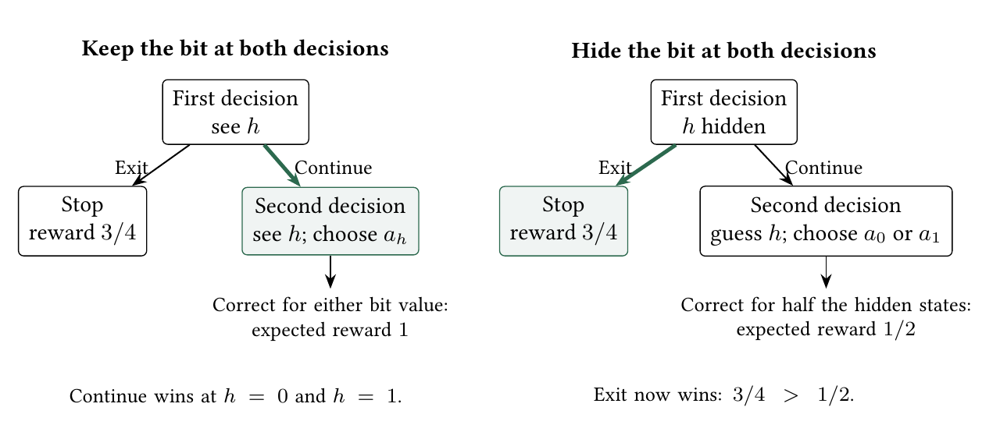
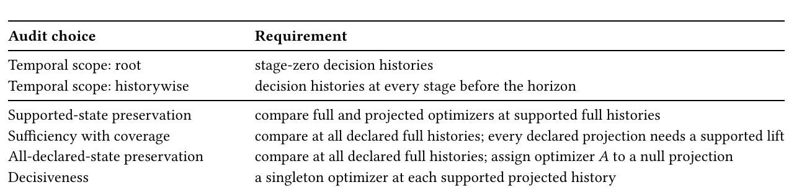
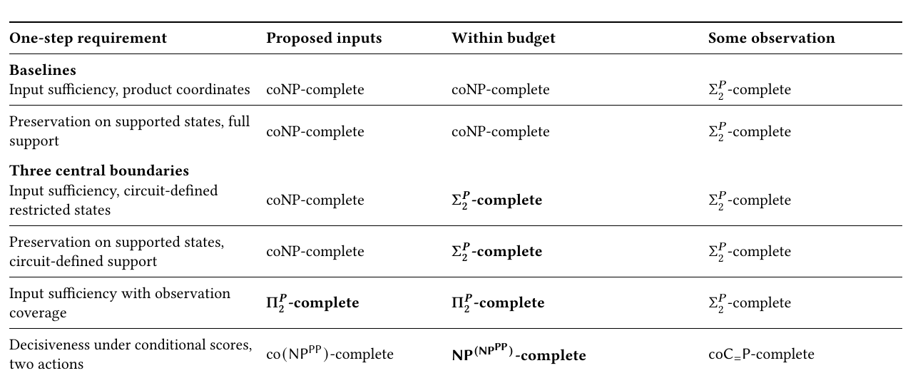
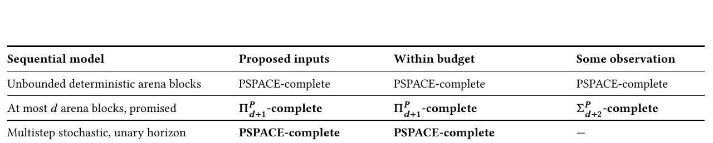

# Less Is Harder Than More: Proving Unnecessary Complexity

Paper4, the JAIR submission, converted to text: part 4 of 5. Read the parts in order. Figures and tables are PNG files in `figures/`, linked where they appear.

### 6.6 Approximation Across Presentations

Suppose we accept keeping more sensors than necessary. Every original response must still survive: the approximation concerns how many inputs we keep, not the decisions they recover. On succinct Boolean products, even distinguishing a one-input optimum from an all-input optimum is hard. An explicit table exposes the conflicting state pairs. We can repeatedly keep the input that distinguishes the most remaining conflicts; this is greedy hitting set, with a tight logarithmic guarantee.

Footnote: 44 DC57, OU8-11, OU36-37, EH2-10

Formally, a factor-𝜌 approximation is a polynomial-time algorithm for the stated promised family that returns an actual interface satisfying the preservation or decisiveness contract and whose cardinality is at most 𝜌 times the optimum. The promise includes feasibility and a positive optimum where a multiplicative ratio is used.

Probabilistic sufficient reasons provide a neighboring local theory with sharp algorithmic and inapproximability results (Arenas et al 2025; Izza et al 2022; Kozachinskiy 2023). Here one projection must preserve the complete optimizer globally.

The sufficiency indicator need not have diminishing returns: on two-bit parity, adding the second bit helps only after the first has been selected. Submodular guarantees therefore need an additional hypothesis (Golovin and Krause 2011; Krause and Guestrin 2009). On listed tables, the number of conflicting row pairs distinguished by the retained inputs has diminishing returns, supplying that hypothesis.

6.6.1 Succinct Boolean Products: A One-to-𝑝 Gap. The next family always needs at least one input. This gives a meaningful approximation ratio even when the earlier construction in Theorem 6.5 can have optimum zero.

Definition 6.37 (Paired Tautology Family). Let 𝜑 be a Boolean formula on 𝑛 ≥ 1 variables. A state is (𝑔, 𝑥, 𝑦) ∈ {0, 1} × {0, 1} 𝑛 × {0, 1} 𝑛 , so the presentation has 𝑝 = 2𝑛 + 1 Boolean coordinates. There are two actions, accept and reject. Define

𝐹 𝜑 (𝑔, 𝑥, 𝑦) := 1[𝑔 = 1] 1[𝜑 (𝑥) = 1 ∨ 𝑥 = 𝑦] , and put

𝑈 (accept, 𝑔, 𝑥, 𝑦) = 𝐹 𝜑 (𝑔, 𝑥, 𝑦), 𝑈 (reject, 𝑔, 𝑥, 𝑦) = 0.

The utility circuit has size polynomial in |𝜑 | + 𝑛 and takes only the values zero and one. In particular, the gate indicator multiplies the whole disjunction: 𝐹 𝜑 (0, 𝑥, 𝑦) = 0 for every 𝑥, 𝑦.

Proposition 6.38 (Boolean Product One-to-𝑝 Gap) 45 . On the paired tautology family,

OPT(𝜑) = ( 1, 𝜑 is a tautology, 𝑝 = 2𝑛 + 1,

𝑝, 𝜑 is not a tautology, where OPT denotes the minimum cardinality of a sufficient coordinate set. In particular, every instance in the family has OPT ≥ 1.

Proof. If 𝜑 is a tautology, 𝐹 𝜑 = 𝑔, so the gate alone is necessary and sufficient. Otherwise fix 𝑎 with 𝜑 (𝑎) = 0. The states (0, 𝑎, 𝑎), (1, 𝑎, 𝑎) witness gate relevance. For each 𝑖, (1, 𝑎, 𝑎 ⊕𝑖 ) ties, while (1, 𝑎 ⊕𝑖 , 𝑎 ⊕𝑖 ) and (1, 𝑎, 𝑎) strictly prefer accept. These pairs witness relevance of 𝑥 𝑖 and 𝑦 𝑖 , respectively. All 𝑝 coordinates are therefore necessary.

■

Theorem 6.39 (One Input or All Inputs: A Hard Approximation Gap) 46 . On the paired tautology family, returning all 𝑝 coordinates is a polynomial-time factor-𝑝 approximation. Unless P = NP, no polynomial-time algorithm has a guarantee 𝜌 (𝑝) < 𝑝 on all sufficiently large odd 𝑝. Thus this nonzero-optimum family has a gap from 1 to 𝑝, and no guarantee strictly below 𝑝 holds uniformly on the family unless P = NP.

Proof. Returning the full set has ratio at most 𝑝 because OPT ≥ 1. A ratio 𝜌 (𝑝) < 𝑝 returns fewer than 𝑝 inputs on tautologies and must return all 𝑝 otherwise, deciding Tautology. Padding with unused formula variables reaches every sufficiently large odd 𝑝 in polynomial time. ■

Footnote: 45 46 PBA1-7

Footnote: PBA1-7

Corollary 6.40 (Input-Length Inapproximability) 47 . Let Λ be the total encoded length of a succinct minimumsufficiency instance. Unless P = NP, no polynomial-time algorithm has approximation ratio 𝑂 (Λ 1−𝜀 ) for any constant 𝜀 > 0. More generally, no such algorithm has ratio 𝑜 (Λ/log Λ).

Why this holds. Bounded-occurrence formulas keep the gate-and-wire encoding nearly linear in the coordinate count. The one-to-all gap then gives the stated encoded-length obstruction. The supplement’s section Approximation Transfers gives the complete proof of this result.

6.6.2 Within-Budget Decisiveness Has the Same Worst-Case Gap. The construction uses cancellation rather than relevance. Let 𝜑 be a Boolean formula on 𝑛 ≥ 1 variables, put 𝑝 = 𝑛 + 1, and use the uniform product on states (𝑔, 𝑥) ∈ {0, 1} × {0, 1} 𝑛 . Define

𝑀 = 2 , ( (−1) 𝑔 𝑀, 𝜑 (𝑥) = 1,

𝑛+1 Í 𝑑 𝜑 (𝑔, 𝑥) =

𝜒 (𝑔, 𝑥) = (−1) 𝑔+ 𝑖 𝑥 𝑖 , 𝜒 (𝑔, 𝑥), 𝜑 (𝑥) = 0.

For two actions 𝑎, 𝑏, set 𝑈 (𝑎) = 𝑀 + 𝑑 𝜑 and 𝑈 (𝑏) = 𝑀 − 𝑑 𝜑 . These utilities are nonnegative integers with polynomial bit length.

Theorem 6.41 (A One-to-All Gap for Within-Budget Decisiveness) 48 . On the family above,

OPT dec (𝜑) = ( 1, 𝜑 is satisfiable,

𝑝, 𝜑 is unsatisfiable.

Consequently returning all coordinates is a factor-𝑝 approximation, while, unless P = NP, no polynomial-time algorithm has guarantee 𝜌 (𝑝) < 𝑝 on all sufficiently large 𝑝. If Λ is the total succinct input length, the same assumption rules out every ratio 𝑜 (Λ/log Λ) and hence every 𝑂 (Λ 1−𝜀 ) for fixed 𝜀 > 0. The lower bound already holds with two actions and an independent uniform distribution on Boolean coordinates.

Why this holds. A satisfying assignment makes the gate singleton decisive. Otherwise parity cancellation makes every proper interface tie; bounded-occurrence formulas transfer this gap to encoded length. The supplement’s section Approximation Transfers gives the complete proof of this result.

6.6.3 Explicit Listed Tables: A Logarithmic Guarantee. For a listed presentation and two states with different optimizer labels, define the discernibility set

𝐷 (𝑠, 𝑡) := {𝑖 : 𝜋 𝑖 (𝑠) ≠ 𝜋 𝑖 (𝑡)}, D ≠ := {𝐷 (𝑠, 𝑡) : Opt(𝑠) ≠ Opt(𝑡)}.

This is the classical rough-set discernibility construction (Skowron and Rauszer 1992).

Proposition 6.42 (Discernibility Hitting-Set Formulation) 49 . A coordinate set 𝐼 is sufficient for an explicit listed table if and only if it hits every member of D ≠ . An empty member certifies that no sufficient coordinate set exists because the coordinate maps fail to separate two different optimizer labels; otherwise finding the smallest sufficient set is exactly the minimum hitting-set problem for D ≠ .

If ∅ ∉ D ≠ and the table has 𝑁 states and 𝑀 = |D ≠ | ≥ 1 distinct discernibility constraints, the greedy covering algorithm returns a sufficient set of size at most

  

𝐻 𝑀 OPT ≤ (1 + ln 𝑀) OPT ≤ 1 + ln OPT,

𝑁

2 in polynomial time (Chvátal 1979). When 𝑀 = 0, the empty set is optimal.

Footnote: 47 48 49 DSC1

Footnote: PBA1-7 DC160-161

Proof. A conflicting pair agrees on 𝐼 iff 𝐼 misses its discernibility set. An empty constraint is therefore infeasible. Otherwise apply greedy set cover to the 𝑀 ≤ 𝑁 2 constraints, one covering set per coordinate. ■


An exhaustive finite census covers all 7,773 antichains of nonempty subsets on at most five coordinates under the declared greedy tie-break. Greedy is exact through four coordinates; its first and largest gap is 3/2 at five coordinates, where it returns three inputs against an optimum of two. Supplement S4 records the protocol and checks.

Theorem 6.43 (Cardinality-Preserving Equivalence with Set Cover on the Gadget Family) 50 . The set-cover gadget uses the listed state set 𝑆 = {false, true} × U with one coordinate map for each set 𝑆 𝑖 in the instance:

𝑞 𝑖 (𝑏, 𝑢) = 𝑏 ∧ 1[𝑢 ∈ 𝑆 𝑖 ].

The optimizer is {accept} on every false-tagged state and {accept, reject} on every true-tagged state. On this family, a coordinate set is sufficient if and only if the corresponding set family is a cover. Feasible solutions are in bijection, and optimum cardinalities coincide.

Proof. An uncovered 𝑢 leaves (false, 𝑢) and (true, 𝑢) indistinguishable despite their different labels. Conversely, a cover separates every opposite-tag pair: a selected set containing its true-tagged element returns one there and zero on the false-tagged state. Equal-tag states have equal labels. This proves both directions without changing cardinality.

The presentation need not be product-closed: duplicate singleton sets already omit mixed coordinate vectors, so Proposition 2.11 does not apply. 51 ■

### 6.7 Sequential Certification

An action can have the same immediate payoff in two sensor states yet lead to different later opportunities. To decide whether a sensor is unnecessary, the controller must compare those continuations too. Here the controller chooses moves and the environment may respond adversarially; the worked two-move example below shows how this makes an input necessary at the root. Formally, replace immediate utility by a state-indexed game and work backward:

backward induction

𝑠 ↦−→ (𝐺 𝑠,𝑎 ) 𝑎∈𝐴 −−−−−−−−−−−−−−→ (𝑄 (𝑠, 𝑎)) 𝑎∈𝐴 ↦−→ Opt seq (𝑠).

The audit preserves the complete induced root optimizer. Imperfect-recall abstraction instead controls game-value loss (Čermák et al 2020).

Example 6.44 (A coordinate revealed after two moves). Let the root state be one Boolean coordinate ℎ, and let the root actions be Carry and Leave. The immediate utility vector is (2, 1) at both ℎ = 0 and ℎ = 1, so the immediate optimizer is always {Carry} and the empty coordinate set is sufficient.

Replace the value of Carry by a horizon-two arena. The controller chooses a row, the environment chooses a column, and the terminal payoff matrix is

𝐺 0 =  2 2 0 2  when ℎ = 1.

 

0 3 when ℎ = 0, 𝐺 1 = −1 3

The induced value is the maximum row minimum. It equals 2 for 𝐺 0 and 0 for 𝐺 1 . Let Leave terminate with payoff 1 at both states. Backward induction therefore gives

Opt seq (0) = {Carry}, Opt seq (1) = {Leave}.

The coordinate has no effect on the immediate optimizer and becomes relevant at the root after the controller and environment moves are evaluated.

Footnote: 50 51 DQ86

Footnote: DQ11, DQ34, DQ86

Proposition 6.45 (Irrelevant Now, Necessary Later) 52 . There exist instances where 𝐼 is sufficient for the immediate optimizer and fails to be sufficient for the optimizer induced by a sequential arena.

Proof. Example 6.44 has a constant immediate optimizer and different induced root optimizers at its two states. Thus the empty coordinate set is immediately sufficient and fails sequential sufficiency. ■

Each switch between choosing a move and checking every environment response adds another layer to the game evaluation. Certification must then compare its root actions across states that look the same. The number of such move blocks controls the complexity ladder in Table 6.

6.7.1 Sequential Decision Problems. The formal model records whose move comes next, which successors are available, and when the payoff is evaluated. Its horizon is written in unary: allowing ℎ moves contributes ℎ symbols to the input length. The complexity bound therefore counts the available number of moves, rather than treating an exponentially long game as a short binary number.

Definition 6.46 (Sequential Decision Problem). A succinct instance gives finite root actions 𝐴, a product state space, one unary horizon ℎ, and circuits describing each arena 𝐺 𝑠,𝑎 . Positions have polynomial-length ℓ-bit names. Total circuits on these names compute ownership (controller or environment), two labelled successors, a terminal predicate, a rational payoff 𝑟 , and root code 𝑣 𝑠,𝑎 . The payoff applies at terminals or when the horizon expires; successors are valid ℓ-bit positions.

For a position 𝑣 with 𝑡 steps remaining, define

 𝑟 (𝑣), 𝑣 terminal or 𝑡 = 0,





𝑉 𝑡 (𝑣) = max 𝑏 ∈ {0,1} 𝑉 𝑡 −1 (succ(𝑣, 𝑏)), 𝑣 controlled by the decision maker,





 min 𝑏 ∈ {0,1} 𝑉 𝑡 −1 (succ(𝑣, 𝑏)), 𝑣 controlled by the environment.







The induced root value is 𝑄 (𝑠, 𝑎) = 𝑉 ℎ (𝑣 𝑠,𝑎 ), and

Opt seq (𝑠) = arg max 𝑄 (𝑠, 𝑎).

𝑎∈𝐴

A quantifier block is a maximal consecutive run of nonterminal positions with the same owner in the depth-ℎ unfolding from a root. The arena block bound is the maximum number of such runs along every unfolded history of length at most ℎ, where a declared terminal or a depth-ℎ cutoff ends the history. Thus cyclic arenas and paths that do not reach a declared terminal are still covered by the promise. A terminal root has zero blocks.

Definition 6.47 (Sequential Sufficiency). For a sequential instance D seq , a coordinate set 𝐼 is sequentially sufficient if

∀𝑠, 𝑠 ′ ∈ 𝑆 : 𝑠 𝐼 = 𝑠 𝐼 ′ =⇒ Opt seq (𝑠) = Opt seq (𝑠 ′ ).

The equality defines certification at the declared root states.

The proposed-input query supplies 𝐼 and asks whether this equality holds. The within-budget query asks whether it holds for some 𝐼 of size at most 𝑘. The some-observation query asks whether one 𝐼 -fiber has a constant induced root optimizer. These are the three static queries with Opt replaced by Opt seq .

Proposition 6.48 (The Least Sequentially Sufficient Set Is the Relevant Set) 53 . Assume the state space is product-closed, so single-coordinate replacements remain valid states. The sequentially sufficient sets have a unique least member, and it is exactly the set of coordinates relevant for the induced root optimizer.

Proof. Sequential sufficiency is ordinary sufficiency of the induced root optimizer map on a product-closed state space. The static minimal-set/relevance equivalence therefore applies. ■

Footnote: 52 53 DC49-50

Footnote: DQ62

6.7.2 Bounded Control Alternation. Fix a constant 𝑑 ≥ 0, with Σ 𝑃 0 = Π 𝑃 0 = P. The pathwise block bound is a promise on the succinct arena descriptions. Recognizing that promise is not part of the decision problems.

Completeness uses the promise-problem convention of Definition 3.1; every generated arena satisfies the declared block bound.

Corollary 6.49 (Bounded-Alternation Certification Ladder) 54 . Under the promise that every succinct arena on a Boolean product state space has at most 𝑑 quantifier blocks:

(1) Sequential-Sufficiency-Check is Π 𝑑+1

𝑃 -complete;

(2) the sequential within-budget query is Π 𝑑+1

𝑃 -complete; and

(3) the sequential some-observation query is Σ 𝑑+2

𝑃 -complete.

The lower bounds use two root actions and arenas with a Boolean terminal payoff.

Why this holds. Threshold evaluation follows the promised arena blocks; conflicting pairs or relevance witnesses add the certification quantifiers. The wrapper adds no internal arena block. The supplement’s section Supporting Proofs for the Main Results gives the complete proof of this result.

At 𝑑 = 0 this is the static coNP/coNP/Σ 𝑃 2 row. Each extra owner block raises the row by one level.

Corollary 6.50 (Unbounded-Alternation Limit) 55 . When the number of arena quantifier blocks may grow polynomially with the input, the proposed-input, product within-budget, and some-observation sequential queries are all PSPACE-complete.

Why this holds. Depth-first evaluation uses polynomial space. The same constant-size base/test wrapper gives the empty-interface, zero-budget and sole-observation lower bounds. The supplement’s section Supporting Proofs for the Main Results gives the complete proof of this result.

## 7 Input Removal in Multistep POMDPs

Both sensor states may call for continuing now, while requiring different actions later. Hiding the sensor can then make continuation less valuable and change even today’s choice. The next example isolates this effect. The audit keeps one fixed input set at every stage and checks the resulting beliefs and choices; the horizon is encoded in unary.

Example 7.1 (One-step constancy does not compose through a belief update). Let a hidden bit ℎ be uniform and fully observed in the original model. At the first of two decision epochs, action Exit terminates with reward 3/4, while Continue moves to a second epoch with no immediate reward. At that epoch, actions 𝑎 0 , 𝑎 1 receive reward one exactly when their index equals ℎ, and zero otherwise. Figure 8 compares the two information sets. With the bit, Continue wins at both states; without it, Exit wins. Agreement of the original root optimizers does not settle deletion when the deleted input also guides a later action.

There are two choices about the audit. Do we compare the first decision only, or every later decision as well? And do we include only histories that can occur, or every history admitted by the model? Table 4 keeps the timing and support requirements separate.

Definition 7.2 (Succinct Unary-Horizon POMDP Encoding). A succinct interface instance has polynomial-length Boolean state names, a listed action set, a unary horizon 𝐻 , and polynomial-size circuits for the dyadic initial distribution, stage-indexed dyadic transition probabilities, and stage-indexed state–action–successor rewards. Rewards are accumulated without discount through horizon 𝐻 . Stages 𝑡 = 0, . . . , 𝐻 − 1 are decision stages, and stage 𝐻 is terminal. The input is a valid-POMDP encoding: masses are nonnegative, the initial masses sum to one, and, for every declared state and every listed action at a decision stage, the outgoing masses over declared stage-(𝑡 + 1) successors sum to one. Separate Boolean circuits declare the initial-state domain and the permitted transitions; the probability circuit is zero outside those declarations. Probability zero is therefore distinct from absence from the model. This is a deterministic-observation POMDP: the full-information model observes the Boolean state name, and interface 𝐼 applies the same fixed coordinate projection to that name at every stage. Arbitrary observation kernels and adaptive sensor-selection policies are outside the model.

Footnote: 54 55 DC46, DC114-125

Footnote: DC155-157



*Fig. 8. A sensor can matter later even when today’s action is the same in both states. The bit ℎ is equally likely to be zero or one. Guessing it correctly pays one; a wrong guess pays zero. Keeping it makes continuation worth one. Hiding it at both decisions reduces that value to 1/2, below the exit reward 3/4. Thick green branches mark the best initial actions.*



*Table 4. Multistep scopes and contracts. Scope specifies when to test; the contract specifies which histories and support obligations to include.*

```text
Audit  choice                           Requirement
Temporal  scope: root                   stage-zero decision histories
Temporal  scope: historywise            decision histories at every stage before the horizon
Supported-state  preservation           compare  full and projected optimizers at supported full histories
Sufficiency with coverage               compare  at all declared full histories; every declared projection needs a supported lift
All-declared-state preservation         compare  at all declared full histories; assign optimizer 𝐴 to a null projection
Decisiveness                            a singleton optimizer at each supported projected  history
```

After deletion, the agent remembers its retained readings and past actions. Several full histories may fit that record; their probabilities determine the posterior used for the next decision.

A decision history records the states and actions so far. Its Bellman continuation compares the best expected reward available from each next action through the remaining stages, using the observations still available.

Definition 7.3 (Decision Histories and Optimizers). A full decision history at stage 𝑡 < 𝐻 has the form

ℎ = (𝑠 0 , 𝑎 0 , 𝑠 1 , . . . , 𝑎 𝑡 −1 , 𝑠 𝑡 ).

Actions are recorded interventions, including suboptimal actions. Stage 𝐻 is terminal and is not audited for a next action.

Í A root history is the observed stage-zero state, not the pre-observation empty history. Write 𝑟 ¯ (ℎ, 𝑎) = 𝑠 ′ 𝑃 𝑡 (𝑠 ′ | 𝑠, 𝑎)𝑟 𝑡 (𝑠, 𝑎, 𝑠 ′ ) for the immediate expected reward when ℎ ends at 𝑠 in stage 𝑡.

A full history is declared if its initial state and transitions satisfy the declaration circuits, and supported if their masses have positive product. Its projection retains the actions and only the 𝐼 -coordinates. A full history is compatible with a projected history if it projects to it; a projected history is declared or supported if it has a full lift with that property. Support is dynamic feasibility under the recorded actions, not on-policy reachability.

Define Opt full (ℎ) as the complete argmax of the stage-𝑡 Bellman continuation from 𝑠 with full future observation. This also applies to a null prefix: it does not condition on that prefix or include past reward. Opt 𝐼 (𝜋 𝐼 ℎ) instead uses the posterior and future 𝐼 -observations. Policies may use their entire available history and maximize total reward to 𝐻 .

For 𝐵 ∈ {root, hist}, let H 𝐵 𝐷 and H 𝐵 + be the declared and supported full decision histories at the chosen scope. The root scope contains only stage-zero histories; the historywise scope contains all decision histories at stages 𝑡 < 𝐻 . Let

𝐷 = {𝜋 𝐼 ℎ : ℎ ∈ H 𝐵 𝐷 }, = {𝜋 𝐼 ℎ : ℎ ∈ H 𝐵 + }

G 𝐼,𝐵 +

G 𝐼,𝐵 be the corresponding declared and supported projected histories.

Definition 7.4 (Multistep Certification Contracts). Fix 𝐵 ∈ {root, hist} and an interface 𝐼 . Preservation on supported states requires

∀ℎ ∈ H 𝐵 + , Opt full (ℎ) = Opt 𝐼 (𝜋 𝐼 ℎ).

Decisiveness requires

+ | Opt 𝐼 (𝑔)| = 1.

∀𝑔 ∈ G 𝐼,𝐵 ,

Input sufficiency with observation coverage requires both

𝐷 + and ∀ℎ ∈ H 𝐵 𝐷 : Opt full (ℎ) = Opt 𝐼 (𝜋 𝐼 ℎ).

G 𝐼,𝐵 ⊆ G 𝐼,𝐵

Thus every declared projected history has a compatible full history of positive probability. Every compatible declared full history is audited, including one of probability zero when its projection can also arise from a supported full history.

For preservation on every declared state, extend the projected optimizer by joint ( Opt 𝐼 (𝑔), 𝑔 ∈ G 𝐼,𝐵

+ ,

Opt 𝐼 (𝑔) = + ,

𝐴, 𝑔 ∈ G 𝐼,𝐵 \ G 𝐼,𝐵

𝐷 joint and require Opt full (ℎ) = Opt 𝐼 (𝜋 𝐼 ℎ) for every ℎ ∈ H 𝐵 𝐷 . Proposed-input problems supply 𝐼 ; within-budget problems ask whether some |𝐼 | ≤ 𝑘 satisfies the target.

When declarations equal positive initial and transition support, coverage is automatic. Otherwise declarations can include null histories. Malformed encodings are rejected. Validity is decidable in polynomial space by enumerating state names and transition triples and summing the dyadic masses with polynomial-bit accumulators.

Lemma 7.5 (Polynomial-Space Exact Continuation) 56 . For Definitions 7.2–7.4, exact next-action values, complete optimizer sets, and tests for compatible declared or supported full histories are computable in polynomial space.

Footnote: 56 PM1-3

Why this holds. Unnormalized values avoid posterior division; the unary horizon bounds recursion and exact accumulator sizes polynomially. The supplement’s section Supporting Proofs for the Main Results gives the complete proof of this result.

Lemma 7.6 (Sign-Separated QBF Planning Core) 57 . From a prenex QBF Φ one can construct in polynomial time a succinct, fully observed, two-action, unary-horizon MDP with dyadic data and value 𝑉 Φ such that, for a polynomial-bit 𝛿 > 0,

Φ true =⇒ 𝑉 Φ ≥ 𝛿, Φ false =⇒ 𝑉 Φ ≤ −𝛿.

Every declared history is supported, and every decision history has a unique optimal action.

Why this holds. Actions choose existential bits and fair transitions choose universal bits; terminal rewards separate truth from falsity, while smaller bonuses break ties. The supplement’s section Supporting Proofs for the Main Results gives the complete proof of this result.

Theorem 7.7 (Unary-Horizon Interface Certification Is PSPACE-Complete) 58 . Under Definitions 7.2–7.4, at both the root and historywise audit scopes, each of the following is PSPACE-complete:

(1) proposed-input and within-budget preservation;

(2) proposed-input and within-budget input sufficiency with observation coverage; and

(3) proposed-input and within-budget decisiveness.

Hardness already holds with Boolean observation coordinates, two actions, unary horizon, polynomial-bit dyadic data, and every declared history supported. Consequently the same classification holds for preservation on every declared state under the null-history convention in Definition 7.4. Completeness is under polynomial-time many-one reductions whose outputs satisfy every validity and normalization condition in Definition 7.2; invalid encodings are never used as promise instances.

Why this holds. Compare a baseline root with a formula root for preservation; calibration pairs force the retained public bits. A zero-value Quit action supplies the decisiveness obstruction. The supplement’s section Supporting Proofs for the Main Results gives the complete proof of this result.

Even two stages retain the one-step support and counting obstructions. In the lift below, the first action is forced by its uniquely optimal reward; the other actions remain available.

Proposition 7.8 (Horizon-Two Inheritance) 59 . Every succinct one-step stochastic decision problem on Boolean coordinates has a polynomial-size horizon-two POMDP lift with one forced first action and one last-stage decision such that, for every retained coordinate set 𝐼 :

(1) the last-decision observation interface is sufficient with observation coverage if and only if 𝐼 is sufficient with observation coverage in the one-step instance; and

(2) every supported last-decision observation has a unique optimal action if and only if | Opt 𝐼 stoch (𝑠)| = 1 for every 𝑠 whose one-step 𝐼 -fiber has positive mass. In particular, when the supplied distribution is strictly positive, this is equivalent to decisiveness of 𝐼 in the one-step instance.

In the same individual-bit interface model, horizon-two proposed-input and within-budget historywise sufficiencywith-coverage certification are Π 𝑃 2 -hard. Horizon-two within-budget historywise decisiveness is NP (NP ) -hard with three actions and positive dyadic masses on every declared initial state and permitted transition.

Footnote: PP

Why this holds. A forced first action samples the original distribution, leaving the original fiber scores at the last stage. The bit-budget transfer needs its separate block-forcing construction. The supplement’s section Supporting Proofs for the Main Results gives the complete proof of this result.

Footnote: 57 58 59 PM10-15, EX1

Footnote: PM4-5 PM6-9, DC10

Dynamic sensor selection lets a POMDP policy choose sensors from past observations, while sensor synthesis and optimal observability select or evaluate observation structures under reachability or reward objectives (Chatterjee et al 2018; Konsta et al 2024; Spaan and Lima 2009). If retained coordinates may depend on history, the certificate is such a sensor-selection policy rather than the fixed projection studied here; that adaptive-interface classification remains open.

The closest complexity premise is PSPACE-completeness of history-dependent policy existence in compressed finite-horizon POMDPs (Mundhenk et al 2000, Theorem 4.27). Compact-POMDP results also show why the representation and horizon conventions matter (Littman, Goldsmith, et al 1998). That premise evaluates one supplied information structure. Theorem 7.7 additionally compares the full and projected optimal-action sets, chooses one fixed retained-coordinate set, and audits declared histories without a compatible full history of positive probability.

## 8 The Complete Classifications

Explicit-state baseline. Explicit tables permit direct pair scans, fiber sums, and arena evaluation. An explicit Boolean product also permits testing all 2 𝑛 = |𝑆 | input subsets in polynomial time. Missing combinations in an arbitrary log instead leave the classical NP-complete minimum-reduct problem (Theorem 6.43). 60

Tables 5 and 6 separate the one-step classification from its sequential extension. Bold cells mark the principal boundaries. The unbolded cells include both adjacent new classifications and the static-product and explicit-reduct baselines (Bassan et al 2024; Wong and Ziarko 1985).

For multistep models, the audit selects one fixed input set and compares the full and reduced optimal-action sets at the declared root or histories, after belief and policy updates.

With two actions, subtract their weighted scores within a fiber. A zero total means a tie; a nonzero total means one winner, whichever action wins. Testing for a winner therefore differs from testing whether a particular action’s score exceeds a threshold. The last row records that distinction.

The superscript in NP C allows a polynomial-time nondeterministic computation to call a solver for a problem in C; later calls may depend on earlier replies. The nested label below combines the choice of retained inputs with a test for an observation whose weighted scores tie. It records the work of these nested tests, not just the number of actions.

60 DC62-77, DC80-82, DC91-93, DQ12, DQ14, DQ45, DQ86-89, DQ92-93



*Table 5. Static and one-step stochastic classifications for the displayed succinct encodings. Product closure supplies one least sufficient interface; missing support can restore incomparable blanket choices; observation coverage adds a support witness; decisiveness retains weighted score comparison. For a fixed retained input set, a some-observation query asks whether at least one realized observation satisfies the row predicate. Semantic validity promises use Definition 3.1.*

```text
One-step requirement                Proposed  inputs          Within  budget                      Some  observation
Baselines
Input sufficiency, product coordinates coNP-complete          coNP-complete                       Σ𝑃-complete
                                                                                                   2
Preservation on supported states, full coNP-complete          coNP-complete                       Σ𝑃-complete
support                                                                                            2
Three central boundaries
Input sufficiency, circuit-defined  coNP-complete             𝚺𝑷-complete                         Σ𝑃-complete
restricted states                                              2                                   2
Preservation on supported states,   coNP-complete             𝚺𝑷-complete                         Σ𝑃-complete
circuit-defined support                                        2                                   2
Input sufficiency with observation  𝚷𝑷-complete               𝚷𝑷-complete                         Σ𝑃-complete
coverage                              2                         2                                  2
D
tw
 e
  o
  ci
    a
    si
     c
     v
      t
      e
      io
       n
        n
        e
         s
         ss under conditional scores, co(NPPP)-complete       NP(NPPP)-complete                   coC
                                                                                                     =
                                                                                                      P-complete
```



*Table 6. Sequential extension. A fixed bound on controller–environment move blocks determines the polynomial-hierarchy level. When that bound grows with the input, or a unary-horizon POMDP updates beliefs after observations, the corresponding certification problems are PSPACE-complete. Here 𝑑 is fixed, the block bound is promised, and Σ 𝑃 0 = Π 𝑃 0 = P. The multistep row covers root-only and historywise preservation, observation coverage, and decisiveness; no some-observation query is posed.*

```text
Sequential model                         Proposed  inputs            Within  budget                   Some  observation
Unbounded  deterministic arena blocks    PSPACE-complete             PSPACE-complete                  PSPACE-complete
At most 𝑑 arena blocks, promised         𝚷𝑷   -complete              𝚷𝑷   -complete                   𝚺𝑷   -complete
                                           𝒅+1                         𝒅+1                             𝒅+2
Multistep stochastic, unary horizon      PSPACE-complete             PSPACE-complete                  —
```

Budgets count fields in the supplied presentation. The static restricted-state and sparse-support lower bounds already use Boolean fields and ordinary bit budgets. The exact two-action minimum construction needs domains of size at most four. The three-action lower bound lets each selected field carry a polynomial-length token. Its two-stage POMDP version uses a separate construction in which each selectable input is one bit. The unit of selection stays fixed within each theorem.

Oracle superscripts above denote literal adaptive access. With two actions, one fiber tests exact nonvanishing of a signed score gap. The construction assigns a separate reading to each count below the required threshold. Every reading must avoid a tie, ruling out all those smaller counts. Proposed-input and within-budget decisiveness therefore retain the displayed oracle classes. Only the some-observation query falls to coC = P.

The three principal proofs are Theorem 6.7 for restricted-state within-budget sufficiency, Theorem 6.29 for observation coverage, and Theorem 6.35 for within-budget decisiveness. 61

Footnote: 61 DC126-136, DC138-149, DQ18-19, DQ91, OU1, OU9-11, OU38

## 9 Verification Scope

Lean checks the cited finite identities, gadget correspondences, and certificate equivalences. Exact programs audit the Boolean restricted-state and sparse-support reductions; the observation-coverage parity reduction; the three-action selector and its product completion; the two-action selector; the multistep QBF reduction; the horizon-two individual-bit reduction; both tolerance reductions; the antichain approximation census; and the frozen learned-policy comparison. The complexity transfers, encoded-size arguments, and imported asymptotic results are manuscript proofs. The supplement maps every cited finite statement as Lean-complete or conditional on a named premise; those statuses do not mechanize the surrounding complexity theorem.

The accompanying archive pins the environments. From its paper4_jair/ directory, replay with python3.12 experiments/verify_jair_artifact.py --bootstrap. Data and Code Availability gives its locator.

## 10 Open Problems

Five questions remain about structured models and broader decision settings. First, does a simple probability model make the audit easier? The two-action decisiveness reductions already use independent uniform inputs for all three queries, so their distributions have moral treewidth zero. Whether the Π 𝑃 2 observation-coverage hardness survives a polytree or fixed-treewidth restriction on the supplied distribution remains open.

Second, having few actions or few distinct optimal-action sets does not by itself make deletion easy: the coNP lower bound already uses two of each. These parameters alone therefore cannot give fixed-parameter tractability unless P = NP. Tractable parameterizations need additional restrictions on how the model is represented. Circuit depth together with distribution width, or compiled representation class together with the retained-coordinate budget, are natural candidates.

Third, average-case or smoothed analysis needs a model for generating or perturbing the supplied tables or circuits. It could then ask when greedy usually finds near-smallest sufficient sets, or when constraint systems for conflicting state pairs usually have small width.

Fourth, multistep input-removal audits are PSPACE-complete for the unary-horizon model (Theorem 7.7). Bounded-memory, bounded-width, binary-horizon, infinite-horizon, and adaptive sensor-selection variants remain separate questions because they change the policy class, the history encoding, or the object being selected.

Fifth, how much model is needed for a specified task and checking guarantee? Fix the allowed cases, an accuracy or regret target, the representation and size measure, and the resources available for extracting and checking structure. Models meeting that task target may still produce different responses; audit each frozen response rather than treating them as interchangeable. The current results separate evaluation from preservation auditing. They give no parameter-count cutoff.

## 11 Conclusion

Build the required behavior from the inputs you intend to keep, and preserve the reasoning that establishes their sufficiency. This fixes neither the smallest interface nor the correctness of the required behavior itself. It establishes the dependence that an input-removal audit would otherwise have to recover.

An input is unnecessary relative to a response and a declared state domain. Missing combinations can permit alternative sufficient interfaces; all combinations give one least sufficient set. Under the stated circuit encodings, choosing an interface within a bit budget on restricted Boolean states is Σ 𝑃 2 -complete, and checking one deletion on Boolean products is coNP-complete even with two actions and at most two optimal-action sets. Efficient evaluation does not supply an efficient general audit.

Structure changes what can be checked. The diagnostic-tree construction uses derived summaries so local checks settle a whole-domain claim in linear time at fixed branching. The classifier’s leaf boxes support a symbolic product audit: eleven blocks suffice on the held-out rows, while fifteen are necessary across every allowed combination. More explicit internal structure can reduce the work of establishing the result.

Uncertainty and future decisions add different obligations. Coverage needs a supported state behind every declared observation; decisiveness compares weighted scores; sequential preservation accounts for information used later. For preservation, approximation permits keeping more inputs than the optimum while still recovering every required response. The separate decisiveness approximation still requires a unique conditional winner, not recovery of the original response. The extended classifications in Table 5 state the cost of those particular questions.

What retained reasoning can contribute. Intermediate work can expose calculations, assumptions and proposed dependencies that an answer alone does not show. Some steps may be checked or corrected even when the whole trace is not a certificate. Training can also use this material: Hsieh et al. improve task scores for the same 220M T5 model by adding rationale generation to label prediction (Hsieh et al 2023). DeepSeek-R1 reports distillation into Qwen and Llama students using about 800k mixed examples, including about 600k reasoning examples (DeepSeek-AI 2025). The latter comparison does not isolate the contribution of traces from the other training data.

These results do not establish that a natural-language trace faithfully reports a model’s internal computation, or that a learned response is correct on every allowed case. They show why intermediate work should not be dismissed merely because it is incomplete. Our question is whether the retained inputs determine a fixed required response throughout the declared domain. A learned component may operate inside a construction that restricts which inputs it can use; training selects its behavior within that restriction. Evidence that it meets the task’s requirements is still needed.

For an existing system, try applicable structural checks first; retaining an input can remain the cheaper correct choice under the stated cost comparison. During design, preserve the constructions and evidence that make the dependence checkable. Their value includes what they let a later auditor establish, even when producing an answer no longer needs them.

Acknowledgments

The author thanks Tobias Fritz for pointing out the coimage formulation of the optimizer quotient in Set.

Declaration of AI Use and Author Contribution

Research direction and responsibility. The author originated and determined the research questions, semantic contracts, classification plan, theorem acceptance criteria, novelty claims, and final exposition, and is responsible for every claim, citation, and interpretation.

Candidate generation and drafting. Generative AI systems proposed candidate definitions, proof and reduction drafts, examples, code, and prose. These candidates were not treated as evidence: the author checked and edited every retained output and discarded any candidate that failed the predeclared criteria.

Independent checks. Section 9 distinguishes the Lean-checked finite cores, executable audits, and manuscript proofs; the supplement records the boundary claim by claim.

Data and Code Availability

The accompanying supplementary package contains the proofs, Lean sources, exact audit programs, raw audit records, licenses, and a file-hash manifest. Its publication_manifest.json identifies this package’s sources; the submission manifest identifies the PDFs and archives supplied for review.

The earlier public artifact is available at https://doi.org/10.5281/zenodo.22780072 (Simas 2026); its packaged manuscript predates this revision. Use the accompanying package for this manuscript’s claim ledger and replay instructions.
