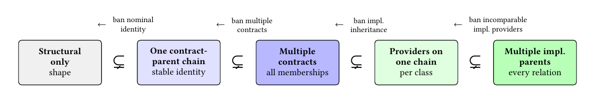
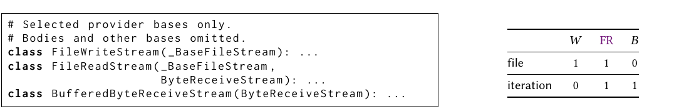
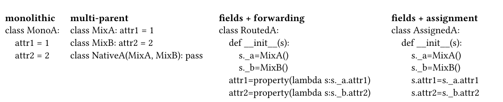
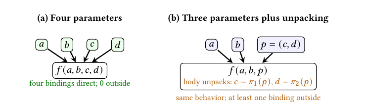
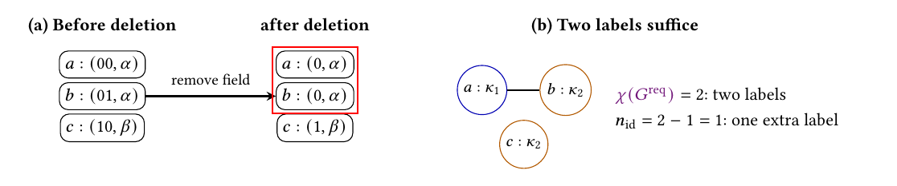

# Semantic Completeness for Correct Maintenance: A Strict Hierarchy of Typing and Inheritance

Paper1, the OOPSLA 2027 submission, converted to text: part 1 of 4. Read the parts in order. Figures and tables are PNG files in `figures/`, linked where they appear.

ANONYMOUS AUTHOR(S)

Removing nominal types or inheritance is often defended as reducing developer burden. The cited Java and Go rationales give no objective measure. Correct maintenance minimizes required facts left for code or tooling to supply and repairs forced by changes, while preserving required facts and behavioral correctness as a program’s intended behavior evolves. Semantically complete languages derive all required type identities, interface memberships, and implementation–class pairs as finite requirements evolve. Incompleteness cannot guarantee the optimum. It forces slop: code restating facts that complete languages derive natively once.

In 20 pinned multiple-inheritance Python projects, recovered pairs grouped by declaring class would need code or tooling: 12,880 without inheritance, 8,792 under first parents, 739 under one parent inheriting only required pairs (certified exact), 0 with multiple parents. With code and state in each provider, state-bearing requirements force 236 outside pairs. Java and C# interface defaults supply no instance state. Of the top 150 pure-Python downloads, at least 24 of 65 size-qualified wheels have positive recovered gap (36.9%, 34 unscored).

For independent providers, the minimum covers reparenting, infinite helpers, delegation, and generators. One parent covers all pairs exactly when providers’ class sets nest or do not overlap; likewise for contracts. Look-alike records needing different handling need as many keys as the confusability graph’s chromatic number. As requirements grow and stay tree-shaped, inserting a provider outside the old ancestor path strictly between ancestors forces one-parent repair. Our zero-gap construction repeats it; multiple parents add one edge per change. Bans cannot lower minima at fixed design costs; savings require otherwise choosing worse than the best.

CCS Concepts: • Software and its engineering → Data types and structures; • Theory of computation → Type theory; Computability.

Additional Key Words and Phrases: semantic completeness, typing, inheritance, schema evolution, correct maintenance, Lean

ACM Reference Format:

Anonymous Author(s). 2027. Semantic Completeness for Correct Maintenance: A Strict Hierarchy of Typing and Inheritance. In Proceedings of ACM SIGPLAN International Conference on Object-Oriented Programming, Systems, Languages, and Applications (OOPSLA 2027). ACM, New York, NY, USA, Article 1, 31 pages.

## 1 Introduction

Languages differ in their built-in support for types, interfaces, and shared code. Removing mechanisms such as nominal types or inheritance is often defended as reducing developer burden. We objectively count the required facts left for code or tooling to supply and the repairs forced to preserve behavioral correctness as intended behavior evolves. We prove which counts mechanism removal makes irreducible. As functionality is added, the program must preserve its existing required behavior.

SWEBOK states the goal: cost-effective support and integrity-preserving modification [85]. We prove the fewest required facts code or tooling must supply to preserve that integrity.

If another language feature always does the same job at no extra cost, removal leaves the best cost unchanged (Lemma 1.1). Java links feature removal to reduced programmer burden and Go credits implicit interfaces with less bookkeeping [28, 79]. Meanwhile Java 8, C# 8, and Swift 2 added stateless multiple method providers, and PHP 5.4 added traits that also carry properties [5, 43, 50, 53, 54].

A code provider, or provider, is the class declaring an implementation. A class combines its own members with the union of its parents’ member sets [16]; with one parent, it inherits only that parent’s members. Precedence resolves same-name conflicts (Theorem 4.17). Read from the provider’s side, the same relation groups the consumer classes needing its code. In Figure 2, AnyIO’s file provider supplies the writer and file reader; its iteration provider supplies the file and buffered readers. The groups overlap at the file reader, but neither contains the other: a crossing. One parent puts a class’s providers on one ancestor chain. It supplies every required pair only when their class groups fit a tree. Multiple inheritance supplies code, descriptors, or state from incomparable parents and derives crossings. Adding functionality can still force extra changes to inheritance or forwarding, even when each version fits a tree. A parent declaration brings its members into the child. A field stores an object; code or tooling exposes its needed members on the containing object (Figure 3).



*Fig. 1. Native capacities form one strict chain (arrows: bans). Fills: gray, shape; blue, contracts; green, implementation; darker, multiple parents. Languages may sit off-chain; AnyIO witnesses both parent steps (§4).*



*Fig. 2. AnyIO crossing (selected providers) [4]. The file writer (𝑊 ) needs file lifecycle; buffered reader (𝐵), iteration; file reader (FR), both. Neither group contains the other.*

```text
# Selected  provider   bases  only.
# Bodies  and  other  bases  omitted.                                                    𝑊    FR   𝐵
class  FileWriteStream(_BaseFileStream):      ...
class  FileReadStream(_BaseFileStream    ,                                     file       1    1   0
                        ByteReceiveStream):    ...                             iteration  0    1   1
class  BufferedByteReceiveStream(ByteReceiveStream):        ...
```



*Fig. 3. Same shown outputs, different facts for code to maintain as providers evolve. Inheritance derives both pairs; fields need routes. The monolith loses MixA and MixB’s required independent identities.*

```text
monolithic    multi-parent                     fields + forwarding                   fields + assignment
class MonoA:  class MixA: attr1 = 1            class RoutedA:                        class AssignedA:
  attr1 = 1   class MixB: attr2 = 2              def __init__(s):                      def __init__(s):
  attr2 = 2   class NativeA(MixA, MixB): pass      s._a=MixA()                            s._a=MixA()
                                                   s._b=MixB()                            s._b=MixB()
                                                 attr1=property(lambda s:s._a.attr1)      s.attr1=s._a.attr1
                                                 attr2=property(lambda s:s._b.attr2)      s.attr2=s._b.attr2
```

A checked local refactoring. Figure 2’s writer must not gain iteration; its memory-backed buffered reader must not gain file lifecycle. This local relation has 4 pairs; every sound one-parent hierarchy (only required pairs) leaves at least 1 outside; the best leaves exactly 1. Section 5 measures AnyIO’s whole-project requirements. The file reader inherits ByteReceiveStream and forwards file lifecycle to _BaseFileStream, retaining membership. Checks replace provider bodies before construction; forwarding uses the replacements. Names and descriptor kinds stay fixed, with no cooperative-super extensions. 3,934 upstream tests pass. The outside pair needs __init__, aclose, and extra_attributes: eight (2 3 ) ways to keep or omit them, all seven incomplete ones failing the read/metadata/close client. Supplement §9.6 gives the contract, executable refactoring, source checks, and test limits.

Workarounds can preserve required facts and behavioral correctness. At a crossing, sound one-parent workarounds still supply at least 𝑑 ↓ > 0 outside pairs and fail correct maintenance



*Fig. 4. A parameter limit illustrates the answer-count unit. Four bindings fit four parameters; three leave at least one outside. Tuple construction and projection restore it automatically if compiler-derived; otherwise, the developer supplies it.*

(Theorem 4.6). 1 We count required facts: extra identity names, class–contract memberships, and implementation–class pairs. Each required answer must be supplied. Lines measure encoding length; the gap counts facts even the best one-parent hierarchy leaves to code or tooling. Price outside work however you like. Multiple parents remain strictly cheaper on every crossing exactly when doing any outside work costs more than doing none. Bundling and bulk discounts do not change that test (Supplement Theorem 4.2). Unit charges give exact counts (Proposition 4.16). Batching shares an operation’s positive cost across facts still requiring supply (Corollary 6.2).

Slop is code restating required facts that a semantically complete language derives natively from their original declarations. Those declarations need stating only once. Slop is the boilerplate compensating for incompleteness. We count the restated facts. Under sound one-parent ancestry, Cunningham’s supply debt [17, 23] splits into 𝑑 ↓ required pairs code or tooling supplies even under the best hierarchy, and 𝑒 𝐻 extra pairs that hierarchy refactoring removes (Theorems 4.6, 4.3). Like garbage in a collected heap, slop is determined by the current program and mechanism, whatever its origin. SlopCodeBench’s agent-code verbosity and structural-erosion measures are heuristic [52]; our fact and repair counts have exact definitions.

Code or generators must encode the missing facts. Packing four values into Figure 4’s three parameters still leaves a fourth binding. The compiler may derive it, or the body must unpack it. With ancestry and generator fixed, 𝑀 possible sets of missing required facts need ⌈log 2 𝑀⌉ input bits regardless of source length (Proposition 4.9).

Deleting a field can make separately declared types look identical while needing different handling. Sharing a representation requires identical handling after every supported change. Otherwise retain a distinguishing key, update references to replacement representations, or enforce a precondition excluding collisions. No helper using the identical record recovers the distinction (Section 3). Contracts state guarantees a class must satisfy; interfaces are a familiar way to declare contracts. Contract membership supplies no code.

Preserving required facts means decoding each case to its specified answer. Exact supply 𝑅 𝐷 = 𝑅 req means no missing or unrequired pairs. Figure 1’s strict witnesses leave some facts outside under the lower rung and none under the upper. Witsenhausen forces the key minimum [86]; tree-shaped sets force the membership and ancestry minima (Sections 3–4).

Correct maintenance. Correct maintenance minimizes the required facts left for code or tooling to supply and the repairs forced by changes, while preserving required facts and behavioral correctness as a program’s intended behavior evolves. With nominal identities fixed, multiple contract and implementation parents leave zero outside supply and repair counts through any finite sequence of code and interface requirements. Each lower rung fails on a named witness (Section 4).

A semantically complete language derives all required type identities, interface memberships, and implementation–class pairs as finite program requirements evolve (Figure 1’s top rung). A ban or technical limitation can make it incomplete. Behavioral correctness alone does not establish correct maintenance: crossings force outside supply even in the best sound one-parent hierarchy. Pairs still supplied by workarounds count at each update, even if their code stays unchanged. Bugfixes need not change 𝑅 req (Proposition 4.16).

Footnote: 1

Footnote: Symbols link to the notation appendix, with plain-language readings and AnyIO values; the supplement opens with the same table. Proof codes identify Lean declarations listed in Supplement §§15–16.

The ancestry gap 𝑑 ↓ is the fewest outside pairs under sound one-parent ancestry (only required pairs), keeping independently changing code providers distinct. Reparenting, unlimited helpers, replication, delegation, and tooling cannot lower it (Theorems 4.6, 4.7; Proposition 4.9). Positive removal charges keep crossings costly; charges at least 𝑑 ↓ recover the gap (Theorem 4.11). Multiple parents leave zero outside implementation pairs: Pareto dominance on these counts (Corollary 4.12). Tree-shaped futures cannot be certified exactly (Theorem 4.20) and strict insertions force repair (Theorem 4.14). If adoption costs less per update than the workaround, savings eventually repay finite setup (Corollary 6.2).

No rule reading only successful outputs and ancestry can distinguish zero from positive gap. Reading ancestry, removals, and outside routes recovers 𝑅 req exactly (Corollary 4.10).

If a ban removes choices without changing each remaining design’s cost, it cannot make the cheapest choice cheaper, even when adding costs across projects. Savings require people otherwise to choose a more expensive design; the cited rationales do not measure those choices (Section 6.5).

Lemma 1.1 (Capacity containment orders the maintenance optimum) 2 . Fix requirements, histories, and cost. Designs in this comparison preserve required answers and behavior. Enlarging their set never raises its minimum. For attained minima, removal preserves it iff an optimum remains, and strictly raises it otherwise. A dominated feature has a retained answer- and behavior-preserving replacement costing no more per design using it, so removal preserves the minimum. Apply coordinatewise.

Each left-to-right step in Figure 1 derives more required facts; in reverse, it is a language or project-policy ban. Adjacent rungs can tie today; an allowed change can leave more facts for code or tooling under the lower rung.

For requirements recovered from 20 pinned Python projects, code or tooling would supply 12,880 pairs without implementation inheritance, 8,792 under declared first parents (91.6% removable excess), 739 under the best sound one-parent hierarchy (certified), and none with multiple parents (Proposition 4.2; measurements: Section 5); pip and aiobotocore have gap zero. Unknown cases stay unscored; these are exact counts for the recovered requirements.

Contributions and reader map.

(0) Five-rung strict hierarchy (Figure 1; Lemma 1.1). Colliding meanings, crossing memberships, nonempty implementation demand, and crossing providers witness its four strict steps.

Theorem 3.2 gives the identity-key minimum across histories.

(1) Minimum outside supply (Theorem 4.6). For distinct providers on one sound ancestor chain per class, the gap is the attained minimum even with infinite helpers, delegation, or generators.

Providers sharing a class are comparable, forcing class sets to nest or not overlap.

(2) Repair across updates (Theorem 4.14). New functionality can require a provider absent from a class’s ancestry. Every strict insertion forces one parent to delete an edge carrying a still-required pair or use forwarding or removal before or after the change. Our program evolution repeats this insertion with gap zero in every version; multiple parents add one edge per change. Standing one-parent routes need not change.

(3) Conflicts survive refactoring (Theorem 4.17). With fixed member names, every answer-preserving design pays the same 𝑘 specified lookup choices; sound one-parent ancestry adds at least 𝑑 ↓ outside pairs.

Footnote: 2

Footnote: OPT13, OPT17-19

(4) Measured minima and omission tests (Sections 3 and 5). The installable analyzer returns bounds and checked designs.

Theorem 6.1 separates behavioral validity from requirement choice; Section 6 prices adoption. Supplement §§9, 1 give certificates and distinguish answers, operations, and costs; Table 1 separates foundations from extensions.

## 2 Representations Must Preserve Every Required Fact

Fix requirements before choosing a representation. Behavioral correctness means every reachable behavior satisfies the program’s requirements: Reach 𝑡 (𝐷) ⊆ Valid 𝑡 [7, 31]; see Supplement §2 for missing and unwanted pairs D (𝐻, 𝑅 req ). If the required answer is the full set of permitted outputs, returning one permitted output does not answer that question; executing one output is a different requirement.

Let 𝑋 contain every interface input, V ans the answers (including output sets), and 𝑎 : 𝑋 → V ans the specification. Encoding 𝑒 : 𝑋 → E with decoder 𝑟 : E → V ans preserves required answers iff 𝑟 (𝑒 (𝑥)) = 𝑎(𝑥) for every 𝑥. The program presents 𝑒 (𝑥); the decoder must recover 𝑎(𝑥). Refinement decides whether such a decoder exists. Swapping required and forbidden cases keeps their groups but changes permitted behavior.

For schemas, field deletion can make separately declared types look identical while requiring different interpretations. 𝑋 = 𝐶 tracks meanings across edits; 𝑒 is the visible record plus any retained identity key. Write 𝑝 : 𝐶 → V for the current record. A decoder from 𝑝 exists on every reachable value exactly when same-looking meanings need the same answer: 𝑝 (𝑥) = 𝑝 (𝑦) =⇒ 𝑎(𝑥) = 𝑎(𝑦). This characterizes safe erasure.

A helper computed from 𝑝 cannot distinguish same-looking meanings; a nominal key can.

Only reachable states count. Leaked information or undeclared side channels change what the decoder can inspect.

A retained identity key 𝜎 : 𝐶 → 𝑇 makes required answers recoverable when 𝑝 (𝑥) = 𝑝 (𝑦) ∧ 𝜎 (𝑥) = 𝜎 (𝑦) =⇒ 𝑎(𝑥) = 𝑎(𝑦). A key can outlive the distinguishing fields; it separates cases that 𝑝 makes alike but 𝑎 distinguishes.

req

For inheritance, 𝑅 𝑡 lists the required implementation–class pairs, and 𝑅 𝐷 lists those supplied req req by ancestry or explicit routes. Soundness requires 𝑅 𝐷 ⊆ 𝑅 𝑡 ; completeness requires 𝑅 𝑡 ⊆ 𝑅 𝐷 .

req

Exact supply requires both, so 𝑅 𝐷 = 𝑅 𝑡 : every required pair is supplied and every forbidden pair is absent.

Correct maintenance. Let 𝑂 𝑡 (𝐷) count facts left to code or tooling at 𝑡. Take coordinatewise infima over design histories preserving required answers and behavioral correctness, 𝐷 ∈ D complete (H ):

Maint ∗ (H ) = (inf 𝑂 𝑡 (𝐷)) 𝑡 , inf 𝐵 rep (𝐷) .


𝐷 𝐷

Mechanism 𝑚 attains correct maintenance iff some 𝐷 ∈ D 𝑚 (H ) reaches this ideal. Behavioral correctness and exact supply are prerequisites; correct maintenance also minimizes the counts.

Every rung satisfies D 𝑚 (H ) ⊆ D complete (H ): the complete mechanism retains forwarding, registration, and generation. Thus the ideal compares designs across the whole hierarchy (Lemma 1.1). Repair obligations form one sum, 𝐵 rep : parent-edge deletions carrying still-required pairs, plus missing or removed pairs before and after each update. The history fixes changes to required facts. Complete supply attains zero on every finite declared supply history, including removals; lower supply rungs fail on single-version examples (Corollary 4.12; Supplement §4.5).

Every representation bound fixes an arbitrary finite declared relation before choosing a mechanism. Reshaping requirements changes the specification (Corollary 4.19); no algorithm certifies all and only tree-shaped futures (Theorem 4.20), and strict insertion between tree-shaped versions forces one-parent repair (Theorem 4.14(0)). Name each required fact’s declaration, required and forbidden cases, and independent changes. Unknown or external cases stay unscored; including them requires recomputing the relation and gap. Section 5 recovers pinned-source relations.

Refactorings preserve every required fact on every reachable input. Identical fields or base lists today do not justify merging declarations. Merge only when no required fact distinguishes them through any supported change. Otherwise, share agreeing implementations and keep identities distinct (Theorem 4.8); changing a required fact changes the specification (Corollary 4.19). Ruling out missing connections needs the complete map. Untested reachable states can still fail. Naming costs and ancestry gaps are independent (Section 6.3).

## 3 Incomplete Typing Forces Separately Maintained Keys

Record structure alone suffices only when cases that can look alike need the same handling through every supported change. Otherwise retain an identity key. TypeScript unique symbol brands retain the distinction through separately maintained identity keys; nominal typing records it directly. Runtime identity needs a key the running program retains: runtime brands store and check a symbol-keyed member. Type-only (phantom) brands are erased and cannot prevent runtime forgery [39, 40, 44, 45].

Choose finite meanings, their possible record changes, and required handling. Figure 5 shows the collision and its minimum naming cost.

Proposition 3.1 (Same structure can hide different meanings) 3 . A test based only on structure recovers the required answer exactly when every same-looking group needs one answer. An independent nominal key can always make the record and key together sufficient and may be constant when structure suffices. A reachable extension can add a same-looking meaning on which every test based only on structure fails while distinct nominal names still distinguish the meanings.



*Fig. 5. (a) Deletion merges 𝑎 and 𝑏’s visible records and tags, although they require 𝐴 1 and 𝐴 2 ; 𝑐 also requires 𝐴 2 . (b) Their edge forces two labels, one beyond a shared label. Isolated 𝑐 can share either; shown sharing 𝑏’s.*

Adding a same-looking meaning forces structural identity evidence to change; one nominal naming rule still distinguishes them without change. Starting with no declaration, nominal evidence costs one addition; structural then nominal costs two additions; replacing structural with nominal costs three changes: two additions and one removal. Supplement §3 compares these three paths.

To count the needed names, join two meanings when a reachable state makes them look alike although they still require different handling. These edges form the confusability graph. Write 𝑉 𝑡 for the meanings present at 𝑡, 𝑥 ≡ 𝑡 𝑦 for equal visible records, and 𝑥 ≈ req 𝑦 for equal required answers. For a trace 𝜌, req ⇐⇒ 𝑥 0 req 𝑦 and ∃𝑡 : 𝑥, 𝑦 ∈ 𝑉 𝑡 and 𝑥 ≡ 𝑡 𝑦. (1)

{𝑥, 𝑦} ∈ 𝐸 (𝐺 𝜌 )

For the specified ways requirements may evolve, 𝐺 req is the union over their reachable traces. Colors are key values; meanings joined by an edge must have different values.

Footnote: 3

Footnote: PD1, IDD1-5, EVO23-30, NHF3-5, NHF11, OWM1, IMR1-5

Theorem 3.2 (Fewest stable key values) 4 . A key assignment is safe at every reachable state exactly when it gives different keys to the endpoints of every edge. The fewest stable key values across the declared reachable histories is the chromatic number of 𝐺 req , even when today’s records differ.

For a nonempty relation, one constant key value requires no maintained name. Additional names therefore number 𝜒 (𝐺 req ) − 1. When each package has its own key namespace, add each package’s 𝜒 − 1 extra names; this can differ from 𝜒 − 1 of the union graph.

Stable identity across histories. Identity keys valid today can fail after an edit. Across supported changes, retain every distinction the decoder needs. Witsenhausen supplies the coloring rule [86].

Finite policies can be checked. For arbitrary generators, unsafe cases have finite counterexamples, but no checker certifies exactly all safe futures, even with two meanings and finite views (co-r.e.-complete) [64]. Supplement §§5–7 give fixed-field constructions and known-schema bounds.

Declarations expose distinctions; they do not create them. Audits reconstruct conflict graphs from sampled versions. Across 439 Temporal Protocol Buffer snapshots and 4,020 message–number slots, 50 fields were deleted, 36 unreserved; 8 numbers later changed name, type, cardinality, or oneof group. The graph needs 2 keys. Reservation at deletion excludes each reuse and enforces safe erasure [57, 78]. It does not recover erased identity from structure. Supplement §10 gives certificates.

The TypeScript audit identifies public brands by module path, kind, and name, using normalized declarations with brand markers stripped. It finds 200 distinct brands in 19 of 150 packages. Exact package-local minima require 7 extra names. History-only edges occur in 5 packages, forcing 4 of the 7; expect-type’s historical edge leaves its chromatic number unchanged. Without brand markers, type-fest 4.3.3’s MultiTagContainer and TagContainer look alike: two permanent keys for sampled history, one for the latest snapshot. Separately, 102 of 200 meanings lack verified runtime identity evidence. The remaining 131 of 150 packages are unscored. Supplement §11 gives the protocol, certificates, and runtime-evidence rules [49].

A Go 1.0–1.26 audit excludes methods promoted from embedded types. Across packages, it tries to identify named types using only nonempty lists of directly declared method signatures [80]: 40 extra names (41 keys) for values, 75 (76) for pointers, matching the worst sampled states (Supplement §12).

Nominal identity never needs more extra keys across supported changes; look-alikes needing different handling make the advantage strict. 5 Names distinguish meanings; contract membership asks which classes are admitted. An ordinary abstract base class (ABC) has no shape-accepting __subclasshook__, unlike some collections.abc classes. Inheritance admits owned members; ABC.register admits unowned members and descendants; implementations still need supply [60].

Proposition 3.3 (Structural contracts admit unwanted members) 6 . Assume every required member matches the contract. Structural membership is exact through every supported change exactly when every reachable match is required. Nominal inheritance or registration is exact when its admitted declarations are exactly the required members and membership is closed under descendants. An unwanted reachable match refutes structural membership; nominal admission still follows its declared edges.

Registration adds a contract edge outside the class body; descendants inherit membership through it. Registries without descendant propagation are outside layers (Theorem 4.4). A supported extension can add an unintended member with the required shape. A structural check admits it. Only an enforced admission rule excludes that case; ownership alone does not. Protocol inheritance does not exclude unrelated matches. Runtime membership is weaker still. 7

Footnote: 4 EVO17-18 5 HVD3, HVD4, HVD7 6 SCM1-4 7 Without @runtime_checkable, isinstance raises; with it, checks

Footnote: require only attribute presence, so different signatures can still match [36, 62].

Identity keys distinguish meanings; inheritance supplies code. Section 4 counts missing pairs.
