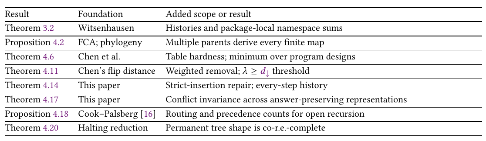
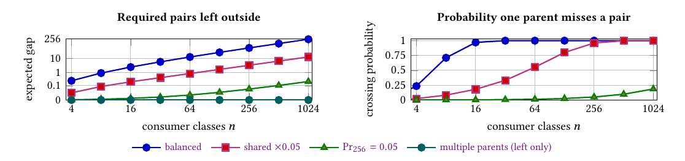
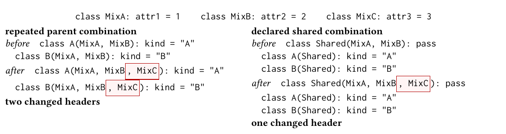
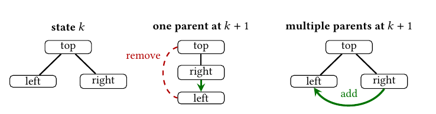

# Semantic Completeness for Correct Maintenance: A Strict Hierarchy of Typing and Inheritance

Paper1, the OOPSLA 2027 submission, converted to text: part 2 of 4. Read the parts in order. Figures and tables are PNG files in `figures/`, linked where they appear.

## 4 Incomplete Inheritance Forces Code into Workarounds

In the declared table 𝑅 req , rows are independently changing shared implementations and columns are classes; (𝑓 , 𝑐) ∈ 𝑅 req means 𝑐 needs 𝑓 . Contract parents supply no implementation. One implementation parent places each class’s code providers on one ancestor chain; multiple parents allow incomparable providers. Code supplies implementations lost when an inheritance path is removed. We count two kinds of compensation: forwarding a missing pair and removing an unwanted one.



*Table 1. Established foundations and what this paper adds.*

```text
Result          Foundation          Added  scope or result
Theorem 3.2     Witsenhausen        Histories and package-local namespace sums
Proposition 4.2 FCA; phylogeny      Multiple parents derive every finite map
Theorem 4.6     Chen  et al.        Table hardness; minimum over program designs
Theorem 4.11    Chen’s flip distance Weighted removal; 𝜆 ≥ 𝑑 threshold
                                                           ↓
Theorem 4.14    This paper          Strict-insertion repair; every-step history
Theorem 4.17    This paper          Conflict invariance across answer-preserving representations
Proposition 4.18 Cook–Palsberg [16] Routing and precedence counts for open recursion
Theorem 4.20    Halting reduction   Permanent  tree shape is co-r.e.-complete
```

In Figure 2, the writer needs only file code, the buffered reader only iteration, and the file reader both: a crossing with four required pairs. Keep iteration ancestry for both readers and file ancestry for the writer; forward the file reader to its file provider. Three pairs are inherited and one is outside. The exact gap is one even with helpers or generators (Theorems 4.5, 4.6). Additivity forces a sum of per-pair prices; unit charges count these pairs (Proposition 4.16).

An implementation’s required set lists the classes needing it. One parent supplies every pair exactly when any two sets nest or do not overlap: the family is laminar, or tree-shaped.

Declarations 𝑁 include consumer classes 𝐶. Implementation 𝑓 lives in its distinct provider declaration 𝑜 𝑓 and is required by 𝐴 𝑓 ⊆ 𝐶. Write 𝑜 𝑓 ⪯ 𝑐 when 𝑐 inherits from 𝑜 𝑓 ; providers are comparable when one is an ancestor of the other. For a guided reading of the symbols, use the supplement’s opening table: plain-language meanings in dependency order, with Figure 2 values where applicable.

Putting independently changing code in separate provider classes does not increase the least forwarding the program needs.

Proposition 4.1 (Separate providers cannot increase outside supply) 8 . Separate providers cannot increase minimum one-parent outside supply. In a fixed hierarchy, each implementation may use its largest available descendant set contained in its required set; equal required sets may all use the largest of their retained sets.

If class 𝑐 does not inherit implementation 𝑓 , 𝜑 (𝑓 , 𝑐) chooses a forwarding destination 𝑣. In routing graph Γ, 𝑐 → 𝑣 is one forwarding edge; 𝑐 → ∗ 𝑣 follows zero or more. Read 𝑓 @𝑐 as “class 𝑐 can reach an implementation of 𝑓 ”:

𝑓 @𝑐 ⇐⇒ 𝑜 𝑓 ⪯ 𝑐 ∨ ∃𝑣. 𝜑 (𝑓 , 𝑐) = 𝑣 ∧ 𝑜 𝑓 ⪯ 𝑣 ∧ 𝑐 → ∗ 𝑣.

Per-pair forwarding, nonpropagating registries, adapters, and generated routes supply missing pairs outside ancestry. Native delegation has its own capacity: Kotlin’s by forwards an interface with one declaration; Rust’s Deref lets member access follow one target chain [34, 66]. Stein models delegation as inheritance [73]; per-pair delegation here is outside supply included in the outside-supply minimum. Copies supply pairs the original provider’s ancestry misses; copying its body does not make the consumer inherit it (Theorem 4.7).

Footnote: 8

Footnote: NHF35-41

Propagation through ancestry. An unoverridden method added to a code provider reaches every required class through ancestry exactly when that provider has no outside pair; otherwise, forwarding code or its shared rule must supply the missing routes. In Figure 2, a new ByteReceiveStream method reaches the file and buffered readers. After changing to one parent, a new _BaseFileStream method reaches the writer directly, but the file reader only if its forwarding code or rule covers it.

Proposition 4.2 (One parent suffices exactly for tree-shaped requirements) 9 . Give each independently maintained implementation one provider. Multi-parent ancestry derives every required pair for every finite family of required sets without outside routes. One-parent ancestry derives every required pair exactly when the required sets are tree-shaped. The result concerns reachability only; it assumes neither mutable state nor a rule for selecting among competing implementations. Python base orders must be C3-consistent, placing subclass bases before their ancestors.

Proof. Use nodes 𝐹 ⊎ 𝐶 with 𝑐 → 𝑓 for 𝑐 ∈ 𝐴 𝑓 . For dual-role declarations, keep identity and contracts; put implementation on a separate helper. One-parent paths nest sets; conversely, inclusion builds the laminar tree, chaining ties and keeping empty sets off-path [27, 30, 72]. □

Supply counts which classes inherit state-bearing implementations; specified sharing, initialization order, and lookup winners are separate (Section 4.1). Layout, mutation, and copying have additional runtime and storage costs. Replicas still supply pairs (Theorem 4.7); state-access lookups fix candidates and winners (Theorem 4.17).

Choose required relation 𝑅 req and implementation supply 𝐻 . The pairs needing repair are D (𝐻, 𝑅 req ) = (𝑅 req \ 𝐻 ) ⊎ (𝐻 \ 𝑅 req ): missing required pairs and unwanted supplied pairs. Ancestry is sound when it supplies only required pairs (𝐻 ⊆ 𝑅 req ).

Missing and unwanted supply. Supply is exact iff 𝐻 = 𝑅 req , equivalently D (𝐻, 𝑅 req ) = ∅. On finite relations, |D (𝐻, 𝑅 req )| = |𝑅 req \ 𝐻 | + |𝐻 \ 𝑅 req |. Additions alone restore exact supply iff 𝐻 ⊆ 𝑅 req : supply every missing pair. Unwanted pairs require removal or changed requirements. 10

The ancestry gap is the fewest required pairs that a sound one-parent hierarchy leaves outside. Retain as many required pairs as possible while their class groups fit one tree:

∑︁

𝑑 ↓ (A) = |𝐴 𝑓 \ 𝐴 nat min 𝑓 |.

𝐴 𝑓 ⊆𝐴 𝑓 𝑓 ∈𝐹 nat

{𝐴 nat :𝑓 ∈𝐹 } laminar

𝑓

A deleted 1 leaves code or tooling to supply an implementation the class still needs but no longer inherits. A crossing describes required groups; the gap counts pairs that sound one-parent ancestry cannot derive. The definition optimizes tables; Theorem 4.6 shows that every program design in its scope reduces to this optimization.

Counting the hierarchy. The three coordinates count extra identity names, outside memberships, and outside implementation pairs. Figure 1’s rungs leave:

Footnote: 9 10

Footnote: NHF7, NHF20, NHF44-45, NHF50-51 SCT46-51, BWR29, BWR37-39, BWR52, BWR57

Extra Outside Outside

Native capacity identity names memberships code pairs Computing the minimum Structural only |𝑀 req | |𝑅 req | Graph coloring (§3)

𝑛 id

One contract parent 𝑑 ↓ (𝑀 req ) |𝑅 req | Deletion search (§4.2)

0

Multiple contracts |𝑅 req | Count required pairs

0 0

One implementation parent 𝑑 ↓ (𝑅 req ) Deletion search (§4.2)

0 0

Multiple implementation parents 0 0 0 Direct edges (Prop. 4.2)

Deciding whether one parent can leave at most ℓ pairs outside is NP-complete; a four-way search finds the minimum (§4.2). The last column concerns finding an optimal representation; runtime execution is priced separately. Here 𝑛 id = max{𝜒 (𝐺 req ) − 1, 0}; 𝑀 req lists required memberships. Across supported changes, structural |𝑀 req | requires a reachable unwanted match per contract (Proposition 3.3). Real languages combine capacities off this chain (Table 4); Lemma 1.1 orders capacities coordinatewise. Contract and implementation graphs can differ; Theorem 4.4 prices sharing one, and Theorem 4.14 covers updates.

Theorem 4.3 (The exact price of inheritance incompleteness) 11 . For every finite required provider– class relation, retaining distinct providers even when their required sets are equal:

(1) adding missing pairs restores exact supply exactly when ancestry is sound. Every such repair maintains a distinct answer for each required pair that ancestry misses;

(2) inheriting only contracts supplies no implementation pair, so its outside cost is |𝑅 req |;

(3) for every sound one-parent hierarchy 𝐻 , |D (𝐻, 𝑅 req )| = 𝑑 ↓ + 𝑒 𝐻 , where 𝑒 𝐻 ≥ 0 counts this hierarchy’s excess outside supply and vanishes exactly at the optimum. Refactoring removes

𝑒 𝐻 ; sound one-parent supply always costs at least 𝑑 ↓ .

(4) multi-parent ancestry with distinct providers supplies exactly every finite required relation and has outside cost zero. 12

Theorem 4.4 (Contract membership obeys the same gap law) 13 . Let 𝑀 req ⊆ 𝑇 × 𝐶 declare nominal contract memberships. One-parent graphs derive every membership exactly when member sets are tree-shaped. Over all sound one-parent graphs and membership-preserving outside layers, the exact outside minimum is 𝑑 ↓ (𝑀 req ); multiple parents leave zero. Additions cannot cancel unwanted inherited membership, hence soundness. Independent contract and implementation graphs have joint minimum 𝑑 ↓ (𝑀 req ) + 𝑑 ↓ (𝑅 req ), counting disjoint answer types.

If one parent graph carries both relations, its exact minimum is 𝑑 ↓ (𝑀 req ⊎𝑅 req ) ≥ 𝑑 ↓ (𝑀 req )+𝑑 ↓ (𝑅 req ). For a strict witness, let 𝑀 req have the single row {𝑊 , FR} and 𝑅 req the single row {FR, 𝐵}: separate gaps zero, shared gap one. A declaration serving contract class set 𝐴 and implementation class set 𝐵 leaves at least |𝐴 △ 𝐵| outside; keeping 𝐴 ∩ 𝐵 is optimal. An implementation-only declaration separates the graphs, as AnyIO’s private file base does.

Contract and implementation incompleteness obey the same one-parent law. Registries or generated tables still determine omitted memberships. The hierarchy’s four strict steps use Figure 5’s identity collision, AnyIO’s crossing declared as memberships, any nonempty 𝑅 req , and Figure 2’s implementation crossing.

A tree-shaped map has zero gap but its updates can force deletion, forwarding, or removal (Theorem 4.14); Corollary 6.2 prices the recurring obligation.

### 4.1 Inheritance supplies candidates; MRO orders them

Python’s C3 method resolution order lists ancestors; member lookup uses the first definition and cooperative super() continues through that order [9]. A resolver cannot choose a missing implementation. Supplement §8 proves that coherent resolution follows one strict precedence order. Multiple parents supply every candidate; only genuine conflicts need ordering. A one-parent refactoring must preserve lookup choices while supplying missing implementations.

Footnote: 11 12 13

Footnote: SCT1-4, SCT20-26, SCT30-32, SCT52-55 BWR42, SCT23, SCT30-34 CAP2-7, CPL1-4

Specified lookup winners, state sharing, and initialization order are representation-invariant, outside the supply triples (Theorem 4.17; Supplement Theorem 8.1). With the same state requirements, multiple parents still permit every one-parent and composition design (Corollary 8.5). A shared ancestor creates a diamond; conflicts require competing definitions. C++ virtual bases and Python’s instance namespace decide sharing. Zero outside supply while meeting state requirements needs a compatibility proof; Python’s lookup/initialization coupling costs exactly one outside answer in the two-class witness (Supplement §8.1). The specification fixes these answers for every representation; layout has a separate runtime price.

Sequential mixin application creates a chain and orders lookup [12, 25]; repeated applications create replicas (Theorem 4.7).

### 4.2 Crossings force pairs outside ancestry

The file reader needs both file-lifecycle and iteration code; the writer needs only file code, and the buffered reader only iteration. With one parent per class, at least one of these four required pairs needs forwarding or other code. The best design leaves exactly one outside inheritance. The following formula counts the minimum for any two implementations.

Theorem 4.5 (Exact gaps for two implementations and a row–column grid) 14 . For two required sets 𝐴, 𝐵, let 𝑁 10 = |𝐴 \ 𝐵|, 𝑁 01 = |𝐵 \ 𝐴|, and 𝑁 11 = |𝐴 ∩ 𝐵|. Then 𝑑 ↓ (𝐴, 𝐵) = min{𝑁 10 , 𝑁 01 , 𝑁 11 }. The three terms count the pairs dropped to fit one tree: drop 𝐴’s implementation from 𝐴-only classes, drop 𝐵’s from 𝐵-only classes, or drop one implementation from classes needing both. The retained sets then satisfy 𝐴 ⊆ 𝐵, 𝐵 ⊆ 𝐴, or disjointness. For the deterministic ℎ × ℎ row–column domain, give each of the 𝑛 = ℎ 2 classes its row implementation and its column implementation. No implementation inheritance

√ leaves all 2𝑛 pairs outside, one implementation parent leaves 𝑑 ↓ = ℎ(ℎ − 1) = 𝑛 − 𝑛, and multiple implementation parents leave zero.

For independent classes, cell probabilities 𝑞 00 , 𝑞 10 , 𝑞 01 , 𝑞 11 mean neither, only 𝐴, only 𝐵, or both. With 𝑞 min = min{𝑞 10 , 𝑞 01 , 𝑞 11 } > 0, zero-gap probability lies between (1 − 𝑞 min ) 𝑛 and 3(1 − 𝑞 min ) 𝑛 (exact inclusion–exclusion proof: Supplement §4.9). 15 Figure 6 plots this exact law: the crossing probability reaches 0.99 at 𝑛 = 20 with balanced regions; making the shared region 20 times rarer moves that point to 367; a source with Pr[𝑑 ↓ > 0] = 0.05 at 𝑛 = 256 reaches 0.99 by 𝑛 = 22,984 (off-axis). Guaranteed avoidance must exclude a crossing region, restricting requirements to tree shape.

Tree shape decides whether one parent derives every pair in a finite requirement table. Deleting at most ℓ pairs to reach it is NP-complete: Chen et al.’s deletion-flip problem on complete 0/1 tables [13, Theorem 2.2 and Corollary 3.1]. Their four-way search deletes one of a crossing’s four pairs [13, Theorem 5.1]. Lean checks this step; the audit replays the search. Supplement §9.9 gives both finder runtimes and distinguishes deletion-only from minimum-flip search.

### 4.3 The table minimum holds over every program design

Java hierarchy work treats classes and interfaces separately [8, 48, 72, 74]; FCA and phylogeny characterize tree fit [27, 30]. Chen et al. minimize table deletions [13]; Theorem 4.6 lifts their minimum to programs with helpers and generated forwarding. Felleisen studies local, structurepreserving translations [24]; we count facts left to code and repairs across updates. Assignment expressions illustrate the boundary (Supplement §4.7).

Footnote: 14 15

Footnote: AVG1-7 AGP1-7



*Fig. 6. Expected gap (left) and crossing probability (right) for three distributions with independent class draws. Cells (neither, left, right, both) use 𝑞 00 = .25, 𝑞 10 = .5 − 𝑞 11 , 𝑞 01 = .25, and 𝑞 11 = .25, .0125, .0002003444; the last gives Pr[𝑑 ↓ > 0] = .05 at 𝑛 = 256. Left scale: log(1 + gap/.01), retaining zero. Multiple parents: zero outside. Specified synthetic distributions determine these curves.*

One-parent ancestry and one-chain mixins or traits [19, 68, 70] put each class’s providers on a chain in the global ancestor order ⪯. C3 orders Figure 2’s _BaseFileStream and ByteReceiveStream; they remain incomparable in ⪯. Unlike selected type-constraint repairs [84], the minimum covers every design with these ancestry constraints.

For a design 𝑅 with sound ancestry, let 𝐴 nat = {𝑐 : 𝑜 𝑓 ⪯ 𝑅 𝑐} be the classes reached through

𝑓 ,𝑅 ancestry and 𝐺 𝑓 = 𝐴 𝑓 \ 𝐴 𝑓 ,𝑅 the classes it misses.

nat

Theorem 4.6 (The ancestry gap is the minimum outside supply) 16 . Fix any finite required map. Consider every design preserving exact supply that keeps implementation providers distinct and inherits only required implementations, with any two providers inherited by one class comparable in the derivation order. Allow arbitrary reparenting, helper nodes, delegation graphs, and forwarding maps. Providers stay distinct even when their required sets agree; the helper set need not be finite. Then

{(𝑓 , 𝑐) : 𝑐 ∈ 𝐺 𝑓 } ⊆ dom 𝜑 𝑅 , min | dom 𝜑 𝑅 | = 𝑑 ↓ (A).

𝑅

This attained minimum is zero iff the required sets are tree-shaped, positive at every crossing, and strictly below contract-only cost when 𝑅 req ≠ ∅.

Proof. Comparable providers have nested sets; incomparable ones share no class by the onechain hypothesis. Even infinite helpers induce a finite tree-shaped subtable; missing pairs need forwarding. Inclusion represents minimizing sets, empty sets stay off-path, and forwarding attains the bound (Supplement §2.2). Behavioral preservation is separate (Theorem 6.1), checked under AnyIO’s local edit contract (Supplement §9.6). □

Helpers added to fit one chain are slop. With unlimited helpers left uncharged, the best sound design still leaves exactly 𝑑 ↓ outside: positive at crossings, versus zero with multiple parents.

Theorem 4.7 (Copying cannot lower the ancestry gap) 17 . Same-identity declarations agreeing in meaning and required classes are replicas. Choose one as original: every choice has the same required sets and gap; copies supply pairs outside its ancestry. Let 𝐻 ⊆ 𝑅 req be sound one-parent ancestry and 𝐸 ⊆ 𝑅 req its replica-, registry-, forwarding-, or generator-supplied pairs. Completeness implies

𝐸 \ 𝐻 = 𝑅 req \ 𝐻, |𝐸 \ 𝐻 | ≥ 𝑑 ↓ .

This includes replica-only supply. Independently changing copies mean distinct implementations, changing 𝑅 req (Corollary 4.19). Independently edited copies can disagree.

Footnote: 16 17

Footnote: SCT24, SCT27-34 SCT56-59, BWR58-62, SDN17-21

Theorem 4.8 (Merge, share, or separate) 18 . For classes 𝐴, 𝐵, let 𝑚 𝐴 , 𝑚 𝐵 be their full state-to-answer tables over the declared reachable states and 𝑖 𝐴 , 𝑖 𝐵 their implementation answers. An answer-preserving representation minimizing distinctions in full meanings and implementations merges them iff 𝑚 𝐴 = 𝑚 𝐵 ; if only 𝑖 𝐴 = 𝑖 𝐵 , it shares their implementation but keeps their identities distinct; if 𝑖 𝐴 ≠ 𝑖 𝐵 , it keeps their implementations separate. No equal structural profile, even the full inheritance graph, can decode distinct answer histories. In the finite supply case, let 𝑖 𝐴 , 𝑖 𝐵 be the sets of required implementations. If both classes must use one set 𝑋 , the minimum number of answer changes is

 min |𝑖 𝐴 △ 𝑋 | + |𝑖 𝐵 △ 𝑋 | = |𝑖 𝐴 △ 𝑖 𝐵 |.

𝑋

It vanishes exactly when the answers agree; otherwise an answer-preserving replacement of shared code changes at least one class assignment.

Identical code today can need different changes tomorrow. Sharing implementations requires agreement through every supported change. For finite sets, the attained minimum changes one answer per implementation needed by only one class. Shared code need not merge identities.

Figure 7 shows how to factor a declared shared combination; Supplement §2.1 proves all three cases and establishes when a finite migration cost is repaid.



*Fig. 7. When classes must keep the same parent combination, declare it once. Adding 𝑚 later common parents across 𝑛 classes then takes 𝑚 header edits instead of 𝑚𝑛. Identical base lists today do not establish that shared requirement.*

```text
               class  MixA: attr1  = 1     class MixB:  attr2  = 2    class  MixC:  attr3 = 3
repeated parent combination                           declared shared combination
before class  A(MixA,  MixB): kind  = "A"             before class  Shared(MixA,  MixB):  pass
  class B(MixA,  MixB):  kind  = "B"                    class  A(Shared):  kind =  "A"
after class  A(MixA,  MixB , MixC ): kind =  "A"        class  B(Shared):  kind =  "B"
  class B(MixA,  MixB , MixC ):  kind = "B"           after class  Shared(MixA,  MixB , MixC ):  pass
                                                        class  A(Shared):  kind =  "A"
two changed  headers
                                                        class  B(Shared):  kind =  "B"
                                                      one changed  header
```

Proposition 4.9 (Generator inputs distinguish outside answers) 19 . Fix ancestry 𝐻 and a generator. Producing 𝑀 ≥ 1 different outside sets requires at least ⌈log 2 𝑀⌉ fixed-width input bits. All subsets of 𝑑 outside pairs require 𝑑 bits regardless of source length; correlation may lower the bound. A complete tool supplies the missing pairs of Theorem 4.7; a complete checker must identify them (Supplement §4.2).

Corollary 4.10 (Passing runs and ancestry hide requirement shape; supply routes reveal it) 20 . For finite 𝑅 req , tree shape permits exact ancestry-only one-parent supply with 𝑑 ↓ = 0. Otherwise every one-parent representation preserving required supply with sound ancestry supplies at least 𝑑 ↓ > 0 pairs outside. Both branches admit programs supplying every required pair with empty ancestry and identical successful outputs; no rule using only these observations distinguishes zero from positive gap. Conversely, a design supplying exactly the required relation, with ancestry 𝐻 , removal set 𝑈 , and outside routes 𝜑 has 𝑅 req = (𝐻 \ 𝑈 ) ∪ dom 𝜑. The full supply map reveals requirement shape and determines 𝑑 ↓ (𝑅 req ); views omitting part of it can hide that shape. Within Theorem 4.6’s scope, 𝑈 = ∅ and | dom 𝜑 \ 𝐻 | ≥ 𝑑 ↓ (𝑅 req ).

Footnote: 18 19 20

Footnote: SEF1-25 SCT3-7, SCT20-26, BWR45-49, RBF3, RLC7-10 BWR42, SCT24, SCT34, SCT59, OLC1-5, OLC9

### 4.4 Even relaxed supply keeps crossings costly

Overrides preserve superclass promises. Overrides must preserve superclass contracts; typechecking alone is insufficient (Section 6.1). Removing unwanted implementation supply cannot cancel a superclass promise. The preceding results count missing pairs; here we also charge removal. Allowing unwanted pairs instead changes requirements (Section 5).

Let 𝐵 𝑓 list the classes inheriting 𝑓 before removal. Forwarding supplies 𝐴 𝑓 \𝐵 𝑓 ; removing 𝐵 𝑓 \𝐴 𝑓 costs 𝜆 ∈ N per pair:

∑︁  

𝑑 𝜆 (A) = |𝐴 𝑓 \ 𝐵 𝑓 | + 𝜆|𝐵 𝑓 \ 𝐴 𝑓 | .

min

{𝐵 𝑓 :𝑓 ∈𝐹 } laminar

𝑓 ∈𝐹

𝑑 1 is Chen et al.’s minimum-flip distance to a tree-shaped family [13]; 𝜆 = 0 makes removal free. One rule can remove several pairs.

Theorem 4.11 (Even relaxed supply keeps crossings costly) 21 . The relaxed finite one-parent supply minimum is 𝑑 𝜆 (A) when forwarded required pairs cost one and removed unwanted pairs cost 𝜆. An optimum forwards 𝐴 𝑓 \𝐵 𝑓 and removes 𝐵 𝑓 \𝐴 𝑓 . Free removal gives 𝑑 0 (A) = 0. Always 𝑑 𝜆 (A) ≤ 𝑑 ↓ (A), with equality when 𝜆 ≥ 𝑑 ↓ (A). If 𝜆 > 0 and A is nonlaminar, 𝑑 𝜆 (A) > 0 (proof: Supplement §4).

Exact native supply has a provider-preserving multiple-parent presentation. A registry, generator, or forwarding layer still determines every required provider–class pair it supplies outside the original provider’s ancestry.

Corollary 4.12 (Complete supply characterizes correct maintenance) 22 . On any finite crossing with distinct providers, multi-parent ancestry is at (0, 0); every exact-supply one-parent design with sound ancestry is at (0, 𝑚), 𝑚 ≥ 𝑑 ↓ > 0. The coordinates are (violations, outside required answers). Multiple parents strictly Pareto-dominate on these counts: equal violations and zero outside pairs against a positive count. Fixed precedence conflicts do not change this order. Among the declared supply rungs, with nominal identities fixed, a mechanism attains Maint ∗ (H ) on every finite declared history iff it has multiple contract and implementation parents. The complete construction has zero outside supply and 𝐵 rep = 0; lower rungs fail snapshot witnesses (Supplement §4.5).

Among behaviorally correct designs, multiple parents leave zero outside pairs against exactly 𝑑 ↓ > 0 in the best sound one-parent design. Price that work by the fact, by the batch, or with bulk discounts. Multiple parents remain strictly cheaper on every crossing exactly when doing any outside work costs more than doing none (Supplement Theorem 4.2).

Even zero-gap updates can force an old parent-edge deletion, forwarding, or removal (Theorem 4.14). External routing creates choices that ancestry no longer fixes, so required supply must be preserved in every reachable configuration.

Independent omission of either route in Figure 3 gives four configurations, only one complete (Theorem 4.13). The caption states why the monolith loses the required provider identities.

Required supply across configurations. Two representations preserve the same required supply iff, at every reachable state 𝑡, every reachable setup supplies every required implementation and no forbidden one: 𝑅 𝐷 = 𝑅 𝑡 . One working setup does not establish this.

Footnote: req

Theorem 4.13 (Reachable omissions violate required supply) 23 . Partition the 𝑑 required answers supplied separately into 𝑏 nonempty groups, each enabled by one control. A configuration is complete iff all 𝑏 controls are enabled; a design preserves required supply iff every reachable configuration is complete. Independent controls admit 2 𝑏 subsets, with 2 𝑏 − 1 incomplete. The grouping rule determines all 𝑑 answers. Distinguishing the complete map from every single-pair omission exercises every outside pair: |𝑅 req | without implementation inheritance, 𝑑 ↓ in an optimal sound one-parent design, and zero with multiple parents. Every crossing has a positive one-parent outside count.

Footnote: 21 BLK1-10 22 BWR9-11, NHF13-14, MGH9-11, UMS1-6 23 BWR19-21, BWR24, BWR29-30, BWR37-38, BWR45-49,

Footnote: SCT23, SCT30-34

Preserving supply is a prerequisite for correct maintenance; code, a checker, or a generator must determine all 𝑑 missing pairs. Independent groups need 𝑏 fixed-width bits (Supplement §4.2).

### 4.5 Strict insertion forces repair at tree-shaped updates

Adding functionality can make a class need code from a provider it did not inherit. Even when requirements grow and stay tree-shaped, inserting that provider strictly between existing ancestors forces extra changes under one parent. The history below repeats this at every update while the gap stays zero. Classes 𝑎, 𝑏, 𝑐 all need top; only 𝑎 needs left and only 𝑏 needs right. Adding right to 𝑎’s requirements puts right strictly between left and top: part (0) uses 𝑥 = left, 𝑔 = right, 𝑞 = top. One parent redirects left’s parent edge from top to right; multiple parents keep it and add right (Figure 8).



*Fig. 8. Same tree-shaped update. Every ancestry-only tree changes at least two direct-parent edges; multiple parents retain both and add one.*

Let Through 𝑡 (𝑒) be the pairs whose old ancestry paths use edge 𝑒. A deletion is charged iff req

Through 𝑡 (𝑒) ∩ 𝑅 𝑡 +1 ≠ ∅. One-parent paths are unique: a charged deletion destroys one for a still-required pair, even if re-derived; addition-only updates retain old paths (Supplement §4.5). 𝐵 rep (𝑛) sums charged deletions once and missing or removed pairs at both update endpoints. An unchanged missing pair counts twice.

req req

Theorem 4.14 (Strict insertion forces one-parent repair) 24 . (0) Strict insertion. Let 𝑅 𝑡 ⊆ 𝑅 𝑡 +1 be both tree-shaped, with fixed providers 𝑥, 𝑔, 𝑞 satisfying 𝐴 𝑡𝑥 , 𝐴 𝑡 𝑥 +1 ≠ ∅, 𝐴 𝑡𝑥 ⊊ 𝐴 𝑞 𝑡 , 𝐴 𝑡𝑥 ⊈ 𝐴 𝑔 𝑡 , and 𝐴 𝑡 𝑥 +1 ⊊ 𝐴 𝑔 𝑡 +1 ⊊ 𝐴 𝑞 𝑡 +1 . Every one-parent update preserving required supply on a fixed set of nodes deletes an old parent edge carrying a still-required pair or needs forwarding or removal before or after the update, even with helpers.

Proof of (0). Absent endpoint forwarding or removal, 𝑞 is initially above 𝑥 and 𝑔 must end between them. The initial 𝐴 𝑡𝑥 ⊈ 𝐴 𝑔 𝑡 excludes 𝑔 from that path. Inserting it deletes an old edge carrying a still-required pair to 𝑞, even with helpers. □

Theorem 4.14 (Repeated history). For every 𝑛, fix providers 𝑓 0 , . . . , 𝑓 𝑛 , top, and classes 𝑐 0 , . . . , 𝑐 𝑛+1 . At state 𝑘, top is needed by all classes; 𝑓 𝑖 ’s required set is {𝑐 0 , . . . , 𝑐 𝑖 } for 𝑖 ≤ 𝑘 and {𝑐 𝑖 } otherwise. Every one-parent policy preserving required supply on a fixed finite node set, allowing forwarding, removal, and arbitrary preallocated helpers (later helpers start isolated), has:

(1) Static fit. Every snapshot is tree-shaped and has ancestry gap zero;

(2) Additive multi-parent update. A direct exact-supply multi-parent graph retains every old edge and adds one per step, without helpers, forecast, forwarding, or removal. Python lists 𝑓 𝑖 before top in 𝑓 𝑖 −1 ’s bases; the reverse fails C3;

(3) Repair at every one-parent update. Every step deletes an old parent edge or needs forwarding or removal at an endpoint;

Footnote: 24

Footnote: SIN1-5, IPE1-28, IPE33-38, SIP1-7, NRH1-6, NRH8-9, OPT3-4, BWR50-56, DRP3-4

(4) Excess over the semantic floor. Every update needs an operation (Proposition 4.16); multiple parents use one addition. Let 𝛿 count charged deletions and 𝜋 count updates with missing or removed pairs at either endpoint, once per update. One parent has 𝛿 + 𝜋 ≥ 𝑛, hence 𝐵 rep (𝑛) ≥ 𝑛.

Standing pairs need not change. The direct graph has 𝛿 = 𝜋 = 𝐵 rep (𝑛) = 0;

(5) Quadratic repair when the parent map returns. If final and initial parent maps agree, final missing plus initially removed unwanted pairs number at least 𝑛(𝑛 + 1)/2, regardless of intermediate maps.

Proof of (1)–(5). Initially 𝑐 𝑖 → 𝑓 𝑖 → top (𝑖 ≤ 𝑛), 𝑐 𝑛+1 → top; add 𝑓 𝑖 −1 → 𝑓 𝑖 at update 𝑖. Increasing indices prove (1)–(2). Apply (0) to (𝑓 𝑖 −1 , 𝑓 𝑖 , top) and sum for (3)–(4); the top-only class makes insertion strict. Returning parent maps force initial removal or final forwarding for all Π = {(𝑓 𝑖 , 𝑐 𝑗 ) : 0 ≤ 𝑗 < 𝑖 ≤ 𝑛}, |Π| = 𝑛(𝑛 + 1)/2, proving (5) (paths: Supplement §4.3). □

Zero gap in every version does not mean repair-free evolution. Ancestry-only policies make at least 𝑛 deletions and 2𝑛 parent changes. Multiple-parent additions use the current graph and 𝑓 𝑖 ; (3) holds for every prefix and every supply-preserving one-parent policy.

Corollary 4.15 (An unchanged hierarchy leaves new requirements outside) 25 . Let a finite hierarchy req req supply exactly 𝑅 0 and stay unchanged when requirements become 𝑅 𝑇 . Its missing and unwanted req req pairs correspond one-to-one with 𝑅 𝑇 △ 𝑅 0 . In this update sequence, if the initial one-parent hierarchy has no outside pair and the final parent map equals the initial map, the final outside count is exactly 𝑛(𝑛 + 1)/2.

req req

For fixed one-parent ancestry 𝐻 ⊆ 𝑅 0 ⊆ 𝑅 𝑇 , every added pair increases outside supply by one. Excess 𝑒 𝐻 cannot decrease and rises strictly when the gap grows by fewer pairs than the requirement (algebra: Supplement §4.3).

Composition obeys this bound; Proposition 4.16 bounds the operations needed to supply these pairs.

Parking top avoids deletions and route edits but leaves 𝑛 + 2 outside pairs at every snapshot, missing the zero-outside optimum. Rechecking those routes at every update is a separate protocol choice (Supplement §4.3; Corollary 6.2).

Proposition 4.16 (Batching shares operations across facts) 26 . The gap counts required yes-or-no answers.

(1) Zero on the empty set and additivity over disjoint answer sets make 𝑄 (𝑆) the sum of individual charges. Charging one per answer uniquely gives 𝑄 (𝑆) = |𝑆 |; positive charges make nonempty sets costly. Semantic edits count changed required answers, the incidence tables’ Hamming req req distance: |𝑅 0 △ 𝑅 1 |.

(2) Adding unrelated required pairs can make 𝑑 ↓ /|𝑅 req | arbitrarily small without reducing 𝑑 ↓ .

(3) Fix an operation type changing at most 𝑏 > 0 required answers per operation. Sound onereq req parent supply needs at least ⌈𝑑 ↓ /𝑏⌉ operations; changing requirements needs ⌈|𝑅 0 △ 𝑅 1 |/𝑏⌉.

A generator can preserve the answers with only the specification edited by a human. One reevaluation can cover the entire change; every faithful representation must execute a meaningchanging step (Supplement Theorem 4.4). Batching shares an operation’s positive price across its answers (Corollary 6.2). A human-edit bound needs finite 𝑏.

Requirements are fixed before anyone writes code. Fixing a bug to meet unchanged 𝑅 req restores required facts or behavioral correctness. The semantic-edit count is zero iff 𝑅 0 = 𝑅 1 ; this does not erase standing outside supply. We compare updates whose endpoints preserve required facts and behavioral correctness. One specification edit can trigger a generator determining every affected pair. Zero-error information theory likewise fixes the required information before pricing its representation [86].

Footnote: req req

Footnote: 25 26

Footnote: SCT38-39, IPE29-32, LRR1-7 BWR22-23, BWR28, BWR43-44, BWR50-56, GRI1-4, SCC1-9

New behavior is defined at its source. Slop restates facts native mechanisms would derive from that source. Metaclasses, descriptors, __getattribute__, and generated ancestry can reuse a rule iff equal inputs always require equal results. A different required result for the same input forces a rule change (exact minimum: Supplement §13.3).

Asking whether class 𝑐 gets implementation 𝑓 does not mean one can list everything 𝑐 gets (Supplement §13.2). Grouping or generating routes does not lower the ancestry gap.

Theorem 4.17 (Conflicts survive answer-preserving refactoring) 27 . Fix required pairs, implementation member names, and the required winner at every lookup. Let Conf be consumer lookups with two distinct implementations of the same name. Every answer-preserving representation, with multiple parents, one parent, or no inheritance, has the same Conf and 𝑘 = | Conf | winner answers. Multiple parents supply every required pair, giving count 𝑘. Sound one-parent ancestry misses a set 𝐺 with |𝐺 | ≥ 𝑑 ↓ (A), giving at least 𝑘 + 𝑑 ↓ (A). Unwanted ancestry with unit-cost removal instead gives 𝑘 + 𝑑 1 (A) > 𝑘 at a crossing. At 𝑘 = 0, multiple parents need no precedence and leave zero answers outside; a positive sound one-parent gap still adds 𝑑 ↓ .

Required sets can cross without same-name conflicts; 𝑘 and 𝑑 ↓ vary independently. Qualifying provider names changes the member interface and contract. Inheritance stores one inspectable lookup rule 𝑃; a shared resolver can also store it, while separate overrides repeat decisions and can diverge. Their maintenance cost is separate: SQLAlchemy’s filtered component has no retained lookup conflict and gap 520 (Section 5).

Inherited code calls methods on the final object, so self.m() can reach a subclass override: open recursion [16]. A wrapper calling on the wrapped object stays there.

Proposition 4.18 (Self-calls move answers between routing and precedence) 28 . Fix a code provider exposing nonempty member set 𝐸, one consumer class, and a specified choice 𝑃 (𝑠) ∈ {base, derived} for each call 𝑠 on itself. Inheritance dispatches through the subclass, defaulting to derived: counts (0, |𝑃 −1 (base)|). A wrapper keeping these calls on the wrapped object defaults to base: (|𝐸|, |𝑃 −1 (derived)|). The coordinates count forwarded members and lookup choices differing from the default; the constructions achieve both optima. The subclass dominates exactly when base lookup choices do not outnumber subclass lookup choices; otherwise the designs are incomparable. One rule may batch several sites but must still determine every lookup choice (Proposition 4.16).

These calls need specified lookup choices. Otherwise a base revision can add unspecified call sites: the fragile-base-class problem [1, 11, 35, 47]. Supplement §8 derives the counts and works through the counting-set and callback examples.

### 4.6 Changing the implementation groups changes the specification

Corollary 4.19 (Changing required implementations changes the comparison) 29 . Preserving 𝑅 req and its independently changing implementations leaves 𝑑 ↓ unchanged. Changing either, including merging independent implementations, changes the specification: name the required answer or independent change removed. Changing the product may be valid; the original program’s lower bound remains.

Family polymorphism deliberately lets related types vary together. Choosing that unit can change the implementation groups or 𝑅 req ; it does not lower the gap for the already chosen relation [22].

A helper can bundle outside pairs [82]; Theorem 4.6 fixes their minimum.

Footnote: 27 28 29

Footnote: BLK1-10, NHF53-58, NHF64-68 SLF1-7 SDN18, NHF35-41

### 4.7 No algorithm certifies every permanently tree-shaped future

Theorem 4.20 (No algorithm certifies every permanently tree-shaped future) 30 . In a fixed computable two-implementation, three-class requirement-stream language, permanent tree shape is co-r.e.-complete: a finite state witnesses each failure, but no procedure certifies exactly all safe generators. Multiple parents derive the required pairs in every state of the same stream.

At state 𝑡, simulate 𝑒 (0) for 𝑡 steps: emit nonoverlapping one-class sets before halting and the fixed crossing afterward. Every table is checkable; all are tree-shaped exactly when 𝑒 (0) never halts. This explicit reduction establishes the boundary; Rice’s theorem supplies broader context [63].

A computable checker that never accepts an unsafe generator must leave some permanently tree-shaped generator uncertified. A different generator producing the same history may still be certified.

Forwarding, registries, and adapters supply a crossing’s missing pairs without changing 𝑅 req or restoring native capacity.

Finite tests do not certify arbitrary open-ended behavior. Passing tests can miss reachable cases; coverage is complete iff |𝑉 \ 𝑇 | = 0, which a separate proof can establish. One-test completeness in a fixed computable trace family is co-r.e.-complete (proof: Supplement §4.1). 31
