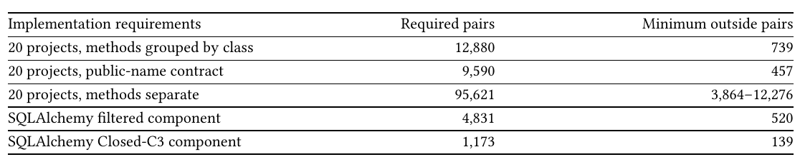
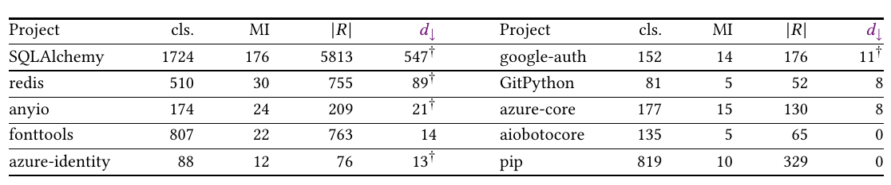
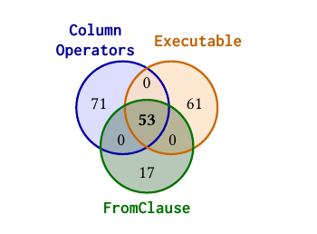
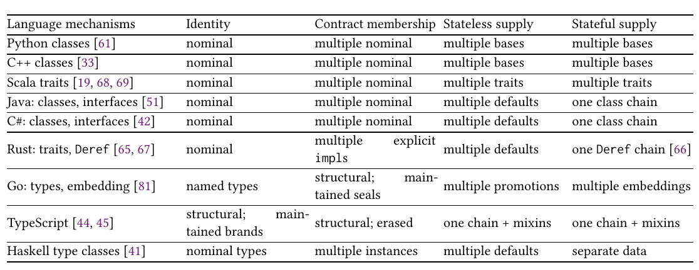

# Semantic Completeness for Correct Maintenance: A Strict Hierarchy of Typing and Inheritance

Paper1, the OOPSLA 2027 submission, converted to text: part 3 of 4. Read the parts in order. Figures and tables are PNG files in `figures/`, linked where they appear.

## 5 Measured Ancestry Gaps in Python

Extraction fixes the counted pairs. Designs attaining checked lower bounds establish objective, exact minima. We count one pair when a class inherits a method body from a code provider. Abstract methods and bodies replaced by overrides do not count. Several methods from one provider still count as one pair. These recovered implementation requirements form 𝑅 obs .

Requiredness witness: AnyIO omissions. AnyIO’s whole-project study replaces omitted routes with failing method stubs. After a 3,934-test baseline, the pinned suite reaches and rejects all 21 single-route omissions, witnessing requiredness. Each two-route omission runs both route-specific tests. All 210 omissions are detected, both routes reached in 169 cases (Supplement §9.7).

Theorem 4.6 minimizes over every sound one-parent design. Changing 𝑅 obs changes a named implementation–class pair (Corollary 4.19).

Proposition 5.1 (Omitting required pairs can raise or lower the gap) 32 . For recovered relations 𝑅 ⊆ 𝑅 req , neither 𝑑 ↓ (𝑅) ≤ 𝑑 ↓ (𝑅 req ) nor 𝑑 ↓ (𝑅) ≥ 𝑑 ↓ (𝑅 req ) holds in general.

Supplement §9.8 gives both minimal witnesses and their checked gaps.

Public-name contract. Each selected public method must still resolve to its original concrete provider, including dunders. This public-name contract forces 9,590 provider–class pairs with certified exact gap 457 under sound ancestry (Table 2; Supplement §9.8.1).

Calls, fields, registries, and generated code can hide crossings from ancestry. Unlike inheritanceusage and fixed-hierarchy studies [20, 76, 77], we optimize every preserving one-parent hierarchy.

Audit inputs. The primary input groups method bodies by their most-derived declaring class; the separate-method input lets methods change independently. SQLAlchemy’s filtered input excludes order-sensitive lookups; Closed-C3 keeps locally determined C3 choices. Each comparison fixes different implementation requirements (Table 2).

A unique concrete body among incomparable most-derived declarations owns the lookup; competing bodies stay unattributed (Theorem 4.17). External or unresolved bases, custom MRO, runtime mutation, and descriptors are excluded here, though the model covers descriptors (Supplement §9.8: exclusions and input hashes).

Footnote: 30 31 32

Footnote: UND31-38, UND41 TST1-10 DEC7



*Table 2. Optima are certified except the separate-method row: 19 solver-optimal values plus SQLAlchemy’s feasible interval. Rows fix different requirements; components are project parts.*

```text
Implementation requirements                           Required pairs                    Minimum  outside pairs
20 projects, methods grouped by class                         12,880                                      739
20 projects, public-name contract                              9,590                                      457
20 projects, methods separate                                 95,621                              3,864–12,276
SQLAlchemy  filtered component                                 4,831                                      520
SQLAlchemy  Closed-C3 component                                1,173                                      139
```

Table 3 totals preserve distinct providers and replicas (Proposition 4.1; Theorems 4.6, 4.7). In recorded optima, 356/739 outside pairs (48.2%) have state-bearing providers: they or resolved ancestors declare nonempty __slots__ or write instance attributes. Stateless defaults cannot supply this state. Re-optimizing those providers’ requirements alone forces 236 outside pairs, certified exact on one sound stateful chain, granting other providers defaults with zero outside supply, keeping each implementation and its state together in its provider (Supplement §9.8.2).

Project selection fixed before optimization. From the pinned hugovk/top-pypi-packages table’s first 150 non-yanked universal pure-Python wheels (1 August 2026), 65 have at least 50 classes; 31 have cross-branch reuse. Positive gaps occur in 18/20 selected for at least four cross-branch classes, and 24/31 overall: at least 36.9% of 65, with 34 unscored. Multiple-parent use need not cross: pip (10 MI classes) and aiobotocore have gap zero. Unresolved external bases are unscored (exclusions: Supplement §9.8). A second fixed rule gives exact gap 25 across 601 classes in nine pyapp-kit libraries (Supplement §9.4).

Searching for forwarding through fields. Forwarding syntax alone does not identify shared code providers: in size-qualified wheels without locally resolved multiple-parent classes, self.field.m flags 23 crossing candidates, all rejected by tracing inherited members. The detector finds all 21 seeded AnyIO pairs written this way, checking recall for this forwarding syntax. Supplement §9.8.5 gives selection, anchors, and blind spots. Inherited routes also remove the sole candidate across three Apache Commons libraries (Supplement §9.8.6).



*Table 3. Eight largest source-class gaps and two zero controls; all twenty: Supplement §9.9. MI counts cross-branch concrete-method reuse. Daggers mark Lean-checked components above 10; undaggered totals sum components at most 10. Seven certificates cover six primary components (two SQLAlchemy) plus Closed-C3.*

```text
Project             cls.      MI        |𝑅|        𝑑         Project          cls.      MI       |𝑅|       𝑑
                                                    ↓                                                       ↓
SQLAlchemy         1724      176      5813       547†        google-auth      152       14       176      11†
redis               510       30        755       89†        GitPython         81        5        52        8
anyio               174       24        209       21†        azure-core       177       15       130        8
fonttools           807       22        763        14        aiobotocore      135        5        65        0
azure-identity       88       12         76       13†        pip              819       10       329        0
```

Source-declared first-parent baseline. Global optimization reduces the first-parent outside count nearly twelvefold, from 8,792 to 739. Of the 8,792, 91.6% are removable excess; one-parent incompleteness forces the remaining 8.4%, the 739.

Figure 9’s classes independently combine SQL expression semantics (ColumnOperators, FromClause) and executability (Executable), producing overlap without containment.

Primary component optimum. SQLAlchemy’s largest component has 223 code providers, 4,831 required pairs, and gap 520 of the project’s 547. A relation-level hierarchy and its outside routes attain 520; executable integration is separate. A Lean-checked LRAT certificate rules out one fewer outside pair under sound one-parent ancestry. Bundles for the recorded design. A bundle is a rectangle of missing pairs: implementations grouped with classes needing all of them. The minimum biclique cover of 𝑅 req \ 𝐻 for this design is 59 bundles [82]; other gap-optimal hierarchies can need different counts. Lean-checked LRAT excludes 58 bundles; Supplement §9.1 gives the maximal-rectangle construction. Each bundle adds uncovered pairs, so independent enabling makes all 2 59 subsets distinct, exactly one complete (Theorem 4.13; Supplement §9.1).

Supply and member lookup choices. Excluding 536 order-sensitive lookups leaves 520 outside pairs with no retained conflict.

Closed-C3 keeps locally resolved lookup choices: (𝑘, 𝑑 ↓ ) = (71, 139) over 1,173 pairs. A design attains this bound; Lean certifies it. One parent keeps every choice and adds the outside pairs. SQLAlchemy changed collection instrumentation to follow Python’s MRO under unpredictable subclass choices: precedence maintenance, separate from the 520 supply count [10].



*Fig. 9. Three crossing SQLAlchemy groups share 53 classes; exclusive regions are 71, 61, and 17, with pair-only regions zero. Regions count classes; lookup choices have their own count.*

The source-class gap is 739/12,880 = 5.7%; unrelated pairs change this fraction without changing the gap (Proposition 4.16). Hidden routes must also be recovered (Corollary 4.10).

Missing inherited pairs across versions. As recovered requirements evolve across 6 pinned SQLAlchemy versions, pairs missing from each class’s first parent change in all 5 transitions: 511 additions or deletions, including 94 on still-required pairs. The independently reconstructed edit count and initial gap both equal 511; no result relates them. Supplement §9.2 gives count trajectories, versions, hashes, and replay.

Strict-insertion trigger audit. Strict insertion forces repair (Theorem 4.14(0)). The preregistered 8 pip and 22 aiobotocore versions are tree-shaped. Their 7 and 21 transitions contain no trigger on persisting providers/classes, nor does aiobotocore’s separate-method input. Supplement §9.3 gives protocol and replay.

Rewiring and relaxed supply. The random comparison changes which code providers each class needs. Each class still needs the same number of providers, and each provider still serves the same number of classes. Across 20 samples, verified lower bounds are 1,522–1,568: every sample’s gap exceeds the observed 739.

With unit-cost forwarding and removal, the source-class minimum is 646–718 (solver lower; checked design upper), against the sound minimum 739. Each provider–class pair is declared required, forbidden, or tolerated: tolerated pairs may be inherited or omitted without charge. Tolerating omission of 𝑡 recovered pairs lowers the gap by at most 𝑡. The reported lower bounds hold whichever unrequired classes are tolerated, within the per-implementation allowance (Supplement §9.9). 33 Supplement §9.5 screens pinned MI-to-SI syntax histories.

Footnote: 33

Footnote: TOL4, TOL6

Changing what counts as one implementation. After merging providers needed by exactly the same classes, declared first parents leave 8,635 outside pairs; one-parent incompleteness forces the certified floor 713 (8.3%). Any other merge changes a named implementation–class pair (Theorem 4.8; Corollary 4.19; Supplement §9.8.2). Source-class grouping favors one parent. Separate method identities change 𝑅 req beyond Proposition 4.1’s fixed groups; pip’s gap becomes 43 (solver-optimal), versus provider gap 0.

## 6 Discussion and Language-Design Implications

### 6.1 Behavioral correctness assumes which implementations are needed

The Liskov substitution principle (LSP) requires subclasses to preserve superclass promises. Blocking an inherited promise violates LSP; forwarding that preserves behavioral correctness does not.

In the checked counterexample, two code providers initially serve {𝑊 , FR}. Change the second’s required classes to {FR, 𝐵}, leaving the first unchanged. All four required pairs remain behaviorally valid, but the gap rises from zero to one (Theorems 4.5, 6.1). The gap changes because the required provider changes. Split providers into roles rather than make unwanted promised methods raise; multiple parents supply the roles.

Permitting all behavior leaves required pairs fixed. Exact supply still requires 𝑅 𝐷 = 𝑅 req .

For implementation requirements alone, classes needing the same providers can share a supply node; a class needing a subset of those providers can be the supply parent. Grouping implementation supply does not decide contract membership or erase distinct identities. 34 Storage does not change this grouping; identity, lifetime, and substitution stay separate [15].

Theorem 6.1 (Per-pair behavioral checks cannot choose the required pairs) 35 . Exact supply, 𝑅 𝐷 = 𝑅 req , and behavioral correctness are separate prerequisites for correct maintenance. Semantic substitution requires that for each required pair, the specification must permit every consumer observation from reachable provider states or histories [37]. Neither implies the other; even complete per-pair checks cannot choose 𝑅 req . Supplement §4.1 gives observation sets; Liskov–Wing’s proof rules remain external.

### 6.2 Is-a and has-a are not opposites

Implementation supply. 𝑜 𝑓 ⪯ 𝑐 =⇒ 𝑓 @𝑐: inheriting an implementation causes a class to have it.

Having an implementation does not exclude containing component objects. Treating “is-a” and “has-a” as opposites is therefore a category error. Ancestry and composition can supply the same required pairs, natively or through routes. 36

Contract membership. A contract admits an object separately from code or component fields. Other composition accounts state limits [11, 26, 38, 56]. The cited tutorial replaces Report’s inheritance from DatabaseServer and Logger with fields, arguing a report “is neither” [6]. For logger behavior without identity, 𝑀 req drops membership but 𝑅 req keeps the pair (Theorem 4.4); composition supplies it outside. The report’s output agrees, but losing required memberships changes the specification (Section 2). Outside supply is |𝑅 req | pairs without ancestry, 𝑑 ↓ under optimal sound one-parent ancestry. Theorem 4.8 counts changes to required facts on merging; Proposition 4.18 counts self-call forwarding and lookup choices.

isinstance and hasattr branches store nominal and structural membership facts in control flow. Same-looking extensions can break hasattr (Proposition 3.1); in Figure 3, inheriting MixA derives x.attr1.

Forwarding, registries, and adapters supply missing implementations; independently edited copies can disagree. Exclude every invalid reachable state.

Footnote: 34 35 36

Footnote: RCN1-7, SCT18, BWR14, BWR17 BAP1-25, INT8-9 CND1-7

### 6.3 Names and implementation inheritance solve independent problems

Even with all code inherited, look-alike records needing different handling need extra identity keys (Theorem 3.2): 𝑚 pairwise confusable meanings need 𝑚 − 1 even at zero gap. Independently, distinct identities do not remove crossings: the ℎ × ℎ row–column family needs ℎ(ℎ − 1) outside pairs but no extra name.

Successful outputs and ancestry cannot identify the gap; ancestry, removals, and outside routes recover 𝑅 req (Corollary 4.10).

### 6.4 Language mechanisms differ in what they derive



*Table 4. Language mechanisms in the correct-maintenance partial order (Lemma 1.1; Figure 1). Implementation paths supply state; contract edges admit classes; brands and seals maintain identity evidence. Sharing and initialization are specified answers (Section 4.1); layout is a runtime cost. State requirements preserve this order (Corollary 8.5). Workarounds supply missing facts (Supplement §14).*

```text
Language mechanisms         Identity             Contract membership Stateless supply     Stateful supply
Python classes [61]         nominal              multiple nominal    multiple bases       multiple bases
C++ classes [33]            nominal              multiple nominal    multiple bases       multiple bases
Scala traits [19, 68, 69]   nominal              multiple nominal    multiple traits      multiple traits
Java: classes, interfaces [51] nominal           multiple nominal    multiple defaults    one class chain
C#: classes, interfaces [42] nominal             multiple nominal    multiple defaults    one class chain
                                                 multiple    explicit
Rust: traits, Deref [65, 67] nominal                                 multiple defaults    one Deref chain [66]
                                                 impls
                                                 structural;   main-
Go: types, embedding [81]   named  types                             multiple promotions  multiple embeddings
                                                 tained seals
                            structural;   main-
TypeScript [44, 45]                              structural; erased  one chain + mixins   one chain + mixins
                            tained brands
Haskell type classes [41]   nominal types        multiple instances  multiple defaults    separate data
```

Table 4 locates the required facts slop must restate: stateful crossings in Java, C#, and Rust; inherited state in Haskell; identity evidence in Go seals and TypeScript brands, and TypeScript’s crossing supply. Every answer-preserving representation pays member lookup choices (Theorem 4.17); unwanted supply costs extra (Theorem 4.11). Haskell type classes supply multiple contracts through superclass constraints and multiple code providers through defaults, but no inherited state [41]. Objects combine with functional programming through typed lambda-calculus encodings [55] and complement abstract data types [14]. Java admits multiple nominal contracts but one state-bearing class chain; Go embeds multiple types but unwanted structural matches need identity evidence. Neither is higher on all coordinates. Promotion obeys selector ambiguity [81] (Theorem 4.4).

Java, Go, and CLR restrict supply; C++, Eiffel, and CLOS use the upper rung [3, 21, 28, 33, 46, 75, 79]. Python, C++, and R are July 2026 TIOBE top-ten languages with state-bearing multiple parents [83].

### 6.5 Incompleteness leaves required facts for code to supply

In SlopCodeBench, agents pass checkpoints while verbosity and erosion rise; guidance lowers initial levels while degradation rates persist [52]. These heuristics parallel removable excess, forced outside supply, and strict-insertion obligations. Passing runs cannot reveal outside supply (Corollary 4.10).

Language-design rationales. If designs keep their costs, a ban cannot lower the best cost, even across projects (Lemma 1.1). A ban lowers actual costs only if people would otherwise choose a design costlier than the best available. Removing the only built-in derivation leaves code to state the required fact. A ban justified by excluding invalid states must name those it excludes automatically and code must otherwise reject.

Dropping requirements changes the specification (Corollary 4.19); enforced preconditions exclude conflicting future changes. No algorithm exactly certifies tree-shaped open futures (Theorem 4.20). Dhall omits some total computable functions to derive termination without per-program proof [18, 64]. A multiple-parent ban removes crossing derivations; lookup choices remain required (Theorem 4.17); strict insertions force repair (Theorem 4.14). The cited Java and Go rationales measure no comparison and derive no exclusion [28, 79].

Adoption costs 𝐾 𝑎 once and at most 𝑟 𝑎 per update; the compared workaround procedure costs at least 𝑞 per obligation after batching shares the positive operation cost (Corollary 6.2). Graham’s Blub paradox offers an analogy for unfamiliar capacity mistaken for complexity [29]. Social proof alone establishes neither lower cost nor derived exclusions.

Python’s syntax ban left binding to for y in [expr]: “No new syntax needed” [32]. Assignment expressions arrived in Python 3.8 [2]; 3.9 still optimized the workaround [59]. Pinned CPython has 140 non-test standard-library assignment expressions [58]; the obligation remains (Supplement §4.7).

Corollary 6.2 (Finite adoption cost cannot erase recurring workaround cost) 37 . On the program evolution in Theorem 4.14, every supply-preserving one-parent policy has 𝐵 rep (𝑛) ≥ 𝑛. Fix a physical procedure covering every counted obligation, including standing routes, with each additional operation costing at least 𝑞 0 > 0 and covering at most 𝑏 > 0 obligations. Its cost is at least 𝑞𝐵 rep (𝑛), with 𝑞 = 𝑞 0 /𝑏 > 0 even after batching (parked-top policy: Supplement §4.3; pricing: §4.5 and Theorem 4.4).

Subtract common costs 𝐾 𝑐 (𝑛). Feasible adoption 𝑎 costs at most 𝐾 𝑎 + 𝐸 𝑎 (𝑛), with finite setup 𝐾 𝑎 and recurring 𝐸 𝑎 (𝑛) ≤ 𝑟 𝑎 𝑛. It is cheaper if 𝑟 𝑎 < 𝑞 and 𝑛 > 𝐾 𝑎 /(𝑞 − 𝑟 𝑎 ); one parent is not optimal. Proof: Supplement §§4.5–4.6.

Corollary 6.3 (Conservative capacity additions) 38 . Adding capacity while retaining old answer- and behavior-preserving designs, histories, costs, and answers (identity, membership, supply, lookup) keeps every old choice available; the cheapest cannot become more expensive (Lemma 1.1). Multiple parents strictly lower outside supply at crossings and repair at strict insertions (Corollary 4.12; Theorem 4.14(0)).

Python 2.3 changed lookups and rejected old hierarchies: nonconservative [71].

## 7 Conclusion

With nominal identities fixed, only multiple contract and implementation parents attain the optimum as code and interface requirements evolve through any finite sequence (Corollary 4.12). At crossings, both designs exhibit behavioral correctness, but multiple parents leave zero outside implementation pairs; the best sound one-parent design leaves exactly 𝑑 ↓ > 0, even with helpers or generators, and fails correct maintenance (Theorem 4.6). Strict insertion breaks an old parent edge still carrying a required pair, or needs forwarding or removal before or after the update. Our construction repeats this while every version fits a tree; multiple parents add one edge per update, retaining old derivations (Theorem 4.14). Refactoring removes slop for excess pairs 𝑒 𝐻 ; native derivation removes it for forced pairs 𝑑 ↓ (Theorem 4.3); conservative additions never raise optima (Corollary 6.3). For the 20 projects’ recovered requirements: 12,880 (no inheritance) → 8,792 (declared first parents) → 739 (best sound one-parent, exact) → 0 outside implementation pairs (multiple parents; Proposition 4.2). Across histories, the stable-key minimum is the confusability graph’s chromatic number; contract memberships obey the gap law (Theorems 3.2, 4.4). Design choice is taught as preference: “favor composition” [26]. Objective counts decide correct maintenance as requirements evolve. Price outside work however you like: multiple parents remain strictly cheaper on every crossing exactly when doing any outside work costs more than doing none (Supplement Theorem 4.2).

Footnote: 37 38

Footnote: IPE23-27, NRH6, OPT3-16, BWR37-39, BWR45-49, BWR63 OPT13, OPT20, CSD1-8, SIN1-5, IPE21-28

Data-Availability Statement.

The artifact supplies Lean sources, the claim-to-Lean handle mapping, fixed inputs,

LRAT certificates, verifiers, mutation logs, and regeneration scripts for Artifact Evaluation. Lean checks every numbered result and tagged claim, with the external inputs listed below, through the claim-to-Lean handle mapping (Supplement §16). Direct replay proves optima for 𝑑 ↓ ≤ 10. For the 7 larger components, replay checks a matching repair and Lean checks LRAT refutations excluding one fewer deletion. The separate public-name contract adds 2 independently checked component certificates. The equal-scope audit certifies its floor by replaying matching certificates and adding 2 certificates for changed larger components. The stateful-row audit adds 2 component certificates. A further LRAT refutation certifies the 59-bundle minimum. From the recovered relation and bound, Lean generates every checked CNF, including the 520-pair crossing-packing residual and bundle-cover formula. CP-SAT searches for candidates; separate-method solver-optimal values rely on its optimizer (Supplement Table 22). Other declarations support proofs and encoders; source extraction and Liskov–Wing’s proof rules (Theorem 6.1) remain external. Lean also checks the exact inclusion–exclusion law and its asymptotic bound; the synthetic distributions are fixed by the stated cell probabilities and crossing rates; their correspondence to program populations remains external.

For the identity-history, open-world, and finite-test results (Sections 3 and 4.7), Lean checks r.e. membership of the failure sets and many-one reductions from halting and nonhalting. These establish membership and hardness; “co-r.e.-complete” uses the standard class definitions [64]. Section 6.5’s cited diagonalization fact remains external. The axiom report names Lean.ofReduceBool and Lean.trustCompiler for native Boolean certificate evaluation; the compiler is trusted to evaluate the checked Boolean computation correctly.

The ancestry-gap command and independent replay procedure are documented in Supplement §9.8.4.

AI Disclosure. Generative AI tools and agents helped translate informal arguments into formal statements, draft prose, run empirical studies, build research infrastructure, and conduct adversarial mock reviews. Lean 4 compiled the resulting proofs without unproved placeholders (sorry).

## References

[1] Jonathan Aldrich and Kevin Donnelly. 2004. Selective Open Recursion: Modular Reasoning about Components and Inheritance. In Proceedings of the 2004 Workshop on Specification and Verification of Component-Based Systems. 26–31. https://www.cs.cmu.edu/~aldrich/papers/savcbs04.pdf

[2] Chris Angelico, Tim Peters, and Guido van Rossum. 2018. PEP 572: Assignment Expressions. Python Enhancement Proposals. https://peps.python.org/pep-0572/ Introduced in Python 3.8.

[3] ANSI Common Lisp. 1996. Common Lisp HyperSpec: Method Selection and Combination. Common Lisp HyperSpec, Section 7.6.6. https://www.lispworks.com/documentation/HyperSpec/Body/07_ffb.htm Accessed 2026-08-21.

[4] AnyIO contributors. 2026. AnyIO 4.14.2: File Streams and Client Tests. Source repository, commit c384f99687c6. https://github.com/agronholm/anyio/blob/c384f99687c64c59ed8a11c3a0f11a2d57daff71/src/anyio/streams/file.py Client tests: tests/streams/test_file.py and tests/streams/test_buffered.py at the same commit.

[5] Apple. 2015. Xcode 7 Release Notes. Apple Developer Documentation Archive. https://developer.apple.com/library/archive/documentation/Xcode/Conceptual/RN-Xcode-Archive/Chapters/xc7_release_notes.html Protocol extensions and default implementations; accessed 2026-08-21.

[6] ArjanCodes. 2026. You Think This Is Good OOP... It’s Not. YouTube video. https://www.youtube.com/watch?v= RqcEK7sWesQ Published 2026-08-28; relevant segment 0:57–3:02; accessed 2026-09-02.

[7] Ralph-Johan Back and Joakim von Wright. 1998. Refinement Calculus: A Systematic Introduction. Springer, New York. doi:10.1007/978-1-4612-1674-2

[8] George Balatsouras and Yannis Smaragdakis. 2013. Class Hierarchy Complementation: Soundly Completing a Partial Type Graph. In Proceedings of the 2013 ACM SIGPLAN International Conference on Object-Oriented Programming Systems, Languages, and Applications. ACM, 515–532. doi:10.1145/2509136.2509530

[9] Kim Barrett, Bob Cassels, Paul Haahr, David A. Moon, Keith Playford, and P. Tucker Withington. 1996. A Monotonic Superclass Linearization for Dylan. In Proceedings of the 11th ACM SIGPLAN Conference on Object-Oriented Programming, Systems, Languages, and Applications. ACM, 69–82. doi:10.1145/236337.236343

[10] Mike Bayer. 2013. Honor the Python Method Resolution Order in Instrumented Collections. SQLAlchemy commit 2c425c9680b8. https://github.com/sqlalchemy/sqlalchemy/commit/2c425c9680b813952254292c5d1ee8e234b6f53a Accessed 2026-08-22.

[11] Joshua Bloch. 2018. Effective Java (3rd ed.). Addison-Wesley. Items 18–19.

[12] Gilad Bracha and William R. Cook. 1990. Mixin-Based Inheritance. In OOPSLA/ECOOP ’90: Proceedings of the European Conference on Object-Oriented Programming on Object-Oriented Programming Systems, Languages, and Applications. ACM, 303–311. doi:10.1145/97946.97982

[13] Duhong Chen, Oliver Eulenstein, David Fernández-Baca, and Michael Sanderson. 2006. Minimum-Flip Supertrees: Complexity and Algorithms. IEEE/ACM Transactions on Computational Biology and Bioinformatics 3, 2 (2006), 165–173. doi:10.1109/TCBB.2006.26

[14] William R. Cook. 2009. On Understanding Data Abstraction, Revisited. In Proceedings of OOPSLA. ACM, 557–572. doi:10.1145/1640089.1640133

[15] William R. Cook, Walter Hill, and Peter S. Canning. 1990. Inheritance Is Not Subtyping. In Proceedings of the 17th ACM SIGPLAN-SIGACT Symposium on Principles of Programming Languages. 125–135. doi:10.1145/96709.96721

[16] William R. Cook and Jens Palsberg. 1994. A Denotational Semantics of Inheritance and Its Correctness. Information and Computation 114, 2 (1994), 329–350. doi:10.1006/inco.1994.1090 Preliminary version in OOPSLA 1989, pages 433–443.

[17] Ward Cunningham. 1992. The WyCash Portfolio Management System. In Addendum to the Proceedings on Object-Oriented Programming Systems, Languages, and Applications (OOPSLA ’92 Addendum). ACM, 29–30. doi:10.1145/157709. 157715

[18] Dhall Language Project. 2026. Safety Guarantees. Official Dhall documentation. https://docs.dhall-lang.org/ discussions/Safety-guarantees.html Accessed 2026-08-26.

[19] Stéphane Ducasse, Oscar Nierstrasz, Nathanael Schärli, Roel Wuyts, and Andrew P. Black. 2006. Traits: A Mechanism for Fine-Grained Reuse. ACM Transactions on Programming Languages and Systems 28, 2 (2006), 331–388. doi:10.1145/1119479.1119483

[20] Roland Ducournau, Floréal Morandat, and Jean Privat. 2009. Empirical Assessment of Object-Oriented Implementations with Multiple Inheritance and Static Typing. In Proceedings of the 24th Annual ACM SIGPLAN Conference on Object-Oriented Programming, Systems, Languages, and Applications. ACM, 41–60. doi:10.1145/1639949.1640093

[21] Ecma International. 2006. ECMA-367: Eiffel, Analysis, Design and Programming Language. https://www.ecmainternational.org/wp-content/uploads/ECMA-367_2nd_edition_june_2006.pdf Feature adaptation and multiple inheritance; accessed 2026-08-21.

[22] Erik Ernst. 2001. Family Polymorphism. In ECOOP 2001: Object-Oriented Programming (Lecture Notes in Computer Science, Vol. 2072). Springer, 303–326. doi:10.1007/3-540-45337-7_17

[23] Neil A. Ernst, Stephany Bellomo, Ipek Ozkaya, Robert L. Nord, and Ian Gorton. 2015. Measure It? Manage It? Ignore It? Software Practitioners and Technical Debt. In Proceedings of the 2015 10th Joint Meeting on Foundations of Software Engineering. ACM, 50–60. doi:10.1145/2786805.2786848

[24] Matthias Felleisen. 1991. On the Expressive Power of Programming Languages. Science of Computer Programming 17, 1–3 (1991), 35–75. doi:10.1016/0167-6423(91)90036-W

[25] Matthew Flatt, Shriram Krishnamurthi, and Matthias Felleisen. 1998. Classes and Mixins. In Proceedings of the 25th ACM SIGPLAN-SIGACT Symposium on Principles of Programming Languages. ACM, 171–183. doi:10.1145/268946.268961

[26] Erich Gamma, Richard Helm, Ralph Johnson, and John Vlissides. 1994. Design Patterns: Elements of Reusable Object-Oriented Software. Addison-Wesley.

[27] Robert Godin and Petko Valtchev. 2005. Formal Concept Analysis-Based Class Hierarchy Design in Object-Oriented Software Development. In Formal Concept Analysis (Lecture Notes in Computer Science, Vol. 3626). Springer, 304–323. doi:10.1007/11528784_16

[28] James Gosling and Henry McGilton. 1996. The Java Language Environment. Sun Microsystems white paper; archived by Oracle. https://www.oracle.com/java/technologies/language-environment.html Chapter 2 design goals and Sections 2.2.5 and 3.3.7; accessed 2026-09-09.

[29] Paul Graham. 2001. Beating the Averages. Essay derived from a talk at the 2001 Franz Developer Symposium. https://www.paulgraham.com/avg.html Revised April 2003; accessed 2026-08-26.

[30] Dan Gusfield. 1991. Efficient Algorithms for Inferring Evolutionary Trees. Networks 21, 1 (1991), 19–28. doi:10.1002/net.3230210104

[31] C. A. R. Hoare. 1969. An Axiomatic Basis for Computer Programming. Commun. ACM 12, 10 (1969), 576–580. doi:10.1145/363235.363259

[32] Stephan Houben. 2018. Re: Temporary Variables in Comprehensions. python-ideas mailing list, 15 February. https://mail.python.org/pipermail/python-ideas/2018-February/048975.html

[33] ISO C++ Working Group. 2023. Working Draft, Standard for Programming Language C++: Multiple Base Classes and Virtual Functions. Working Draft N4950. https://timsong-cpp.github.io/cppwp/n4950/class.mi Sections class.mi and class.virtual; accessed 2026-08-21.

[34] JetBrains. 2026. Kotlin Documentation: Delegation. https://kotlinlang.org/docs/delegation.html Updated 10 September 2026; accessed 8 October 2026.

[35] Gregor Kiczales and John Lamping. 1992. Issues in the Design and Documentation of Class Libraries. In Proceedings of the Seventh Annual Conference on Object-Oriented Programming Systems, Languages, and Applications. ACM, 435–451. doi:10.1145/141936.141971

[36] Ivan Levkivskyi, Jukka Lehtosalo, and Łukasz Langa. 2017. PEP 544: Protocols: Structural Subtyping (Static Duck Typing). Python Enhancement Proposals. https://peps.python.org/pep-0544/ Explicit and implicit protocol subtyping; accessed 2026-10-07.

[37] Barbara Liskov and Jeannette M. Wing. 1994. A Behavioral Notion of Subtyping. ACM Transactions on Programming Languages and Systems 16, 6 (1994), 1811–1841. doi:10.1145/197320.197383

[38] Steven Lowe. 2015. Composition vs. Inheritance: How to Choose? Thoughtworks Insights. https://www.thoughtworks. com/insights/blog/composition-vs-inheritance-how-choose Published 2015-05-11; accessed 2026-09-02.

[39] Donna Malayeri and Jonathan Aldrich. 2008. Integrating Nominal and Structural Subtyping. In ECOOP 2008: Object-Oriented Programming (Lecture Notes in Computer Science, Vol. 5142). Springer, 260–284. doi:10.1007/978-3-540-70592-5_12

[40] Donna Malayeri and Jonathan Aldrich. 2009. Is Structural Subtyping Useful? An Empirical Study. In Programming Languages and Systems: 18th European Symposium on Programming (Lecture Notes in Computer Science, Vol. 5502). Springer, 95–111. doi:10.1007/978-3-642-00590-9_8

[41] Simon Marlow (Ed.). 2010. Haskell 2010 Language Report. Haskell.org. https://www.haskell.org/onlinereport/ haskell2010/ Sections 4.3.1–4.3.2: class and instance declarations.

[42] Microsoft. 2026. C# Language Specification: Interfaces. Microsoft Learn. https://learn.microsoft.com/en-us/dotnet/ csharp/language-reference/language-specification/interfaces Accessed 2026-08-20.

[43] Microsoft. 2026. The History of C#. Microsoft Learn. https://learn.microsoft.com/en-us/dotnet/csharp/whatsnew/csharp-version-history C# 8.0, released September 2019, introduced default interface members; accessed 2026-08-21.

[44] Microsoft. 2026. TypeScript Handbook: Symbols and unique symbol. TypeScript Handbook source. https://github.com/microsoft/TypeScript-Website/blob/90e92beb7b1da8c5408f2cf0fb83c55d380a2886/packages/ documentation/copy/en/reference/Symbols.md TypeScript-Website commit 90e92beb7b1d; accessed 2026-08-20.

[45] Microsoft. 2026. TypeScript Handbook: Type Compatibility. TypeScript Handbook source. https://github.com/microsoft/TypeScript-Website/blob/90e92beb7b1da8c5408f2cf0fb83c55d380a2886/packages/ documentation/copy/en/reference/Type%20Compatibility.md TypeScript-Website commit 90e92beb7b1d; accessed 2026-08-20.

[46] Microsoft .NET Runtime Team. 2026. Book of the Runtime: Introduction to the CLR. Microsoft .NET Runtime Documentation. https://github.com/dotnet/runtime/blob/main/docs/design/coreclr/botr/intro-to-clr.md Accessed 2026-08-27.

[47] Leonid Mikhajlov and Emil Sekerinski. 1998. A Study of the Fragile Base Class Problem. In ECOOP ’98—Object-Oriented Programming (Lecture Notes in Computer Science, Vol. 1445). Springer, 355–382. doi:10.1007/BFb0054099

[48] Ivan Moore. 1996. Automatic Inheritance Hierarchy Restructuring and Method Refactoring. In Proceedings of the 11th ACM SIGPLAN Conference on Object-Oriented Programming, Systems, Languages, and Applications. ACM, 235–250. doi:10.1145/236337.236361

[49] npm, Inc. 2026. Public Registry API. npm registry documentation. https://github.com/npm/registry/blob/ ae49abf1bac0ec1a3f3f1fceea1cca6fe2dc00e1/docs/REGISTRY-API.md npm/registry commit ae49abf1bac0; accessed 2026-08-28.

[50] Oracle. 2014. Default Methods. The Java Tutorials, JDK 8. https://docs.oracle.com/javase/tutorial/java/IandI/defaultmethods.html Archived JDK 8 tutorial; accessed 2026-08-21.

[51] Oracle. 2025. The Java Language Specification: Interfaces. Java Platform Documentation. https://docs.oracle.com/javase/specs/jls/se25/html/jls-9.html Sections 9.1.3, 9.4.1, and 9.4.3; accessed 2026-08-19.

[52] Gabriel Orlanski, Devjeet Roy, Alexander Yun, Changho Shin, Alex Gu, Albert Ge, Dyah Adila, Nicholas Roberts, Frederic Sala, and Aws Albarghouthi. 2026. SlopCodeBench: Benchmarking How Coding Agents Degrade Over Long-Horizon Iterative Tasks. arXiv:2603.24755 [cs.SE] doi:10.48550/arXiv.2603.24755 Version 2, 7 May 2026.

[53] PHP Development Team. 2012. PHP 5.4.0 Release Announcement. https://www.php.net/releases/5_4_0.php Introduces traits; accessed 2026-10-06.

[54] PHP Documentation Group. 2026. PHP Manual: Traits. https://www.php.net/manual/en/language.oop5.traits.php Traits compose methods and properties; accessed 2026-10-06.

[55] Benjamin C. Pierce and David N. Turner. 1994. Simple Type-Theoretic Foundations for Object-Oriented Programming. Journal of Functional Programming 4, 2 (1994), 207–247. doi:10.1017/S0956796800001040

[56] Chris Pietschmann. 2026. C#: Inheritance vs Composition—When to Use Each and Why AI Can’t Decide for You. PietschSoft. https://www.pietschsoft.com/post/2026/05/08/csharp-inheritance-vs-composition-when-to-use-each Published 2026-05-08; accessed 2026-09-02.

[57] Protocol Buffers Project. 2026. Language Guide (proto3): Deleting Fields. Protocol Buffers Documentation. https://protobuf.dev/programming-guides/proto3/ Accessed 2026-08-17.

[58] Python contributors. 2026. CPython Standard Library at Commit 5c7445b. https://github.com/python/cpython/tree/5c7445be431698c6764af1246b2f5d7ca5c5c930/Lib AST assignment-expression census of Python files in Lib, excluding test, tests, and idle_test directories; protocol, per-file hashes, source positions, and regeneration script in the artifact.

[59] Python Software Foundation. 2020. What’s New in Python 3.9: Optimizations. https://docs.python.org/3.9/whatsnew/3.9.html#optimizations

[60] Python Software Foundation. 2025. Abstract Base Classes. Python 3.14.0 Standard Library source. https://github.com/ python/cpython/blob/ebf955df7a89ed0c7968f79faec1de49f61ed7cb/Doc/library/abc.rst

[61] Python Software Foundation. 2025. Python Data Model: Class Creation and Attribute Access. Python 3.14.0 Language Reference source. https://github.com/python/cpython/blob/ebf955df7a89ed0c7968f79faec1de49f61ed7cb/Doc/ reference/datamodel.rst CPython commit ebf955df7a89; accessed 2026-08-20.

[62] Python Software Foundation. 2026. typing: Protocol and runtime_checkable. https://docs.python.org/3/library/typing. html.

[63] Henry Gordon Rice. 1953. Classes of Recursively Enumerable Sets and Their Decision Problems. Trans. Amer. Math. Soc. 74, 2 (1953), 358–366. doi:10.1090/S0002-9947-1953-0053041-6

[64] Hartley Rogers, Jr. 1987. Theory of Recursive Functions and Effective Computability. MIT Press, Cambridge, MA. https://mitpress.mit.edu/9780262680523/theory-of-recursive-functions-and-effective-computability/ Reprint of the 1967 edition.

[65] Rust Project Developers. 2026. The Rust Reference: Implementations and Trait Coherence. Rust Language Reference source. https://github.com/rust-lang/reference/blob/3b38834b39f732c64686f7c64aa29dcf3cd83ba5/src/items/ implementations.md rust-lang/reference commit 3b38834b39f7; accessed 2026-08-20.

[66] Rust Project Developers. 2026. The Rust Reference: Special Types and Traits. https://github.com/rust-lang/reference/ blob/3b38834b39f732c64686f7c64aa29dcf3cd83ba5/src/special-types-and-traits.md Accessed 2026-10-08.

[67] Rust Project Developers. 2026. The Rust Reference: Traits. Rust Language Reference source. https://github.com/rust-lang/reference/blob/3b38834b39f732c64686f7c64aa29dcf3cd83ba5/src/items/traits.md rust-lang/reference commit 3b38834b39f7; accessed 2026-08-20.

[68] Scala Project. 2026. Scala 3 Book: OOP Modeling and Mixin Composition. Scala documentation source. https://github.com/scala/docs.scala-lang/blob/7689a46f38261d036ef5ee5b87d9ff366af396b9/_overviews/scala3-book/domain-modeling-oop.md docs.scala-lang commit 7689a46f3826; accessed 2026-08-20.

[69] Scala Project. 2026. Scala 3 Reference: Trait Parameters. Scala Documentation. https://docs.scala-lang.org/scala3/ reference/other-new-features/trait-parameters.html Accessed 2026-08-20.

[70] Nathanael Schärli, Stéphane Ducasse, Oscar Nierstrasz, and Andrew P. Black. 2003. Traits: Composable Units of Behaviour. In ECOOP 2003: Object-Oriented Programming (Lecture Notes in Computer Science, Vol. 2743). Springer, 248–274. doi:10.1007/978-3-540-45070-2_12

[71] Michele Simionato. 2003. The Python 2.3 Method Resolution Order. Python documentation. https://docs.python.org/3/howto/mro.html

[72] Gregor Snelting and Frank Tip. 2000. Understanding Class Hierarchies Using Concept Analysis. ACM Transactions on Programming Languages and Systems 22, 3 (2000), 540–582. doi:10.1145/353926.353940

[73] Lynn Andrea Stein. 1987. Delegation Is Inheritance. In Proceedings of the 2nd ACM SIGPLAN Conference on Object-Oriented Programming Systems, Languages and Applications. ACM, 138–146. doi:10.1145/38765.38820

[74] Mirko Streckenbach and Gregor Snelting. 2004. Refactoring Class Hierarchies with KABA. In Proceedings of the 19th Annual ACM SIGPLAN Conference on Object-Oriented Programming, Systems, Languages, and Applications. ACM, 315–330. doi:10.1145/1028976.1029003

[75] Bjarne Stroustrup. 1989. Multiple Inheritance for C++. Computing Systems 2, 4 (1989), 367–395. https://www.usenix. org/publications/compsystems/1989/fall_stroustrup.pdf Earlier version presented at the EUUG Spring Conference, May 1987.

[76] Ewan D. Tempero, James Noble, and Hayden Melton. 2008. How Do Java Programs Use Inheritance? An Empirical Study of Inheritance in Java Software. In ECOOP 2008: Object-Oriented Programming (Lecture Notes in Computer Science, Vol. 5142). Springer, 667–691. doi:10.1007/978-3-540-70592-5_28

[77] Ewan D. Tempero, Hong Yul Yang, and James Noble. 2013. What Programmers Do with Inheritance in Java. In ECOOP 2013: Object-Oriented Programming (Lecture Notes in Computer Science, Vol. 7920). Springer, 577–601. doi:10.1007/978-3-642-39038-8_24

[78] Temporal Technologies, Inc. 2026. Temporal API Protocol Buffer Definitions. GitHub repository. https://github.com/ temporalio/api Revision 78685101cb08, accessed 2026-08-18.

[79] The Go Authors. 2026. Frequently Asked Questions. Go Documentation. https://go.dev/doc/faq Guiding principles and type inheritance; accessed 2026-08-28.

[80] The Go Authors. 2026. The Go Programming Language Specification. Go 1.26.4 source distribution. https://github. com/golang/go/blob/a9ce111d580581fb925ae88f125c69b7d93504ea/doc/go_spec.html

[81] The Go Authors. 2026. The Go Programming Language Specification. Go Documentation. https://go.dev/ref/spec Accessed 2026-08-20.

[82] Dirk Oliver Theis. 2011. On Some Lower Bounds on the Number of Bicliques Needed to Cover a Bipartite Graph. arXiv preprint arXiv:0708.1174 (2011). doi:10.48550/arXiv.0708.1174

[83] TIOBE Software BV. 2026. TIOBE Index for July 2026. TIOBE Programming Community Index. https://www.tiobe. com/tiobe-index/ July 2026 snapshot, archived in the artifact; accessed 2026-08-24.

[84] Frank Tip, Adam Kiezun, and Dirk Bäumer. 2003. Refactoring for Generalization Using Type Constraints. In Proceedings of the 18th ACM SIGPLAN Conference on Object-Oriented Programming, Systems, Languages, and Applications. ACM, 13–26. doi:10.1145/949305.949308

[85] Hironori Washizaki (Ed.). 2026. Guide to the Software Engineering Body of Knowledge (4.0a ed.). IEEE Computer Society. https://ieeecs-media.computer.org/media/education/swebok/swebok-v4.pdf Chapter 7, introduction and Section 1.1; PDF cover dated August 2026.

[86] Hans S. Witsenhausen. 1976. The Zero-Error Side Information Problem and Chromatic Numbers (Corresp.). IEEE Transactions on Information Theory 22, 5 (1976), 592–593. doi:10.1109/TIT.1976.1055607
