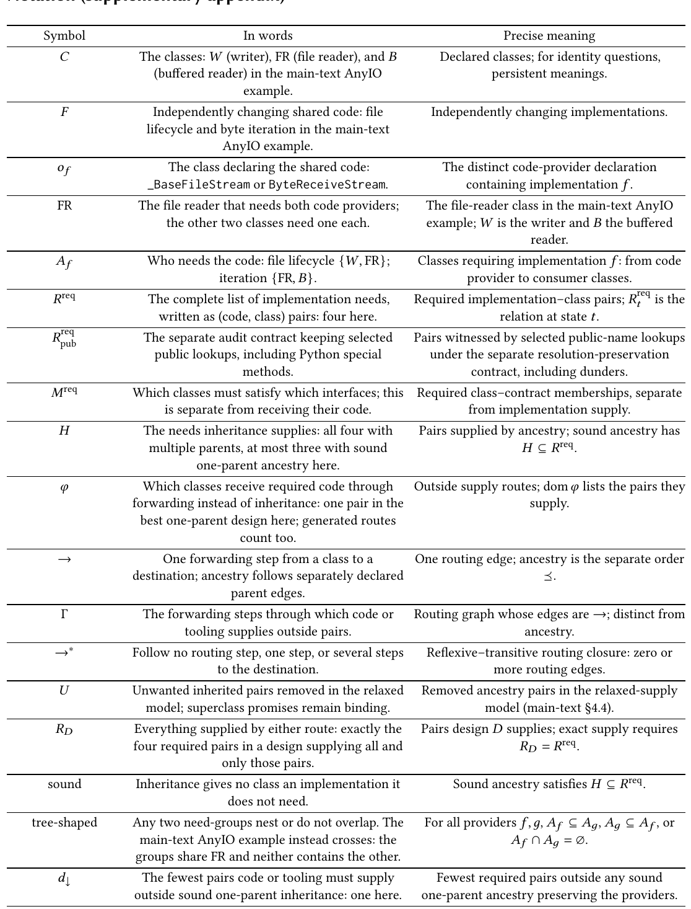
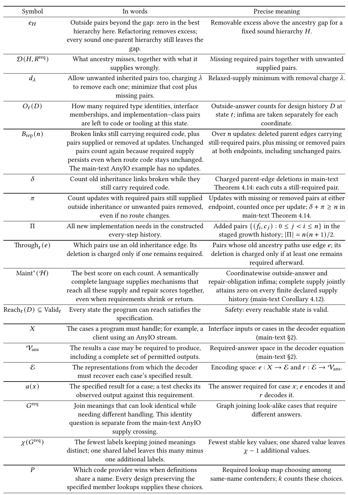
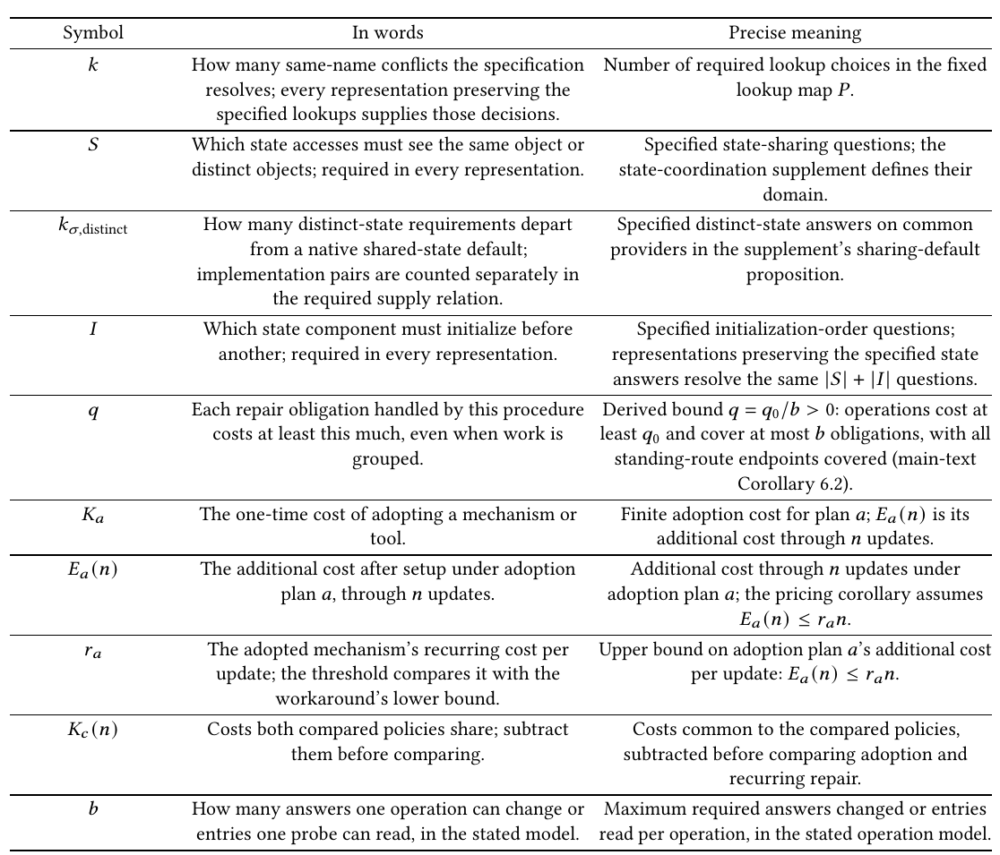

# Semantic Completeness for Correct Maintenance: A Strict Hierarchy of Typing and Inheritance

Paper1, the OOPSLA 2027 submission, converted to text: part 4 of 4. Read the parts in order. Figures and tables are PNG files in `figures/`, linked where they appear.

## Notation (supplementary appendix)



```text
Notation   (supplementary       appendix)
     Symbol                           In words                                  Precise meaning
        𝐶            The classes: 𝑊 (writer), FR (file reader), and 𝐵 Declared classes; for identity questions,
                       (buffered reader) in the main-text AnyIO               persistent meanings.
                                      example.
        𝐹              Independently changing shared code: file     Independently changing implementations.
                      lifecycle and byte iteration in the main-text
                                  AnyIO  example.
        𝑜                 The class declaring the shared code:        The distinct code-provider declaration
         𝑓
                      _BaseFileStream  or ByteReceiveStream.              containing implementation 𝑓 .
        FR           The file reader that needs both code providers; The file-reader class in the main-text AnyIO
                         the other two classes need one each.      example; 𝑊  is the writer and 𝐵 the buffered
                                                                                    reader.
       𝐴
         𝑓
                      Who  needs the code: file lifecycle {𝑊 , FR}; Classes requiring implementation 𝑓 : from code
                                  iteration {FR, 𝐵}.                      provider to consumer classes.
       𝑅req           The complete list of implementation needs, Required implementation–class pairs; 𝑅req is the
                                                                                                     𝑡
                        written as (code, class) pairs: four here.             relation at state 𝑡.
       𝑅req           The separate audit contract keeping selected Pairs witnessed by selected public-name lookups
        pub
                       public lookups, including Python special     under the separate resolution-preservation
                                      methods.                            contract, including dunders.
       𝑀req         Which classes must satisfy which interfaces; this Required class–contract memberships, separate
                         is separate from receiving their code.           from implementation supply.
        𝐻             The needs inheritance supplies: all four with Pairs supplied by ancestry; sound ancestry has
                      multiple parents, at most three with sound                   𝐻 ⊆ 𝑅req.
                              one-parent ancestry here.
        𝜑            Which  classes receive required code through Outside supply routes; dom𝜑 lists the pairs they
                    forwarding instead of inheritance: one pair in the              supply.
                     best one-parent design here; generated routes
                                     count too.
        →                One forwarding step from a class to a   One  routing edge; ancestry is the separate order
                    destination; ancestry follows separately declared                 ⪯.
                                    parent edges.
        Γ            The forwarding steps through which code or  Routing graph whose edges are →; distinct from
                            tooling supplies outside pairs.                        ancestry.
       →∗           Follow no routing step, one step, or several steps Reflexive–transitive routing closure: zero or
                                 to the destination.                          more routing edges.
        𝑈           Unwanted  inherited pairs removed in the relaxed Removed ancestry pairs in the relaxed-supply
                      model; superclass promises remain binding.             model (main-text §4.4).
       𝑅            Everything supplied by either route: exactly the Pairs design 𝐷 supplies; exact supply requires
         𝐷
                    four required pairs in a design supplying all and             𝑅 𝐷 = 𝑅req.
                                  only those pairs.
      sound         Inheritance gives no class an implementation it     Sound ancestry satisfies 𝐻 ⊆ 𝑅req.
                                   does not need.
    tree-shaped     Any two need-groups nest or do not overlap. The For all providers 𝑓 ,𝑔, 𝐴 𝑓 ⊆ 𝐴 𝑔 , 𝐴 𝑔 ⊆ 𝐴 𝑓 , or
                     main-text AnyIO example instead crosses: the                𝐴 𝑓 ∩ 𝐴 𝑔 = ∅.
                    groups share FR and neither contains the other.
        𝑑            The fewest pairs code or tooling must supply    Fewest required pairs outside any sound
         ↓
                    outside sound one-parent inheritance: one here. one-parent ancestry preserving the providers.
```



```text
     Symbol                           In words                                  Precise meaning
       𝑒             Outside pairs beyond the gap: zero in the best Removable excess above the ancestry gap for a
        𝐻
                      hierarchy here. Refactoring removes excess;           fixed sound hierarchy 𝐻.
                    every sound one-parent hierarchy still leaves the
                                        gap.
    D(𝐻, 𝑅req)        What ancestry misses, together with what it Missing required pairs together with unwanted
                                  supplies wrongly.                              supplied pairs.
        𝑑           Allow unwanted  inherited pairs too, charging 𝜆 Relaxed-supply minimum with removal charge 𝜆.
         𝜆
                      to remove each one; minimize that cost plus
                                   missing pairs.
      𝑂
       𝑡
        (𝐷)          How  many  required type identities, interface Outside-answer counts for design history 𝐷 at
                     memberships, and implementation–class pairs    state 𝑡; infima are taken separately for each
                         are left to code or tooling at this state.               coordinate.
     𝐵 rep(𝑛)        Broken links still carrying required code, plus Over 𝑛 updates: deleted parent edges carrying
                    pairs supplied or removed at updates. Unchanged still-required pairs, plus missing or removed pairs
                       pairs count again because required supply  at both endpoints, including unchanged pairs.
                    persists even when route code stays unchanged.
                     The main-text AnyIO example has no updates.
        𝛿            Count old inheritance links broken while they Charged  parent-edge deletions in main-text
                               still carry required code.          Theorem  4.14: each cuts a still-required pair.
        𝜋           Count updates with required pairs still supplied Updates with missing or removed pairs at either
                    outside inheritance or unwanted pairs removed, endpoint, counted once per update; 𝛿 + 𝜋 ≥ 𝑛 in
                              even if no route changes.                     main-text Theorem 4.14.
        Π           All new implementation needs in the constructed Added pairs {(𝑓 𝑖 ,𝑐 𝑗 ) : 0 ≤ 𝑗 < 𝑖 ≤ 𝑛} in the
                                 every-step history.                 staged growth history; |Π| = 𝑛(𝑛 + 1)/2.
   Through  (𝑒)       Which pairs use an old inheritance edge. Its Pairs whose old ancestry paths use edge 𝑒; its
           𝑡
                    deletion is charged only if one remains required. deletion is charged only if at least one remains
                                                                              required afterward.
    Maint∗(H)        The best score on each count. A semantically      Coordinatewise outside-answer and
                     complete language supplies mechanisms that  repair-obligation infima; complete supply jointly
                    reach all these supply and repair scores together, attains zero on every finite declared supply
                       even when requirements shrink or return.         history (main-text Corollary 4.12).
Reach 𝑡 (𝐷) ⊆ Valid 𝑡 Every state the program can reach satisfies the  Safety: every reachable state is valid.
                                    specification.
        𝑋           The cases a program must handle; for example, a Interface inputs or cases in the decoder equation
                            client using an AnyIO stream.                        (main-text §2).
       Vans          The results a case may be required to produce, Required-answer space in the decoder equation
                     including a complete set of permitted outputs.              (main-text §2).
        E             The representations from which the decoder  Encoding space: 𝑒 : 𝑋 → E and 𝑟 : E → Vans .
                       must recover each case’s specified result.
      𝑎(𝑥)           The specified result for a case; a test checks its The answer required for case 𝑥; 𝑒 encodes it and
                       observed output against this requirement.                  𝑟 decodes it.
       𝐺req           Join meanings that can look identical while   Graph joining look-alike cases that require
                       needing different handling. This identity               different answers.
                     question is separate from the main-text AnyIO
                                  supply crossing.
     𝜒 (𝐺req)         The fewest labels keeping joined meanings  Fewest stable key values; one shared value leaves
                    distinct; one shared label leaves this many minus        𝜒 − 1 additional values.
                                one additional labels.
        𝑃             Which code provider wins when definitions       Required lookup map choosing among
                       share a name. Every design preserving the  same-name  contenders; 𝑘 counts these choices.
                    specified member lookups supplies these choices.
```



```text
Symbol                           In words                                  Precise meaning
   𝑘           How  many same-name  conflicts the specification Number of required lookup choices in the fixed
                resolves; every representation preserving the               lookup map 𝑃.
                  specified lookups supplies those decisions.
   𝑆           Which state accesses must see the same object or  Specified state-sharing questions; the
               distinct objects; required in every representation. state-coordination supplement defines their
                                                                               domain.
𝑘               How  many  distinct-state requirements depart Specified distinct-state answers on common
 𝜎,distinct
                     from a native shared-state default;      providers in the supplement’s sharing-default
               implementation pairs are counted separately in                proposition.
                        the required supply relation.
   𝐼            Which  state component must initialize before   Specified initialization-order questions;
                  another; required in every representation.  representations preserving the specified state
                                                              answers resolve the same |𝑆 | + |𝐼 | questions.
   𝑞           Each repair obligation handled by this procedure Derived bound 𝑞 = 𝑞 0/𝑏 > 0: operations cost at
                 costs at least this much, even when work is least 𝑞 and cover at most 𝑏 obligations, with all
                                                                  0
                                 grouped.                     standing-route endpoints covered (main-text
                                                                            Corollary 6.2).
  𝐾
    𝑎
                The one-time cost of adopting a mechanism or   Finite adoption cost for plan 𝑎; 𝐸
                                                                                            𝑎
                                                                                              (𝑛) is its
                                   tool.                           additional cost through 𝑛 updates.
 𝐸
  𝑎
    (𝑛)         The additional cost after setup under adoption  Additional cost through 𝑛 updates under
                         plan 𝑎, through 𝑛 updates.          adoption plan 𝑎; the pricing corollary assumes
                                                                            𝐸 𝑎 (𝑛) ≤ 𝑟 𝑎 𝑛.
   𝑟             The adopted mechanism’s recurring cost per Upper bound on adoption plan 𝑎’s additional cost
    𝑎
                 update; the threshold compares it with the            per update: 𝐸 𝑎 (𝑛) ≤ 𝑟 𝑎 𝑛.
                        workaround’s lower bound.
 𝐾
  𝑐
    (𝑛)          Costs both compared policies share; subtract   Costs common  to the compared policies,
                          them before comparing.               subtracted before comparing adoption and
                                                                           recurring repair.
   𝑏           How  many answers one operation can change or Maximum   required answers changed or entries
               entries one probe can read, in the stated model. read per operation, in the stated operation model.
```
