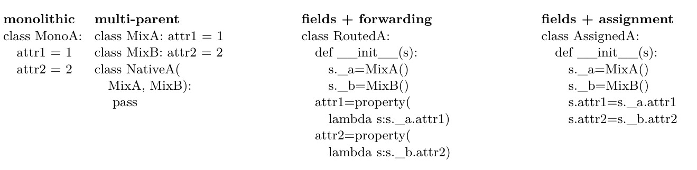
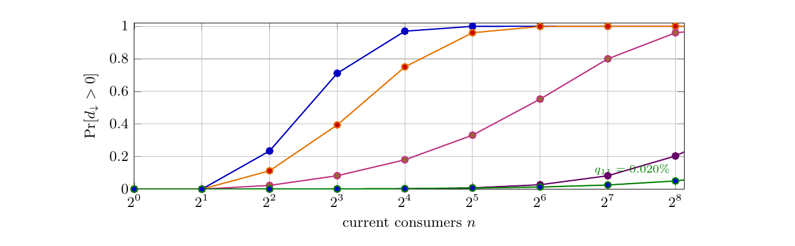

# Supplement to Semantic Completeness for Correct Maintenance: part 3 of 10

Optional reading: the paper1 supplement converted to layout-preserving text, page by page. Figures are PNG files in `figures/`.

Thus an accounting can erase a strict crossing separation only by assigning zero or negative price to
some nonempty outside set. This characterizes the price of the same required facts; labels identify those
facts regardless of their storage or source syntax. Bundling changes how they are encoded. Every other
zero-versus-nonempty witness obeys the same sufficient condition. The earlier monotone-price result below is
a special case: its assumptions imply positive prices for all nonempty sets.
Theorem 4.3 (Strict separations survive non-additive prices) 56 . Fix a finite nonempty universe A of
required facts and a common price Q : 2A → R for their outside supply. Suppose Q(∅) = 0, Q({a}) > 0 for
every a ∈ A, and S ⊆ T implies Q(S) ≤ Q(T ). There is ε > 0 such that every nonempty outside set costs
at least ε. Consequently, if an upper-rung design leaves no facts outside and every lower-rung design leaves
some, the upper design costs zero and the infimum over all lower designs is at least ε > 0. In particular,
every sound one-parent design for a crossing costs positively under every such price; exact multiple-parent
supply costs zero.
Proof. Take ε = mina∈A Q({a}) > 0. Every nonempty S contains an a, so Q(S) ≥ Q({a}) ≥ ε. The
zero-outside design costs Q(∅) = 0. For the implementation case, suppose a sound one-parent selection
leaves nothing outside. Every retained provider scope then equals its required scope. Retained scopes are
tree-shaped, contradicting the crossing. The multiple-parent construction supplies every pair natively.
   Each strict step in the main-text hierarchy has this zero-versus-positive witness. The theorem allows
unequal fact prices and bulk discounts, including a fixed positive charge for an entire nonempty batch. Such a
charge need not add across facts. Unit charges recover the exact counts; changing prices preserves these strict
separations. Assigning zero cost to a required fact removes its contribution to the price; it does not remove
the required fact. Changing the intended behavior is a specification change (main-text Corollary 4.19).

Every faithful representation must realize a semantic change. A representation may be program text,
a generated graph, or a compressed description together with the inputs and state that determine its behavior.
Let r decode it to the declared meaning. A faithful change of representation e satisfies r′ (e(p)) = r(p); it
preserves whether meanings differ.
Theorem 4.4 (A semantic change requires positively priced execution) 57 . Let a finite operation
sequence take representation p to p′ with r(p) ̸= r(p′ ). It contains a step that changes the decoded meaning.
If each executed operation has positive price, their total price is positive, regardless of how many facts one
operation changes. For the finite sequence of u > 0 operations, its smallest operation price q0 is positive and
its total cost is at least q0 u. These conclusions hold for every decoder and every faithful re-encoding of the
same declared meanings.
Proof. An empty sequence leaves the representation unchanged. If every step preserved the decoded meaning,
induction would give r(p) = r(p′ ). Thus some executed step changes it. A finite nonempty list of positive
prices has a positive minimum q0 , and summing the individual bounds gives C ≥ q0 u > 0. Faithfulness gives
r′ (e(p)) ̸= r′ (e(p′ )) exactly when r(p) ̸= r(p′ ).

   This derives positive total execution cost without assigning a price to each changed fact. A single
operation can change them all and still has its positive price. For a uniform per-fact rate across executions,
the machine and protocol supply the capacity and price bounds used next. Additional maintenance cost
subtracts operations shared with the compared design.

Compression and bounded-capacity realization. Compression can shorten the description of outside
answers without changing how many required answers the program supplies. The input bound in §4.2 counts
distinguishable outside sets. Executing a decoded set requires operations even when its description is short.
The update index can select the outside set in the main text’s prescribed growing history; independently
variable outside answers are a separate premise. For a finite execution or materialization trace, let m answer
occurrences be covered by u operations, each covering at most b > 0 occurrences. An occurrence is counted
56   PIS1-6   57   SCC1-9

once, even if several operations cover it. The coverage bound gives u ≥ ⌈m/b⌉. If those operations cost at
least q0 > 0 each, above a common baseline C0 , then
                                                             q0                    q0
                                           C − C0 ≥ q0 u ≥      m,          q :=      > 0.
                                                              b                     b
Lean proves the positive rate and cost bound from the finite coverage, capacity, and charging premises. The
operation-cover bound permits each operation to realize up to b answers, so batching is already included.
Batching divides the positive operation price across at most b occurrences; the resulting price q0 /b is still
positive. Description compression and zero additional input bits do not cancel this execution charge.58
    To set m = Brep (n), the protocol must cover every occurrence that Brep counts, including a pair at
both endpoints when it remains missing. Retaining one route need not execute it twice. Requiredness over
reachable executions likewise does not require every pair to be exercised in one execution. The AnyIO suite
reaches and rejects all 21 single-route omissions (§9.7); these executions witness requiredness. The machine
and protocol determine the price of realizing those required facts. Native implementations also execute
required behavior. A gross execution cost is incremental only when the charged operations are additional to
those of the comparator; shared work belongs in C0 .
    The fixed machine and executed protocol supply the operation capacity and price. Landauer’s bound prices
logically irreversible information loss; applying it requires identifying such an operation [Landauer(1961),
Bennett(2003)]. Retention bounds depend on the memory model, duration, reliability, and refresh protocol;
Chiuchiù et al. show that preservation cost in their model can be arbitrarily reduced at fixed duration
and error probability by sufficiently frequent refresh [Chiuchiù et al.(2018)]. These physical results remain
external to Lean. A fixed machine and protocol can supply b and q0 in declared energy, time, or monetary
units. A labor or monetary comparison prices its own additional operations; energy uses its own unit and
comparator.
    Across the staged n-transition history, Brep (n) counts charged parent-edge deletions plus missing required
pairs and removed unwanted pairs at both update endpoints. Brep (n) ≥ n. Lean checks this bound with
the normalized charge.59 If incremental charges after batching are at least qBrep (n) for q > 0, a policy that
keeps one parent has cost at least Kc (n) + qBrep (n) ≥ Kc (n) + qn, where Kc (n) contains costs common to
the compared policies. Keeping the mechanism incomplete creates this additional term. Common project
costs stay in Kc (n); expertise changes occurrence prices while the history fixes Brep ’s semantic count.
    The acquisition comparison separates setup from continuing cost. A feasible plan records one finite initial
cost Ka for training, supervised adoption, implementation, and migration, plus continuing excess Ea (n) ≤ ra n.
If ra < q, it is cheaper than permanently keeping one parent after ⌊Ka /(q − ra )⌋ + 1. Familiarity, installed
base, turnover, retraining, ecosystem integration, and unavailable tooling can raise Ka or ra ; they describe
path dependence produced by earlier availability and adoption. Complete capacity retains the option to use
the same familiar design, so these contextual prices leave the irreducible supply gap intact. Applying the
theorem to each feasible policy gives the quantified claim in the main text; an unavailable path is absent from
the policy family rather than assigned infinite cost. The operation bound additionally assumes an allowed
operation vocabulary, nonnegative per-operation cost p, and capacity b > 0.

4.6      Learning belongs in the policy comparison
Dynamic optimization compares policies using their present and future costs [Bertsekas(2015)]. Current
skills describe the starting state; feasible training and migration can change it. Let Pstay ̸= ∅ contain
policies preserving the required answers and behavior that retain one parent, and let Pall also admit feasible
acquisition policies. Both sets preserve the same requirements and start from the same state. Use one
cumulative cost function Cn at horizon n, including acquisition and all continuing costs. Set inclusion gives

                                                   inf Cn (p) ≤      inf    Cn (p).
                                                  p∈Pall          p∈Pstay

The generic order result requires the smaller set to be nonempty and the larger cost set to be bounded below.
Nonnegative costs satisfy the latter. Allowing acquisition retains every staying policy, so it cannot worsen the
best available cost.60
58   BWR22, BWR63   59   NRH3-6   60   OPT13-14

Optimum versus realized choice. Fix the requirements and a cost C per design. Let D′ ⊆ D, with
chosen designs d ∈ D and d′ ∈ D′ . If d minimizes C on D, then C(d) ≤ C(d′ ), since d′ remains feasible in D.
Thus C(d′ ) < C(d) implies that d was suboptimal. This applies unchanged when a design is a joint choice
across projects and C is a well-defined aggregate cost. A burden reduction under these fixed requirements
and costs therefore needs evidence about design selection; it cannot follow from a lower restricted optimum.61
    For the strict result, use the acquisition model’s nonnegative integer cost units. Suppose each staying policy
s implements the staged history and its execution or validation protocol incurs Cn (s) ≥ Kc (n) + qBrep,s (n)
after batching, with the common baseline Kc (n) and q > 0. Suppose a feasible acquisition policy a has
Cn (a) ≤ Kc (n) + Ka + Ea (n), where Ea (n) ≤ ra n and ra < q. The staged theorem gives Brep,s (n) ≥ n for
every s. For every n ≥ ⌊Ka /(q − ra )⌋ + 1,
                       inf Cn (p) ≤ Cn (a) ≤ Kc (n) + Ka + Ea (n) < Kc (n) + qn ≤    inf      Cn (s).
                     p∈Pall                                                         s∈Pstay

Thus the best cost strictly improves, and no staying policy minimizes cost over the enlarged set. The proof
uses a uniform lower bound over all staying policies; it does not assume that the larger set has a minimizing
policy. The comparison can therefore exclude permanently keeping one parent without finding the globally
best acquisition policy.62

4.7      Tools must supply every missing implementation–class pair
Let H ⊆ Rreq be the judgments supplied by a sound native mechanism, and let a tool supply T ⊆ Rreq such
that H ∪ T = Rreq . Exact supply forces
                                          T \ H = Rreq \ H.
For each required pair the native mechanism misses, the tool must determine how that class receives that
implementation. A registry, adapter, generator, macro system, code-generation pipeline, or language server
can compress its syntax, but its rule still determines every missing pair. For one-parent ancestry, minimizing
over all native trees and all such tools gives exactly d↓ ; multiple-parent ancestry can make the deficit empty.
A checker is the dual case: to enforce exact supply it must reject every incomplete reachable map, so its
acceptance rule owns the same pairs. These statements are independent of the tool’s implementation language
or presentation and are mechanized by the native-deficit injection and bundled-topology theorems.63

Assignment expressions separate local rewrites from whole-program repairs. In February 2018,
Stephan Houben answered a request for comprehension bindings with for y in [expr]: “No new syntax
needed” [Houben(2018)]. PEP 572 documents recomputation and control flow restructured into state-
ments [Angelico et al.(2018)]. Learning assignment expressions adds adoption cost (Ka , Section 4.6). Banning
them leaves the required behavior to be implemented another way. Van Rossum accepted the PEP, then with-
drew from decision-making, citing the fight [van Rossum(2018)]. Python 3.9 later optimized the workaround to
assignment speed, without exporting its variable to the enclosing scope [Python Software Foundation(2020)].
Optimizing a workaround does not eliminate the obligation it supplies.
    At the pinned CPython revision [Python contributors(2026)], the census finds 140 assignment expressions
in 83 non-test files. The artifact’s language_capacity_census/count_cpython_assignment_expressions.
py counts AST NamedExpr nodes in Python files under Lib/, excluding directories named test, tests,
and idle_test; it retains the implementation of unittest. Its locked revision, source hashes, included
and excluded file lists, and source locations make the count replayable. Every included file must parse;
unsupported grammar aborts the scan so every reported file contributes checked syntax nodes. The recorded
replay used a parser built from that same revision. The count locates installed use; optimality follows from
comparing preserving implementations under the chosen cost.
    Python’s := supplies a binding inside an expression and, inside a comprehension, can export it to the
containing function [Angelico et al.(2018)]. Fix one Python version’s semantics and remove only assignment
expressions to compare the two syntax sets. Comparing Python 3.7 directly with 3.8 would also change
dictionary-comprehension evaluation order. Under one cost function and specification, adding syntax preserves
every old realization, so its attained minimum cannot increase. Strict improvement needs a witness on that
same cost coordinate.64
61   OPT17-19   62   OPT15-16   63   SCT3-7, SCT20-26, BWR45-49    64   WAL5

Reuse alone does not force duplication. A local binding can be encoded as (lambda y: body)(f(x));
Felleisen’s call-by-value let translation already permits this [Felleisen(1991)]. A comprehension can instead
use for y in [f(x)]. Python 3.9 optimizes that idiom to assignment speed while retaining its non-escaping
scope [Python Software Foundation(2020)]. Both have one authoritative occurrence of f(x). One lambda
can bind several values; an existing iteration binder may already supply the required reuse. Even 0 < f(x)
< 10 uses one evaluation in two comparisons. Consequently, neither a duplicated occurrence per consumer
nor an added construct per reused value is a universal lower bound. Counts of syntax constructs are separate
from counts of changed required facts and from the ancestry gap. The lexical model checks both binder
encodings.65
    Lazy branch selection also admits a shared workaround. PEP 572’s copy.py example and Dropbox
observations contrast a flat if/elif chain with eager evaluation or nested statements [Angelico et al.(2018)].
A loop over the candidate functions can preserve first-success order, bind each tested value once, and stop
immediately, using one shared loop for any number of tests. Where the enclosing function already returns
the selected result, assignment statements followed by if/return also keep the chain flat. Neither needs one
helper per branch. Re-indentation changes source layout while preserving each required answer, so its cost
belongs to the encoding. A chain-preserving bound must declare its representation rule and structural cost.
The binding footprint supplies the local obstruction below.
    An escaping binding has a genuine local obstruction. In the first-order lexical core, primitive operators
preserve enclosing bindings. Lambda parameters occupy a private function store, and comprehension targets
occupy a private iteration store. Reflection, dynamic compilation, and callbacks writing captured locals are
separate capabilities. Induction over expression syntax proves that every assignment-free expression preserves
the enclosing store, including arbitrarily nested binders.66 Start with x = 0 and hold the surrounding program
fixed: evaluate the expression hole, then execute while not x: pass. The source hole (x := 1) makes the
context terminate. Every assignment-free replacement in this core leaves x zero, so the same context diverges.
Thus no replacement of the expression alone preserves termination. This is a local non-eliminability result
with Felleisen’s termination observation in the stated core: restructuring the surrounding program changes
the permitted rewrite and can supply the binding elsewhere. Lean checks the invariant, the changed-binding
witness, and the separation for every replacement expression.67
    PEP 572’s short-circuit witness makes the same scope distinction concrete: any((comment :=
line).startswith(’#’) for line in lines) leaves the last examined line in the containing scope. On
success it is the witness; on failure it is the last tested line, if any. A loop with break, or an initialized
mutable cell populated inside the generator, preserves this behavior by changing the enclosing representation.
Ordinary lambda parameters and iteration targets alone do not export that binding. Full Python also has
preexisting nonlocal writers, and Python 3.13 exposes write-through frame locals [Shannon and Gao(2021)];
the non-interference invariant does not cover those operations. The primitive contract must list them because
they can change the enclosing store and therefore the non-interference proof’s hypotheses.
    The artifact’s assignment-expression regression suite checks single evaluation, lazy order, successful
and unsuccessful searches, empty inputs, batched binders, and these counterexamples. It executes on the
installed Python; grammar parsing checks accepted syntax, while interpreter execution checks its behavior.
Paper1PL/AssignmentExpressions.lean proves the invariant for the declared lexical calculus; the Python
regressions exercise its concrete examples. This example separates preservation of an expression’s lexical
effects from whole-program computability, while retaining the paper’s distinction between semantic-answer
counts and representation-specific work.
    Figure 1 compares native derivation with explicit routes.

Invalid-state necessity. For state t and design D, behavioral safety requires Reacht (D) ⊆ Validt . When
the boundary is finite, define It (D) = | Reacht (D) \ Validt |; then It (D) = 0 is equivalent to behavioral safety.
The safety condition needs no finiteness assumption. For any positive real denominator m, It (D)/m = 0 iff
It (D) = 0, so normalization adds no information at the target. It can only dilute a positive count by adding
unrelated valid behavior, exactly the denominator failure isolated by the main paper’s gap-ratio corollary.
Correct maintenance requires this safety condition at every change, preservation of required answers, and
attainment of the outside-answer and repair minima. Security against a declared invalid behavior requires the
65   WAL3-4   66   WAL1   67   WAL2, WAL6-7

monolithic       multi-parent                            fields + forwarding            fields + assignment
class MonoA:     class MixA: attr1 = 1                   class RoutedA:                 class AssignedA:
   attr1 = 1     class MixB: attr2 = 2                      def __init__(s):               def __init__(s):
   attr2 = 2     class NativeA(                               s._a=MixA()                    s._a=MixA()
                    MixA, MixB):                              s._b=MixB()                    s._b=MixB()
                    pass                                    attr1=property(                  s.attr1=s._a.attr1
                                                              lambda s:s._a.attr1)           s.attr2=s._b.attr2
                                                            attr2=property(
                                                              lambda s:s._b.attr2)

Figure 1: Same shown outputs, different facts for code to maintain as providers evolve. Inheritance derives
both pairs; fields need routes. The monolith loses MixA and MixB’s required independent identities.

same necessary condition: that behavior cannot remain reachable. The Hamming and physical-edit results
then price the change from an invalidated old representation to a new behaviorally safe one.68
   More formally, let E(D) be any allowed family of physical encodings of a required external relation D,
and let a(e) ≥ 0 price the work of selecting, coordinating, and policing encoding e. If each displaced answer
has positive marginal cost at least q, every one-parent design preserving required supply obeys

                                               q|D| + a(e) ≥ q|D| ≥ qd↓ .

Choosing forwarding rather than a registry, adapter, or generator can change a(e) and the presentation of D;
it cannot turn the forced relation or the coordination around it into a benefit of restricting ancestry. Every
encoding supplies the same missing pairs and adds its own nonnegative coordination cost.69
    For an evolving hierarchy, let ρR count retracted old direct-parent edges. If this coordinate is priced
separately, the total ledger adds its declared marginal cost. The staged immediate-parent family has dt = 0
at every state and multi-parent point (ρM , DM ) = (0, ∅). An ancestry-only one-parent policy has ρS ≥ n; a
policy preserving required supply and freezing its initially sound parent function has |Dn | ≥ n(n + 1)/2; every
mixed policy satisfies the per-transition retraction-or-external-pair dichotomy. Summing over n transitions
gives at least n charged occurrences. At positive marginal cost q, a fixed one-time saving K can offset them
only while K ≥ qn; some finite horizon violates that inequality.

4.8      Time-weighted acquisition costs
More generally, let K0 < ∞ be a one-time prevention cost, let kt ≥ 0 be recurring intervention-side cost, and
let δt ≥ 0 weight the tth avoided charge qt > 0. Established intertemporal accounting chooses the intervention
exactly when
                                                 XT          T
                                                             X
                                            K0 +     δt kt <    δt qt .
                                                          t=1        t=1

The paper’s cumulative semantic-work ledger is the undiscounted case δt = 1. A discount schedule can change
monetary present value but not the required edit count. Migration and initial training enter K0 [Becker(1962)];
turnover, hiring premiums, review, and tool upkeep enter kt . Prevention removes the compared repair stream;
any remaining charges stay in the ledger.70
    Within the atomic-role model, same-role authority exchange preserves the scope family. Changing a scope
changes Rreq ; omitting a required pair or admitting an unwanted one breaks exact supply. Separate copies
become distinct authorities. A policy that admits separate edits admits divergence, while a common generator
or propagation checker carries the authority relation externally. The final case stores the dependency relation
outside ancestry, where the exact cost theorem applies.

4.9      Exact two-role and row–column gaps
For two required class sets A, B, partition the consumer classes into the left-only, right-only, shared, and
outside regions, of sizes N10 , N01 , N11 , N00 . Two retained rows are laminar only if at least one of the first
68   BWR38-39, BWR57, BWR54-56   69   OPT3-5   70   IPE23, OPT3-6

three regions is emptied. Deleting the left-only region makes the left row a subset of the right; deleting the
right-only region gives the reverse containment; deleting the shared region leaves no overlap. Therefore

                                                  d↓ (A, B) = min{N10 , N01 , N11 }.

Lean checks both the lower bound over every repair and all three attaining constructions.71
     Lean also checks the exact zero-gap probability and its asymptotic bound. For arbitrary cell probabilities
q00 , q10 , q01 , q11 , zero gap means that at least one of cells 10, 01, 11 is absent. Inclusion–exclusion therefore
gives                                X              X
                        Pr[d↓ = 0] =   (1 − qr )n −    (1 − qr − qs )n + q00
                                                                           n
                                                                             ,     r, s ∈ {10, 01, 11}.
                                        r                r<s

For fixed qmin = min{q10 , q01 , q11 } > 0, absence of a least-probable cell gives the lower bound (1 − qmin )n ; the
union bound gives three times that quantity as an upper bound. Thus the probability is Θ((1 − qmin )n ).72
    Suppose next that membership in each of the two scopes is independent across providers and across n
consumers, with probability p ∈ (0, 1). Put q = p(1 − p), r = p2 , and s = (1 − p)2 . Then (N10 , N01 , N11 , N00 )
is multinomial with cell probabilities (q, q, r, s), so the finite expected gap is
                                         X                                 n!
                            E[d↓ ] =              min{a, b, c}                          q a+b rc sn−a−b−c .
                                                                 a!b!c!(n − a − b − c)!
                                        a,b,c≥0
                                       a+b+c≤n

Inclusion–exclusion gives the exact crossing probability

                                Pr[d↓ > 0] = 1 − 2(1 − q)n − (1 − p2 )n + (p2 + (1 − p)2 )n
                                                   + 2(1 − p)n − (1 − p)2n .

Every subtracted base is strictly below one, hence this probability tends to one. The strong law applied to
the three region counts gives d↓ /n → p min{p, 1 − p} almost surely; bounded convergence gives the same
                                                                             write Di = Ni − n/4 for the three
limit in expectation. The relation itself has expected size 2np. At p = 1/2, P
relevant cells. Since Var(Di ) = 3n/16, Cauchy–Schwarz and mini Di ≥ − i |Di | give
                                                            √     √
                                           E[d↓ ] ≥ n/4 − (3 3/4) n.
                                                                                                 p
For X = N10 − N01 , E[X 2 ] = n/2 and E[X 4 ] = (3n2 − n)/4. Hölder’s inequality gives E|X| ≥ n/6, while
min(N10 , N01 ) = (N10 + N01 − |X|)/2; hence
                                                           √     √
                                           E[d↓ ] ≤ n/4 − n/(2 6).
                                              √
Therefore the√ one-parent
                  √       √cost is n/4 − Θ( n). The multinomial central limit theorem sharpens      √ this to
n/4 − (3/(4 π)) n + o( n). Thus the three implementation-reachability costs are n, n/4 − Θ( n), and
zero for no implementation inheritance, one parent, and multiple parents respectively. The declared source
distribution determines these rates; a codebase population would need its own measured distribution.

Arbitrary skew and changing population size. The balanced law is one point in an exact four-cell
family. Let (q00 , q10 , q01 , q11 ) be any declared distribution over neither role, left only, right only, and both
roles. The same pointwise theorem gives
                                                                         d↓
                                 d↓ = min{N10 , N01 , N11 },                −→ min{q10 , q01 , q11 }
                                                                         n
almost surely and in expectation. Inclusion–exclusion gives

                            Pr[d↓ > 0] = 1 − (1 − q10 )n − (1 − q01 )n − (1 − q11 )n
                                             + (q00 + q10 )n + (q00 + q01 )n + (q00 + q11 )n − q00
                                                                                                n
                                                                                                   .
71   AVG1-3   72   AGP1-7

Source                    q00     q10     q01              q11    n.5      n.9   n.99      lim d↓ /n
                balanced                0.250 0.250 0.250              0.250       6       12      20         0.250
                moderate skew           0.250 0.500 0.150              0.100      10       24     45          0.100
                95% cell suppression 0.250 0.487 0.250                 0.013      56       184   367          0.013
                extreme skew            0.250 0.740 0.009              0.001     695    2302     4603         0.001
                5% at n = 256           0.250 0.500 0.250 .0002003444 3460 11492 22984 .0002003444

Table 6: Exact waiting thresholds under skew. The four cells are neither, left only, right only, and both. nα
is the first population size with Pr[d↓ > 0] ≥ α.

                                                                                                       req
                 Source                   Ed64 Pr[d64 ≥ 4]         Ed256 Pr[d256 ≥ 4] Pr[d256 ≥ 16] E|R256 |
                 balanced                12.668          0.9999 57.279           > .9999         > .9999    256.0
                 moderate skew            5.933          0.8850 25.421           > .9999          0.9869    217.6
                 95% cell suppression     0.800          0.0086    3.200          0.3978         < .0001    195.2
                 extreme skew             0.027         < .0001    0.223         < .0001         < .0001    192.3
                 5% at n = 256            0.013         < .0001    0.051         < .0001         < .0001    192.1

Table 7: Exact gap severity under the same skewed sources. Skew changes the waiting time and slope while
each displaced pair remains one outside semantic answer.

Positive-support skew changes only the waiting time and the linear rate; it removes neither crossing risk nor
asymptotic certainty. The gap is identically zero only under the additional closed-world premise that one
of q10 , q01 , q11 is exactly zero forever. That is a tree-shaped support limitation: it excludes a crossing cell
altogether. No finite history of non-occurrence proves zero probability, and the main paper’s open-world
theorem rules out an algorithm recognizing exactly the safe arbitrary future generators.73 With positive mass
in all three crossing cells, the crossing probability tends to one. Define

                                                nα = min{n : Pr[d↓ > 0] ≥ α}.

Table 6 gives the exact population at which each skewed source reaches 50, 90, and 99 percent crossing
probability; Table 7 gives exact finite severity. The checked script evaluates the multinomial sum directly
rather than sampling it. Finite expectation and limiting rate are computed separately; in the skewed rows the
rare crossing cell is almost always the minimum, so their rounded values at n = 256 nearly equal 256 times the
limiting rate. The final source removes only q11 , transfers its mass to q10 , and solves for a 5 percent crossing
probability at n = 256. This reference population matches the 256 classes touched by SQLAlchemy’s certified
optimum. That match fixes population size: the component contains 223 providers and 4,831 incidences,
whereas the synthetic law isolates two roles.
    This source’s 99% threshold can also be reconstructed without rounded cell probabilities. Keeping the
rare-cell term gives (1 − q11 )256 ≈ 0.95, hence
                                                   
                                       256 ln(0.01)
                              n.99 ≈                  = ⌈22,983.97055 . . .⌉ = 22,984.
                                         ln(0.95)

The full inclusion–exclusion calculation verifies the same integer: the crossing probability is below 0.99 at
22,983 and above it at 22,984.
    The audited SQLAlchemy and OpenAI wheels parse 1,724 and 3,911 classes, so 256 is not a program-size
ceiling. Total parsed classes are not, however, the consumer population of one fixed two-role law. The twenty
projects have different role counts and assignments, so the audit does not infer synthetic n or d↓ from total
class count.
73   UND31-38

1

                            0.8

              Pr[d↓ > 0]
                            0.6

                            0.4

                            0.2
                                                                                                   q11 = 0.020%
                              0
                               20          21       22        23        24        25      26       27         28
                                                                current consumers n

Figure 2: At the audited component size n = 256, the green source reaches only 5% because one crossing cell
is suppressed by 99.92% (1,248× below balanced). With positive support in all three crossing cells, a crossing
eventually appears with probability approaching one; skew changes its arrival time.

    The same law covers shrinking populations. Suppose additions draw a combination from q, deletions choose
one extant consumer uniformly, and the add/delete choice does not inspect its combination. Conditional on
the current population Nt = n, exchangeability gives the same multinomial law at every time t, regardless
of the preceding additions and deletions. This follows by induction: an independent addition appends one
q-draw, while uniform deletion from an i.i.d. sample leaves an i.i.d. sample. Figure 2 therefore reads in either
direction as Nt rises or falls.
    Elapsed time alone cannot determine exposure when population can shrink: a process can hold Nt small
by deleting. The exact path quantities are the current Nt and the accumulated semantic variation
                                                                T
                                                                X
                                                         VT =         |Rtreq △ Rt−1
                                                                                req
                                                                                    |.
                                                                t=1

Every required pair inserted or deleted changes VT by one semantic-answer unit. Under the exchangeable
process above,
                                       E[VT ] = T (q10 + q01 + 2q11 ).
For arrival-only growth, Nt = t and the nα values are also exact first-crossing quantiles. Deletions can
postpone the crossing only by changing Rreq ; VT counts those deletions and does not erase earlier variation.
    The row–column family removes the distributional premise. On consumers [h] × [h], give each cell its
row role and column role. Let a retained row scopes and b retained column scopes have cardinality at least
two. Every other scope omits at least h − 1 incidences. A large row and large column cannot both retain
their common cell: their intersection contains only that cell, so laminarity would otherwise force a set of size
at least two into a singleton intersection. The ab large row–column pairs therefore force at least ab further
omissions. Consequently every one-parent repair has

                                           d↓ ≥ (h − a)(h − 1) + (h − b)(h − 1) + ab ≥ h(h − 1).

Keeping every row and one diagonal cell from each column attains the bound. The exact costs are therefore
2h2 , h(h − 1), and zero across the same three mechanisms. Lean checks the cross-intersection lemma, the
double-counting bound, and the attaining construction.74

Fixed-description factoring statement. In a fixed description model, successful factoring produces a
shorter program preserving the model’s specified answers after paying for the abstraction, so its expanded
form exceeds that model’s minimum [Li and Vitányi(2008)]. The statement depends on the chosen description
language; a helper, generator, table, interpreter, or inherited implementation can hold the shared factor.75
74   AVG4-7   75           BWR13, CRS3-4

Exact expansion preserves the valid domain. An effective exact factorization supplies a factored
authority, a deterministic expansion function, soundness of every generated explicit state, and exact recon-
struction of every valid explicit state. Lean proves that the expansion range is exactly the validity set. Relative
to unrestricted manual expansion, the additional write-time representation states are therefore precisely the
invalid ones. Here a representation state may be a source tree, generated file set, registry, or configuration.
This claim concerns coherence before execution; operational runtime validity is a separate predicate. For an
arbitrary indexed family of duplicated answers, Lean also constructs the one-answer factorization and proves
that its generated range is exactly the states in which every copy agrees. Unrestricted manual copies add
precisely the states containing a disagreement.76

5      Linear Field-Menu Bounds
The field bounds count the binary observations needed to expose every future identity conflict while each
supported deletion merges at most two meanings. The calculations below give matching asymptotic bounds
within the binary-linear model. They are paper proofs; the next section gives an explicit mechanized
construction. Let the entities be Fk2 , and sample r nonzero linear functionals. A direction v =
                                                                                               ̸ 0 is safe when
the sampled functionals in v ⊥ span that hyperplane. Failure means missing H \ H ′ for a codimension-one
subspace H ′ of a hyperplane H. One uniform nonzero draw hits that set with probability greater than 1/4,
and there are fewer than 22k pairs (H ′ , H). Hence

                                                                                      2k
                     Pr[some branch fails] < 22k (3/4)r < 1      when         r>              ≈ 4.82k.
                                                                                   log2 (4/3)

Deduplicating the draws yields an existence bound of at most ⌈5k⌉ fields. This paper contributes the
deprecation-menu interpretation of that finite probabilistic construction.
     Within the binary-linear class, every retained set must contain at least k − 1 functionals in each hyperplane
v ⊥ , while each nonzero functional belongs to exactly 2k−1 − 1 such hyperplanes. Double counting gives

                                           m(2k−1 − 1) ≥ (2k − 1)(k − 1),

so m > 2(k − 1) = 2 log2 N − 2. These asymptotic calculations remain at manuscript level. The numbered
coordinate-and-parity construction below is explicit.77

6      Explicit Coordinate-and-Parity Menu
The construction makes every pair of meanings look alike in some supported deletion, while no individual
deletion merges more than two. It uses entities x ∈ Fk2 , the k coordinate functionals xi , and the k2 pair
                                                                                                      

parities xi + xj . The complete translation is:

Evolving-observation object                                   Finite-geometry object
entity                                                        vector x ∈ Fk2
optional binary field                                         nonzero linear functional u
deprecation direction                                         vector v ̸= 0
merged pairs                                                  matching x ↔ x + v
fields retained by that branch                                master-menu points in v ⊥
multiplicity at most two                                      retained points span v ⊥
complete future conflict                                      every hyperplane is spanned
minimum binary-linear field count                             size of a strong blocking set
76   BWR58-62   77   FLD1-8

For each nonzero direction v, retain coordinate i when vi = 0 and every parity ij when vi = vj = 1; all
other fields are deprecated once and never return. The retained tests lie in and span v ⊥ . To see spanning,
choose a pivot p with vp = 1. Equal branch profiles agree on every zero-direction coordinate and on every
parity xi + xp for which vi = 1. Once xp is fixed, these observations determine every coordinate, so each fiber
has size at most two. Conversely, x and y have the same branch profile when v = x − y =    ̸ 0: they agree on
every zero position, and flipping both endpoints preserves every retained parity. Thus branch x − y merges
every distinct pair x, y, making the union  conflict graph complete. The coordinate fields make the initial
profile discrete, and their count is k + k2 .
    For k = 3, the construction uses six fields on eight entities. Each of the seven nonzero directions pairs
x with x + v, while every branch retains fibers of size two. The optimized resource is the number of
binary observations: the menu still has N − 1 direction-indexed branches and uses correlated linear tests.
Menu-description complexity, branch count, and the naturalness of these observations in an ordinary schema
remain separate.
    If every branch instead retains one arbitrary finite-valued field and N ≥ 3, each multiplicity-two conflict
relation is a matching. Covering KN needs at least N − 1 matchings for even N and N for odd N ; a
one-factorization attains those bounds. The exact singleton-menu field count is therefore N − 1 for even N
and N for odd N . Allowing a branch to retain several correlated fields makes a sublinear menu possible. The
explicit coordinate-and-parity construction uses Θ(log2 N ) fields; the preceding probabilistic construction
and double-counting lower bound give the optimal Θ(log N ) order in the binary-linear model.

7     Known Schema Families and Lattice Closure
Knowing every future schema is different from knowing only how schemas may change. The key bounds
depend on which of these facts the allocator receives. Suppose a finite catalog of entities and every admissible
schema state are known before allocation. The robust price is the chromatic number of the union conflict
graph. If the schema family is known but entities arrive in an unknown order, and the allocator can compute
each arriving entity’s future conflicts with earlier entities, the future-backdegree theorem gives the greedy
bound for that order. The optimal guarantee over admissible orders is the corresponding online chromatic
number. If even the future incidence of unseen entities is unknown, the adaptive lower bound applies. Thus
“known schema” must distinguish a labeled future universe from a transition grammar.
    For one state, a reusable tag class is independent in the partition matroid whose parts are profile fibers.
For two states, common independent sets are the matchings of a bipartite multigraph: its two sides are the
two collections of fibers, and each entity is an edge between its two fibers. Kőnig line coloring therefore makes
the exact offline price the maximum fiber size. For a fully declared labeled universe, precoloring also attains
that price causally. With stream-revealed endpoints, greedy uses at most 2B − 1 colors; the classical online
edge-coloring lower bound makes this palette tight in the low-degree regime, even for bipartite instances
[Bar-Noy et al.(1992)]. This allows the intersection of the two partition matroids to violate matroid axioms;
the matchings of a three-edge path already have maximal members of sizes one and two. With three states
the incidence object is instead a tripartite 3-uniform hypergraph. The k = 2 coordinate-and-parity menu
gives exactly three states with snapshot price two and union price four.
    Neither chromatic parameter is controlled by transition depth alone. A constant-depth menu containing
the discrete state and one pair-merge state for each pair has complete future-conflict graph, although every
allowed state has multiplicity at most two.
    A literal lattice of partitions behaves differently. Order it from fine to coarse and suppose every lattice
state is admissible and satisfies the multiplicity bound. Its top element is a supported coarsest schema, every
possible conflict lies within one of its fibers, and B tags suffice. The constant-depth counterexample permits
many incomparable pair merges but excludes their join because that join violates the multiplicity promise.
Its promise-respecting state family therefore fails join closure. This separates schema depth from supported
coarsening closure.
