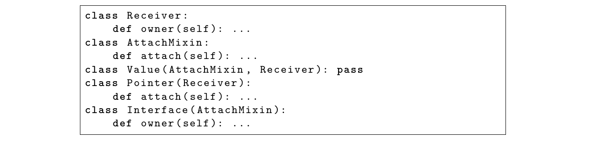

# Supplement to Semantic Completeness for Correct Maintenance: part 5 of 10

Optional reading: the paper1 supplement converted to layout-preserving text, page by page. Figures are PNG files in `figures/`.

and Lean-checked LRAT refutations excluding one fewer deletion. This contract has 9,590 pairs and exact
gap 457. Its gap is neither a lower nor an upper bound on the primary 739: deleting pairs can move the gap
in either direction. A zero means the selected public lookups fit ancestry; other API requirements define their
own relation and gap.

             Project             Public-name pairs Exact gap Dynamic export modules omitted
             botocore                          231           0                                  0
             aiobotocore                        56           0                                  0
             anyio                              98           4                                  0
             httpx                              49           1                                  0
             pip                                 0           0                                  0
             google-auth                        93           3                                  0
             opentelemetry-api                   4           0                                  0
             SQLAlchemy                       3617         327                                  0
             openai                           2270           1                                  0
             openpyxl                          530           3                                  0
             awscli                            699           1                                  0
             oauthlib                          127           1                                  0
             networkx                          191           3                                  1
             redis                             718          84                                  0
             Werkzeug                           85           4                                  0
             GitPython                          43           6                                  1
             azure-core                         48           0                                  0
             azure-identity                     40           2                                  0
             fonttools                         655          13                                  1
             gitdb                              36           4                                  0

Table 14: Separate public-name resolution contract on the original twenty projects. Dunders count as public;
provider declarations may be private. Zero-pair rows are retained.

9.8.2   Collapsing equal provider scopes
Merging every equal-scope group gives the certified equal-scope floor 713 across the locked twenty projects.
Define f ≡ g exactly when Af = Ag , and keep one provider for each equivalence class. The quotient reduces
1,234 providers to 1,204, with 12,667 required pairs; 18 projects still cross (Table 15).
    This test removes every distinction between code providers that serve precisely the same classes. Such a
merge preserves each class’s current code bundle; replacing unequal scopes with one shared scope changes at
least |Af △ Ag | answers (main-text Theorem 4.8; Corollary 4.19). The test allows providers with identical
class sets to share one identity, and recomputes the minimum after merging them. The surviving gap therefore
does not require keeping equal-scope providers distinct.
    All twenty projects are retained. The artifact reconstructs scopes from the locked wheels and archives
every equivalence class and original provider name. Every quotient component has a checked feasible repair.
Exhaustive replay certifies components with gap at most ten; larger components use Lean-checked LRAT
refutations excluding one fewer deletion. An existing certificate is reused only after its input family and

source digest match the reconstructed component, and its proof is replayed. Changed larger components
have 2 new certificates. Counts and rows below are generated from this checked report.

              Project             Original providers Equal-scope groups Quotient pairs Exact gap
              botocore                          55                   54             265           3
              aiobotocore                       38                   37              64           0
              anyio                             24                   24             209          21
              httpx                              8                    8              57           2
              pip                               91                   91             329           0
              google-auth                       23                   23             176          11
              opentelemetry-api                 10                   10              42           1
              SQLAlchemy                       390                  386            5796         546
              openai                            35                   35            2370           2
              openpyxl                          28                   28             551           3
              awscli                           122                  121             759           3
              oauthlib                          20                   15             113           1
              networkx                          67                   65             200           3
              redis                            111                   97             581          64
              Werkzeug                          22                   21              96           6
              GitPython                         16                   16              52           8
              azure-core                        30                   30             130           8
              azure-identity                    17                   17              76          13
              fonttools                        114                  113             762          14
              gitdb                             13                   13              39           4

Table 15: Equal-scope relaxation on the locked twenty-project cohort. Only identical class sets merge; every
quotient optimum is independently certified.

Provider state in archived optimal repairs. Refining the state rule to exclude empty slots and initializer-
only declarations and include inherited state changes the earlier count from 457 (61.8%) to 356 (48.2%).
Source-class grouping yields 1,234 providers and 12,880 pairs from 95,621 inherited method–class pairs. Of the
primary repairs’ 739 outside pairs, 356 (48.2%) have providers carrying instance state: the provider or a locally
resolved ancestor declares nonempty __slots__ or writes an instance attribute. The detector counts stores on
an instance method’s receiver and setattr(receiver, ...); it excludes reads, class/static methods, nested
function scopes, and annotation-only declarations. Empty slots and an initializer that only calls super() do not
qualify by themselves; inherited state does. Ancestry follows the extraction’s locally resolved graph; unresolved
external bases supply no inferred state. It classifies the archived optimal repair choices; it does not minimize
or maximize state-bearing pairs over all optima. python_factorization_audit/provider_state_audit.py
verifies each pinned wheel and source digest against the archived case, resolves every externalized provider,
retains its state-source declarations, and derives both the report and manuscript counts from them.
Proposition 9.1 (Restricting provider rows bounds the stateful gap) 93 . Let Fstate be the providers
carrying instance state under the rule above. Restrict any sound laminar retention to those rows. It stays
93   SRA1-2

Project             Stateful providers    Pairs   Projected upper   Exact gap
                  botocore                           51      247                 3           3
                  aiobotocore                        22       29                 0           0
                  anyio                               9       23                 8           0
                  httpx                               3       40                 0           0
                  pip                                64      246                 0           0
                  google-auth                        22      171                11          11
                  opentelemetry-api                   6       16                 1           0
                  SQLAlchemy                        290     2816               276         187
                  openai                             31      293                 2           2
                  openpyxl                           25      110                 2           2
                  awscli                            107      631                 3           3
                  oauthlib                           17      120                 1           1
                  networkx                           36       93                 0           0
                  redis                              71      222                12           6
                  Werkzeug                           18       81                 5           1
                  GitPython                          11       30                 3           0
                  azure-core                         23       90                 7           5
                  azure-identity                     16       58                11           5
                  fonttools                          98      670                 9           8
                  gitdb                               4       10                 2           2

Table 16: State-bearing provider rows, with fixed identities, scopes, and sound ancestry. The upper column
restricts the primary repair; the exact column reoptimizes this subrelation. Components of gap at most 10
use exhaustive replay; larger ones use Lean-checked LRAT.

laminar, so its missing pairs bound d↓ (Rreq |Fstate ) from above. In the archived primary repairs this gives
d↓ (Rreq |Fstate ) ≤ 356.
Proof. Every pair of retained rows already nests or is disjoint. Removing other rows preserves that property;
its missing cells are exactly the original missing cells whose provider is retained. The minimum cannot exceed
this feasible cost.
    Reoptimizing the full state-bearing subrelation gives the independently certified aggregate minimum 236.
The 356 state-bearing pairs in the original full optimum give a feasible upper bound; reoptimization includes
all qualifying rows, including those with no original outside pair. State detection uses the same declaration
scan and locally resolved ancestry as the annotation above; a positive instance write resolves statefulness
even if a slots expression is not statically evaluated. At fixed provider/state carriers and sound ancestry, this
is a lower bound for Table 27’s one-stateful-chain placement: optimistically granting every other provider
free default-method supply cannot remove the stateful rows’ laminar obstruction. Defaults that cannot
express an additional provider can only increase the cost [Oracle(2025e)]. Every translation preserving these
provider/state carriers and sound one-chain supply must meet this bound. Provider grouping also retains
methods that never access state.

9.8.3   Recovering unique concrete bodies among abstract declarations
The earlier frozen extraction rule dropped a lookup whenever its most-derived declaration set was incomparable.
The strengthened rule first removes abstract declarations from that set. It attributes the lookup when exactly

one concrete declaration remains and still declines to guess when two concrete declarations compete. Thus
the rule changes candidate supply without inventing a winner.
    The artifact reruns both rules from the same locked wheels, loading the earlier frozen rule from its retained
source bytes and comparing normalized implementation–class relations by SHA-256 digest. It recovers 37
method lookups and reduces recorded ambiguities from 1008 to 971. Nineteen of twenty relations are identical
to that earlier frozen-rule baseline. In opentelemetry-api, six recovered lookups add three implementation–class
pairs; an exact rerun leaves its gap at one. Consequently all reported optima and every LRAT-backed relation
remain unchanged, while the primary aggregate relation grows by three pairs. The complete 20-project
comparison is archived in generated/python_extraction_strengthening/results.json; Table 17 shows
the seven named end-to-end checks.

                  Project        recovered lookups ambiguities current |R|      current digest
                  anyio                          24          26–2         209 bf416f56e946
                  pip                             0         58–58         329 ae8b9f97449f
                  SQLAlchemy                      0     564–564          5813 edaf3d43cb48
                  redis                           0     170–170           755 c2a2f0fb54e3
                  Werkzeug                        0         57–57          97 3851d5a0efb2
                  azure-core                      7         37–30         130 7d8926ffab9e
                  fonttools                       0         26–26         763 eb798fe60ea0

Table 17: Frozen-rule versus strengthened-rule extraction. “Ambiguities” is before–after. Equal relation
digests are recorded in the complete JSON; the displayed digest is the strengthened relation’s SHA-256 prefix.

   Figure 3 gives the boundary case in which recovery can change the relation. The concrete provider sets
are {Value, Pointer} for owner and {Value, Interface} for attach, so their exact gap is one. Attributing
AttachMixin.attach through Value does not require choosing it over Receiver.owner: the members differ.

                class Receiver :
                    def owner ( self ): ...
                class AttachMixin :
                    def attach ( self ): ...
                class Value ( AttachMixin , Receiver ): pass
                class Pointer ( Receiver ):
                    def attach ( self ): ...
                class Interface ( AttachMixin ):
                    def owner ( self ): ...

Figure 3: A five-class abstract/concrete boundary witness. Coverage is forced when one incomparable
candidate supplies the queried member; genuinely competing concrete declarations remain unattributed.

9.8.4   Run the analyzer on another input
From the artifact root, python3 -m pip install ./experiments installs ancestry-gap. It accepts Python
source without importing its code, or a user-declared finite implementation–class relation:

ancestry-gap python /path/to/package --out gap.json
ancestry-gap relation requirements.json --out declared-gap.json
ancestry-gap verify gap.json
The report contains the relation and its size |R|, source hashes and declaration locations, omissions, a feasible
outside repair, and crossing witnesses. Matching independently checked lower and upper bounds establish an

exact gap; otherwise the report retains their interval. CP-SAT status is separate from independent verification.
The verifier rechecks feasibility and disjoint crossing witnesses and, where needed, reruns the four-way search
under a declared node limit. Reaching that limit reports incomplete verification. New inputs use feasibility,
packing, and bounded exhaustive search; larger archived instances add Lean-checked LRAT certificates. The
installed examples have |R| = 4 and d↓ = 1; the tool guide defines the input format and scope.

9.8.5   External-route syntax control
The control reuses the complete population lock and selects every parsed wheel with at least 50 locally parsed
classes and zero locally resolved multiple-parent classes, before scanning routes. This gives 25 projects. The
scanner records a pair (field.member, c) when a method or property named member, declared directly on
class c, accesses or calls self.field.member in its body. It compares roles only when they share the same
field name. An independent verifier reparses all eligible wheels, checks wheel and source digests, reconstructs
every role set, and checks the selected crossing regions. Table 18 lists one lexicographically first route-spelling
crossing per project with such a crossing; every listed consumer declaration has at most one syntactic base.
    This grammar groups matching route spellings. Resolving provider identity also requires inherited
forwarding and receiver domains. The pinned follow-up checks all 23 selected route-pair candidates. Pydantic’s
selected crossings disappear when inherited members are included; httpcore’s matching spellings cross distinct
receiver domains and optional adapters; BigQuery’s selected spellings resolve to distinct job-specific getter
providers. No selected candidate therefore establishes a shared-provider crossing. The control shows that
matching route spellings can name distinct providers or hide inherited routes.

Seeded forwarding recall. The same scanner finds 21 of 21 locked AnyIO provider–consumer pairs
rewritten as direct self.field.member declarations, matching all 31 member declarations. Pair recall
requires every listed member to match. The experiment retains the original ancestry, fixing a positive control
for the scanner’s declared syntax. Optimal repairs and naturally occurring forwarding require their own
resolved inputs. Joint witness execution binds 18 pairs; three abstract-class wrappers are shadowed by
concrete wrappers. Both original and seeded witness suites pass, the full upstream suite is outside this syntax
control. The artifact records per-declaration scanner matches, selected-provider binding traces, witnesses,
source hashes, and the JSON from which manuscript counts are derived.

     Project                 left member           right member        left only both right only syntax gap
     pydantic                fragment              host                       1     1          4            1
     httpcore                aclose                get_extra_info             3     1          1            1
     google-cloud-bigquery clustering_fields field_delimiter                  1     1          1            1

Table 18: Route-spelling crossings among 3 of 25 size-qualified zero-local-MI wheels. Each row’s two member
spellings share the field name recorded in the verified JSON. The final column applies the two-role formula
min{N10 , N11 , N01 } = 1 to this syntactic relation. Provider resolution rejects every candidate: matching
spellings either use distinct providers or omit inherited routes, which resolves the apparent crossings.

9.8.6   Java forwarding check
A fixed three-library check scans Apache Commons Collections 4.5.0, IO 2.20.0, and Lang 3.18.0 source releases.
Its direct-declaration grammar records same-named calls through a resolved instance field with unchanged
arguments, preserving the field’s declaring identity and written method signature. Collections has one crossing
pair in that declared relation; the other two libraries have none. The candidate concerns entrySet and put
in AbstractInputCheckedMapDecorator, FixedSizeMap, and PredicatedMap. However, PredicatedMap
inherits the first route. An exploratory sensitivity including inherited routes through the nearest local method
declaration removes the candidate and detects no crossing in the three libraries. The source hashes, complete
route reports, exclusions, and replay commands retain both analyses. This check supplies no positive Java

semantic witness: direct declarations omit inherited capabilities, and the expanded grammar still omits
accessor-mediated and unresolved routes. Complete requirement shape remains unmeasured.

9.9      Python factorization results and certificates
The main MRO-invariant projection keeps only a unique most-derived concrete provider. A separate sensitivity
applies standard C3 when every explicit transitive base resolves within the parsed source. It measures 196
external pairs among 4,345 incidences, compared with 164 among 4,288 under the invariant projection on
the identical consumer carrier. For the largest SQLAlchemy component, the invariant projection retains
zero multi-provider selector sites but omits 536 MRO-sensitive lookups among its consumers. Its fully local
Closed-C3 subcomponent contains 92 providers, 183 consumers, and 1,173 pairs. C3 resolves 71 conflict
sites there, and its exact one-parent gap is 139; hence the matched coordinates are (71, 139). Because 139
exceeds the FPT replay ceiling of 10, exactness here is proved by an independent LRAT refutation checked
in Lean together with the feasible 139-pair retained-laminar witness. The remaining sites depend on bases
outside the parsed wheel boundary. Across the project the invariant projection omits 564 such lookups. Thus
(0, 520) and (71, 139) are separate matched measurements on the conservative and locally C3-closed relations,
respectively. Their gap fractions are 520/4,831 = 10.8% and 139/1,173 = 11.8%; the corresponding conflict
counts are zero and 71.
     Each counterfactual retains the measured provider–consumer relation and allows arbitrary reparenting,
synthetic factor nodes, and optimal forwarding. An independent checker reparses the source and verifies
each wheel digest and retained-laminar upper witness. For every component with ki ≤ 10, the four-way
FPT replay proves the matching lower bound. For the other 7 components, a decision CNF asks whether
one fewer deletion suffices, CaDiCaL emits an LRAT refutation, and Lean validates that proof against the
CNF. Lean generates every checked gap CNF from the recovered finite relation and bound; completeness
is proved (a laminar retention within budget implies satisfiability). Source extraction remains external.
Exhaustive small-instance tests agree with brute-force gap on the families stated in the artifact. For the
holder bound, Lean checks an intersection-closure certificate, derives all 109 maximal rectangles, generates
the 58-holder decision CNF, and checks its LRAT refutation. CP-SAT’s OPTIMAL status cross-checks the
search; the generated CNF, repair-to-satisfiability proof, and checked refutation establish the lower bound
independently.
     For the Closed-C3 component, a separate 122-crossing packing makes the Lean-native refutation compact;
Lean checks it against the same recovered family as the archived Python/PySAT cross-check. For the 520-pair
component, a separately generated packing contains 496 incidence-disjoint crossings. Every laminar repair
deletes at least one incidence from each crossing, leaving only 23 further deletions available under the strict
519 budget. Lean checks the packing, generates the packing-factored residual CNF, proves that every repair
within the strict budget satisfies it, and checks its LRAT refutation. Python supplies only the recovered
relation and packing candidate; neither is accepted without the corresponding Lean-side checks. The JSON
also contains rectangle covers, fooling families, and component-level search statistics.
     The random comparison swaps provider–class pairs in each project’s recovered requirements. It preserves
each provider’s class count and each class’s provider count, as well as |F |, |C|, and |R|. Consecutive samples
are separated by 20 accepted switches per incidence and use the fixed seed recorded in the report. For each
sample, disjoint local crossing witnesses give a verified lower bound; the null run does not invoke CP-SAT
and therefore does not label those bounds as exact optima. Across 20 samples, the observed aggregate gap
739 is below every aggregate null lower bound (1,522–1,568). Samples follow the fixed swapping procedure on
recovered requirements; uniform sampling over all such graphs is not established.

Declared tolerance: a third cell value. A pair can be required, forbidden, or tolerated. A tolerated pair
may be inherited or omitted without charge; the gap is minimized over this declared three-valued relation.
Table 20 measures overreach tolerance: the optimizer chooses up to k extra classes per implementation.
Every specific declaration within that budget restricts this choice, so its solver lower bounds apply to every
declaration at the stated budget. These bounds rely on the optimizer; the primary exact optima additionally
have independently checked replay or refutation certificates.94
94   TOL5, TOL6

Project, component      Providers Classes Pairs Objective Bound Status
                     AnyIO, 0                       18           57   196              21    21 OPTIMAL
                     google-auth, 0                 16           42   148              11    11 OPTIMAL
                     SQLAlchemy, 3                 223       728 4831              520      520 OPTIMAL
                     SQLAlchemy, C3 max             92       183 1173              139      139 OPTIMAL
                     SQLAlchemy, 51                 17           96   224              11    11 OPTIMAL
                     redis, 2                       51           68   545              87    87 OPTIMAL
                     azure-identity, 1              14           39     68             13    13 OPTIMAL

Table 19: Archived OR-Tools CP-SAT 9.15.6755 search results for the seven components with independent
Lean-checked LRAT lower bounds. Primary component indices are zero-based; “C3 max” is the maximum-gap
fully local Closed-C3 subcomponent. The independent checker reparses each retained-laminar witness. The
archived solver status is not a premise of exactness.

   Omission tolerance has no measured row. Its loss is nevertheless bounded: let T ⊆ Rreq mark recovered
pairs that may be omitted, while remaining legal to inherit. Write

                                          dT =       min         |(Rreq \ H) \ T |.
                                                   H⊆Rreq
                                                 H tree-shaped

Deleting T from the legal supply relation is a different operation and can raise the gap (main-text Proposi-
tion 5.1).
Lemma 9.2 (Omission tolerance saves at most one answer per tolerated pair) 95 . For finite Rreq
and T ⊆ Rreq , dT ≤ d↓ (Rreq ) ≤ dT + |T |.

Proof. An optimal sound hierarchy for the original relation remains admissible, and tolerance only removes
charges, proving the first inequality. Conversely, take a minimizing hierarchy H for dT . Its original missing
pairs are the charged misses and at most |T | tolerated misses, so d↓ (Rreq ) ≤ |Rreq \ H| ≤ dT + |T |. Lean also
checks attainment of the finite minimum and the inclusion of every declared overreach choice in its budgeted
search space.

   Thus reducing the certified original gap 739 by m through omission tolerance requires declaring at least
m recovered pairs dispensable.96

                           Sensitivity                                 all projects SQLAlchemy
                           No specification slack (t = 0)                    739–739        520–520
                           At most one extra consumer per role               390–673        219–500
                           At most two extra consumers per role              308–632        172–483
                           At most five extra consumers per role             150–608         75–483
                           Unit-cost forwarding plus removal                 646–718        465–537

Table 20: Specification and removal sensitivities. Each interval gives a solver lower bound and a checked
supply-repair upper bound. For unit removal cost, the aggregate upper repair contains 686 forwarded pairs
and 32 removed pairs.

   Nineteen separate-method relations cross; only aiobotocore stays zero in both provider and method inputs.
Solver-dependent method bounds 3,864–12,276 span 4.04–12.84% of 95,621 method–class pairs.
95   TOL1-4   96   TOL7

Project                 |C| impl.-MI |F |     |R| 1st parent gap gap/|R| max gap |C/≡b |
           SQLAlchemy             1724      176 390 5813          3,591 547     9.41%       520       90
           redis                   510       30 111      755       540    89 11.79%           87      24
           anyio                  174        24    24    209       145    21 10.05%           21       7
           fonttools              807        22 114      763       388    14    1.83%         10      10
           azure-identity           88       12    17     76         48   13 17.11%           13       5
           google-auth             152       14    23    176       105    11    6.25%         11       5
           GitPython                81         5   16     52         21    8 15.38%               8   6
           azure-core              177       15    30    130         67    8    6.15%             6    7
           Werkzeug               177          6   22     97         55    6    6.19%             6    5
           gitdb                    54         5   13     39         22    4 10.26%               4   3
           botocore                485         8   55    266       186     3    1.13%             3    3
           openpyxl                582         7   28    551       479     3    0.54%             2    3
           awscli                 1079         8 122     760       446     3    0.39%             3   3
           networkx               555          6   67    202         81    3    1.49%             3    3
           httpx                    85         4    8     57         16    2    3.51%             1   3
           openai                 3911         4   35 2370        2,309    2    0.08%             2    2
           opentelemetry-api        79         7   10     42         21    1    2.38%             1    2
           oauthlib               114          7   20    128         94    1    0.78%             1    2
           aiobotocore             135         5   38     65         20    0    0.00%             0   1
           pip                     819       10    91    329       158     0    0.00%             0   1

Table 21: All 20 within-project no-MI counterfactuals for the MRO-invariant provider relation. The fact
granularity is one nominal provider bundle; the generated first-parent column sums to 8,792; the gap d↓ (A)
is the exact number of provider–consumer pairs that must leave ancestry; the final column counts distinct
answer columns on the full consumer carrier, including the all-zero column.

                       Table 22: Method-slot sensitivity by project. The method gap is the
                       pinned solver optimum when the reported status is OPTIMAL; otherwise
                       the entry is the checked lower–upper interval. Solver optimality remains
                       inside the declared trust boundary.

                    Project              provider gap method pairs method gap              status
                    botocore                         3          1,289            32     OPTIMAL
                    aiobotocore                      0            279             0     OPTIMAL
                    anyio                          21             384            48     OPTIMAL
                    httpx                           2             115             4     OPTIMAL
                    pip                              0          1,740            43     OPTIMAL
                    google-auth                    11             925           115     OPTIMAL
                    opentelemetry-api                1             59             1     OPTIMAL
                    SQLAlchemy                     547         52,642 1,492–9,904 FEASIBLE

Project             provider gap method pairs method gap             status

                   openai                           2              9,671      28   OPTIMAL
                   openpyxl                         3              4,735      69   OPTIMAL
                   awscli                           3              4,232      69   OPTIMAL
                   oauthlib                         1               843        7   OPTIMAL
                   networkx                         3              1,932      72   OPTIMAL
                   redis                          89              11,113   1,592   OPTIMAL
                   Werkzeug                         6               771       32   OPTIMAL
                   GitPython                        8               388       25   OPTIMAL
                   azure-core                       8               536       26   OPTIMAL
                   azure-identity                 13                321       19   OPTIMAL
                   fonttools                      14               3,558     184   OPTIMAL
                   gitdb                            4                88        6   OPTIMAL

    Source extraction parses packages without importing or executing them. The parser resolves module-local
declarations, aliases, imports, relative imports, and re-exports. Two selected projects have k = 0. Syntactic
MI can therefore coexist with a tree-shaped provider relation. A positive independently checked crossing
lower bound certifies nonlaminarity of the measured MRO-invariant relation; FPT replay or Lean-checked
LRAT refutations prove the provider-level optimum magnitudes. Undocumented maintainer intent, source
lines, and runtime operations remain outside these results.

Weighted and fixed-forest factorization objectives. Let A◦ contain the distinct applicability scopes
and let m(S) count independently factorable roles with scope S. Equal-scope roles share an optimal retained
scope, so the indexed objective is
                                                     X
                                     nat
                                         min    ◦
                                                          m(S)|S \ S nat |.
                                       S     ⊆S (S∈A )
                                                           S∈A◦
                                    {S nat :S∈A◦ } laminar

This is the weighting used by the provider-bundle and independently factorable method-slot
                                                                                        P          audits. Facts
needed by nonoverlapping groups of classes    form   independent components,    so d↓ =  i k i and the artifact’s
componentwise FPT running time is i O(4ki |Fi |2 |Ci |). If a candidate forest T is fixed, each fact instead
                                         P
chooses its largest fitting descendant set independently:
                                           X                                 
                                 dT↓ (A) =      |Af | −    max    | descT (v)| .
                                                         descT (v)⊆Af
                                           f

Once descendant sets are known, this takes O(|F ||T |). Enumerating relation-level forwarding stubs is then
mechanical. Their behavioral integration, review, and validation remain outside this objective. Choosing the
tree, including reparenting and factor nodes, is the global search below.97
    For a finite required table, checking pairs of sets decides whether one parent suffices. Chen et al.’s
deletion-flip problem uses the same complete 0/1 character matrix and permits only removing present pairs.
Their M-free graph condition says exactly that the required sets are tree-shaped; their Theorem 2.2 gives this
equivalence and Corollary 3.1 proves deletion-flip NP-complete, already on complete inputs [Chen et al.(2006)].
This directly classifies our deletion-only decision problem, without transferring hardness from their separate
two-direction minimum-flip problem. A local crossing has four present pairs and two absent pairs. Their
Theorem 5.1 branches on the four deletions for deletion-flip, or on all six changes for minimum-flip. With
Gusfield’s crossing finder, their deletion algorithm runs in O(4d↓ |F ||C|). The artifact instead checks each role
97   NHF34-41

pair directly and scans its classes, giving O(4d↓ |F |2 |C|). Lean proves that every deletion-only repair must
take one of the four branches. Exhaustive search returns a minimum tree-shaped result.
   When every required set has size two and no two are identical, the full sets retained by a repair form a
matching: two distinct full sets sharing a class cross. Each remaining set can retain one class without creating
a crossing. Hence d↓ = |F | − ν, where ν is the maximum matching size of the graph whose edges are the
required sets. Duplicate sets give edge weights equal to their multiplicities and replace ν by the maximum
matching weight. These size-two inputs are polynomially solvable; the argument here is a manuscript proof.

10     Protocol Buffer Permanent-Key Audit
Protocol Buffers puts an integer field number on the wire. Old data can still contain that number af-
ter the field is deleted. Reserving it prevents a new field from reusing it and changing the interpreta-
tion [Protocol Buffers Project(2026)]. This audit follows deletions, reservations, and later reuse with a
different field descriptor. The required distinction outlives the visible field.

Worked decision: can field number 7 be reused? The audit unit is a fully qualified message name
plus field number. A Protocol Buffer wire tag also includes wire type, but the no-reuse rule protects the
number across those encodings. The persistent slot therefore uses message name and field number because
the no-reuse rule persists across wire-type changes. The audit must distinguish fields with different names,
types, cardinalities, or oneof groups. The Temporal history contains the three meanings in Table 23.

Historical meaning                        message                                      field    certificate color
visibility_archival_uri                   NamespaceConfig                               7              α
custom_search_attribute_aliases           NamespaceConfig                               7              β
next_retry_delay                          RespondActivityTaskFailedRequest              7              α

Table 23: An end-to-end reuse certificate from the pinned Protocol Buffer history. The schema-slot key is
(message, field number).

   The first two meanings share (NamespaceConfig, 7), so the pair test inserts one conflict edge and
requires different permanent keys. The third meaning uses integer 7 in another message, so its slot differs
and it can reuse color α. The shared slot and two-coloring certify an exact price of two keys. Protocol
Buffers makes the equivalent commitment by reserving the deleted number; the graph does not reserve every
occurrence of integer 7 in every message.
   The artifact compiles 439 mainline snapshots from Temporal’s public API his-
tory [Temporal Technologies, Inc.(2026)]. Across 4,020 message–number slots, it finds 50 deletions.
Only 14 reserve the number immediately; 36 remain unreserved, and 8 later return with different field
descriptors. Those reuses form 8 disjoint conflict edges and require exactly 2 permanent keys. Reservation
prevents those conflicts when the schema is edited.

Boundary. The audit uses qualified descriptors on 439 mainline snapshots. It establishes deletion, reserva-
tion, and descriptor-distinct reuse. Runtime impact would additionally require traffic, retained bytes, reader
versions, and semantic continuity across renames.

11     TypeScript Published-Brand History Audit
This audit asks how many stable keys keep published meanings distinct after their brand markers are erased
from the visible declarations. A conflict needs two meanings that coexist and look alike in a sampled release;
the number of brand declarations alone does not determine the key minimum.
   The population lock records the first 150 packages returned by npm’s public search endpoint for keywords:
typescript, with popularity weight one and quality and maintenance weights zero [npm, Inc.(2026)]. For

each package, the lock selects at most sixteen stable releases at equal rank intervals, including the first
and last release, and records publication times, tarball URLs, and registry integrity hashes. The lock
contains 2282 snapshots; 2281 were available and passed their recorded hash. The unavailable snapshot is
@graphql-codegen/cli@1.21.0; the audit does not substitute another release.
    For each snapshot, extraction starts from the declared TypeScript entry points and follows relative
declaration imports without importing or executing the package. The finite relation contains named public
declarations with a computed property keyed by a locally resolvable unique symbol. The visible profile is
exact normalized declaration syntax after deleting those marker properties. Two persistent meanings are
adjacent when some sampled release contains both with the same visible profile. Thus the measured price is
the history graph’s chromatic number: only conflicting declarations need different keys.
    Within each package, the persistent key is the normalized module path, declaration kind (type or
interface), and declaration name. Path normalization removes the package prefix, a leading dist/esm/,
dist/cjs/, build/esm/, build/cjs/, lib/esm/, or lib/cjs/, and the source or declaration suffix. Reusing
this key retains the same history vertex; a rename or move that changes it creates a new vertex. Marker
names are recorded separately. This convention fixes the sampled identity relation; the audit does not infer
semantic continuity across renamed declarations. Marker resolution uses local declarations and unambiguous
names in the traversed declaration files. Conflicting records with the same key in one snapshot are excluded.
    Sampling cannot inflate that price. Precomposing a declared history with a sampling map only deletes
possible witnesses: its conflict graph is a subgraph of the full-history graph, and every key assignment
adequate on the full history remains adequate on the sample. The reported values are therefore exact for the
pinned sampled relation and lower bounds for the packages’ full published histories.98
    Runtime evidence records whether the shipped program retains the marker beyond its declarations. A
meaning has verified runtime backing only when shipped non-declaration TypeScript or JavaScript both
allocates the named symbol and uses it as a computed runtime property. Of the 200 extracted meanings,
98 meet that test and 102 have no such evidence in the shipped artifact. The scan records shipped marker
evidence; a runtime failure concerns what a reachable execution actually does and needs its own behavioral
evidence.
    Table 24 lists every package with an extracted meaning. Each of its 19 history graphs has a proper
coloring and a clique of the same size. Their raw package-local alphabet sizes sum to 26 and have maximum 3.
BecauseP  every package owns an independent alphabet and one constant value is free, the normalized additive
price is p (χp − 1) = 7. Each package needs its own alphabet; a disjoint-union coloring instead reuses colors
across packages. The subtraction counts one free constant per package, while the 200 meanings supply the
graph’s vertices. Across the audit, 9 conflict edges in 5 packages occur only before the latest sampled release;
6 raw alphabet sizes exceed their latest-snapshot prices. Positive additional-name prices occur in 6 packages;
conflicts remain in the latest release of 3, and historical states account for 4 of the 7 additional names.

                     Table 24: Pinned TypeScript brand-history receipt. Prices are exact
                     for the sampled package-local graphs. A latest price of zero means that
                     the latest sampled release exposes no meaning in the extracted relation;
                     it does not erase earlier conflicts from the history contract.

                                     sampled/                            no runtime             χ history/
       Package                                    meanings     runtime    evidence     edges
                                      pinned                                                      latest
       type-fest                       16/16          6          0            6          1         2/1
       zod                             16/16          3          0            3          1         2/0
       @typescript-eslint/
                                       16/16          1          0            1          0         1/0
       utils
       expect-type                     16/16          35         0           35          2         2/2
       @sinclair/typebox               16/16         128         86          42          5         3/2
       ts-node                         16/16          1          0            1          0         1/1

98   EVO38-39
